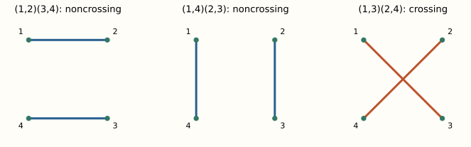

[The complete series](../../free-probability.qmd) · Part 2 of 6

In [Part I](../free-prob-1/index.qmd), the words $aabb$ and $abab$ behaved differently. For centered free variables,
$$
\tau(aabb)=\tau(a^2)\tau(b^2),\qquad \tau(abab)=0.
$$
Expanding every power by hand will become painful quickly. We need a way to organize the words. The useful bookkeeping objects are partitions whose blocks do not cross.

## Crossing and noncrossing partitions {#draw-the-positions-before-manipulating-the-variables}

A partition divides $\{1,\ldots,n\}$ into disjoint nonempty blocks. It is **noncrossing** if there are no indices $i<j<k<\ell$ with $i,k$ in one block and $j,\ell$ in a different block.

For four positions, the three pairings are
$$
\{\{1,2\},\{3,4\}\},\quad
\{\{1,4\},\{2,3\}\},\quad
\{\{1,3\},\{2,4\}\}.
$$
Only the last one crosses when the positions are placed around a circle.

{fig-alt="Four numbered corners in each panel. Adjacent and nested pairings do not cross. Pairing 1 with 3 and 2 with 4 makes intersecting diagonals."}

For $abab$, pairing equal letters requires precisely the crossing pairing. For $aabb$, it requires the first noncrossing pairing. This is the diagrammatic trace of our earlier calculation. To make it a general method, we introduce cumulants.

## Cumulants are defined recursively from moments

Write $NC(n)$ for the set of noncrossing partitions of $n$ positions. The **free cumulants** $\kappa_n$ are the multilinear functionals defined by
$$
\tau(x_1\cdots x_n)
=\sum_{\pi\in NC(n)}\kappa_\pi(x_1,\ldots,x_n),
$$
where
$$
\kappa_\pi(x_1,\ldots,x_n)
=\prod_{V\in\pi}\kappa_{|V|}(x_{i_1},\ldots,x_{i_{|V|}}),
\qquad V=\{i_1<\cdots<i_{|V|}\}.
$$
The factors on the right are scalars, so their product commutes. Within each cumulant, the original order of the arguments is retained.

This is a recursive definition: the one-block partition contributes $\kappa_n$, and all other blocks have smaller size. Once cumulants of lower orders are known, solve for $\kappa_n$.

For one variable, abbreviate $m_n=\tau(a^n)$ and $\kappa_n=\kappa_n(a,\ldots,a)$. The first relations are
$$
\begin{aligned}
m_1&=\kappa_1,\\
m_2&=\kappa_2+\kappa_1^2,\\
m_3&=\kappa_3+3\kappa_2\kappa_1+\kappa_1^3,\\
m_4&=\kappa_4+4\kappa_3\kappa_1+2\kappa_2^2
       +6\kappa_2\kappa_1^2+\kappa_1^4.
\end{aligned}
$$
That coefficient two counts the noncrossing pairings on four positions. Classical cumulants use all set partitions, so the corresponding coefficient is three.

For a centered variable,
$$
\kappa_2=m_2,\qquad \kappa_3=m_3,\qquad
\boxed{\kappa_4=m_4-2m_2^2.}
$$
For a symmetric sign variable, $m_2=m_4=1$, giving $\kappa_4=-1$. A negative fourth free cumulant is entirely possible.

## Mixed free cumulants vanish {#the-theorem-that-makes-the-bookkeeping-useful}

The crucial result is the **mixed-cumulant characterization of freeness**: unital subalgebras are free exactly when every mixed free cumulant vanishes. Here mixed means that its arguments come from more than one of the subalgebras. [Speicher, Section 3](https://arxiv.org/html/1908.08125v2#S3).

This theorem connects the combinatorial definition to the alternating-centered definition. We use it here without reproducing its full induction proof.

For centered free $a,b$, apply the moment formula to $abab$. Singleton blocks vanish by centering. Blocks containing both letters vanish by the theorem. Pairing equal letters would cross. Every contribution is therefore zero.

Now expand a cumulant of $a+b$ by multilinearity. Every mixed choice of arguments vanishes, leaving only the all-$a$ and all-$b$ terms:
$$
\boxed{\kappa_n(a+b)=\kappa_n(a)+\kappa_n(b).}
$$
The full moment sequence does not add. The cumulant sequence does.

For the sum of two free symmetric sign variables, the second cumulant is two and the fourth is minus two. Hence
$$
m_4=-2+2(2)^2=6,
$$
recovering Part I without listing sixteen words.

## Semicircle moments count noncrossing pairings {#a-distribution-made-entirely-of-pairs}

Suppose $s$ has cumulants
$$
\kappa_1(s)=0,\quad \kappa_2(s)=v,\quad
\kappa_n(s)=0\quad(n\geq3).
$$
Only partitions into pairs survive. Odd moments vanish, and
$$
\tau(s^{2k})=C_kv^k,
\qquad C_k=\frac1{k+1}\binom{2k}{k}.
$$
Why Catalan numbers? Pair the first position with position $2j+2$. Noncrossing forces the $2j$ positions inside that pair and the remaining positions outside it to pair separately. If $C_0=1$, this gives
$$
C_k=\sum_{j=0}^{k-1}C_jC_{k-1-j}.
$$
Thus the even moments begin $1,v,2v^2,5v^3,14v^4$ when the initial one is the zeroth moment.

For $v>0$, these are the moments of the **semicircle density**
$$
\rho_v(x)=\frac{\sqrt{4v-x^2}}{2\pi v}
\,\mathbf1_{\{|x|\leq2\sqrt v\}}.
$$
The substitution $x=2\sqrt v\cos\theta$ verifies the moments by a beta integral. In particular, its variance is $v$, and its fourth moment is $2v^2$. When $v=0$, the law is $\delta_0$.

## Why a free central limit theorem follows

Let $a_1,a_2,\ldots$ be freely independent, identically distributed, bounded self-adjoint variables, centered with variance $v$. Set
$$
s_N=\frac{a_1+\cdots+a_N}{\sqrt N}.
$$
Multilinearity gives $\kappa_k(ca)=c^k\kappa_k(a)$. Additivity then yields
$$
\kappa_k(s_N)=N^{1-k/2}\kappa_k(a_1).
$$
The first cumulant is zero, the second remains $v$, and every fixed higher cumulant tends to zero. Since each fixed moment is a finite polynomial in cumulants, the moments converge to those of the semicircle law.

This also gives weak convergence of the laws. The common second moment ensures tightness. Convergence of higher even moments controls the tails needed to pass moments to any weak subsequential limit. The compactly supported semicircle law is moment-determinate, so every such limit is the same.

The normal and semicircle laws play parallel roles: classical independent sums retain all pairings in their limiting moments, while free sums retain the noncrossing pairings.

## Exercises {#try-it-before-continuing}

1. Find the fourth cumulant of the variance-one semicircle law.
2. Find the sixth moment of a centered semicircular variable with variance two.
3. If $b$ is another free copy of a centered variance-one $a$, express $\tau((a+b)^4)$ in terms of $m_4(a)$.

Answer sketches

1. $2-2(1)^2=0$.
2. $C_3\,2^3=5\cdot8=40$.
3. It is $2m_4(a)+4$. Equivalently, add the fourth cumulants and use the new variance two.

## Further reading

[Speicher's survey on noncrossing partitions](https://www.mat.univie.ac.at/~slc/s/s39speicher.pdf) explains the combinatorial foundations. [Nica and Speicher's book](https://www.math.uni-sb.de/ag/speicher/publikationen/Nica-Speicher.pdf), Lectures 8 through 12, develops the free central limit theorem and cumulant machinery in detail.

[Previous: spectra and freeness](../free-prob-1/index.qmd) · [Next: calculating sums with the R-transform](../free-prob-3/index.qmd)
