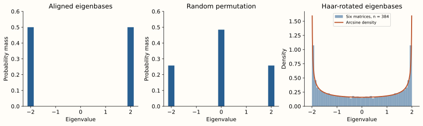
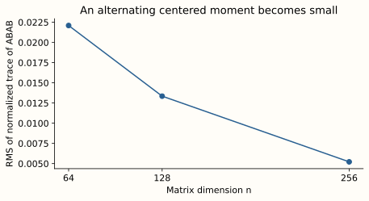

[The complete series](../../free-probability.qmd) · Part 4 of 6

The calculation in [Part III](../free-prob-3/index.qmd) predicts an arcsine law when we add two free variables whose laws each put half their mass at $-1$ and half at $1$.

Now we can test that prediction. Keep the eigenvalues fixed and change only the relative eigenvectors. This makes the missing ingredient from Part I visible.

## Three ways to use exactly the same eigenvalues

For even $n$, set
$$
D_n=\operatorname{diag}(\underbrace{1,\ldots,1}_{n/2},
\underbrace{-1,\ldots,-1}_{n/2}).
$$
Compare these choices:

| Second matrix | Relative eigenbasis | Prediction for the sum |
| --- | --- | --- |
| $D_n$ | Perfectly aligned | Half the eigenvalues at each of $-2,2$ |
| $P_nD_nP_n^*$ | A uniform random permutation | Limiting masses $1/4,1/2,1/4$ at $-2,0,2$ |
| $U_nD_nU_n^*$ | A Haar-random unitary rotation | Limiting arcsine density on $[-2,2]$ |

A permutation randomizes which signs match, but both matrices remain diagonal. Its empirical matching frequencies approach the product of the two sign distributions. A Haar unitary also mixes the coordinate directions themselves.

{fig-alt="Three panels. Aligned matrices give masses one half at minus two and two. Randomly permuted signs give approximately one quarter, one half, one quarter at minus two, zero, two. Haar rotations give a continuous U-shaped histogram matching the arcsine curve."}

The Haar panel pools six independent draws at $n=384$. The other two panels each show one matrix pair at that dimension. The vertical axes distinguish discrete probability mass from continuous density. The density's endpoint singularity also makes the outer histogram bars sensitive to bin width.

## Sampling a Haar unitary correctly

Start with a complex Gaussian matrix $Z$ and compute a QR decomposition. Correct the phases on the diagonal of $R$ so that the resulting triangular factor has positive real diagonal. The corresponding unitary factor has Haar distribution. This is the QR construction described by [Mezzadri](https://arxiv.org/abs/math-ph/0609050).

```python
import numpy as np

rng = np.random.default_rng(1729)

def haar_unitary(n):
    z = (rng.normal(size=(n, n))
         + 1j * rng.normal(size=(n, n))) / np.sqrt(2)
    q, r = np.linalg.qr(z)
    d = np.diag(r)
    return q * (d / np.abs(d))[None, :]

n = 384
signs = np.r_[np.ones(n // 2), -np.ones(n // 2)]
a = np.diag(signs)
u = haar_unitary(n)
b = (u * signs) @ u.conj().T
spectrum = np.linalg.eigvalsh(a + b)
```

The zero-diagonal event has probability zero for an exact Gaussian draw. Column multiplication by `signs` implements $UD_n$, and the conjugate transpose is essential for complex matrices.

The phase correction makes this a general Haar sampler. In this particular conjugation experiment, those column phases cancel against the diagonal $D_n$, but that cancellation would not justify calling an arbitrary uncorrected QR output Haar.

## Test a mixed moment, not just a histogram

The one-variable spectrum of $A+B$ checks one consequence of freeness. We can also check a word that appears directly in the definition:
$$
T_n=\frac1n\operatorname{Tr}(ABAB).
$$
Both $A=D_n$ and $B=U_nD_nU_n^*$ are exactly centered. Freeness predicts $T_n\to0$.

For the aligned and permuted cases, $A$ and $B$ commute and square to the identity, so $ABAB=I$ and $T_n=1$ exactly. This is a particularly clear distinction.

For ten independent Haar draws at each size, the recorded results are:

::: {.table-responsive}

:::

The limiting second and fourth moments are 2 and 6. The last column is $\sqrt{\frac1{10}\sum_jT_{n,j}^2}$, rather than the signed average, so positive and negative fluctuations cannot cancel.

{fig-alt="A line plot of the root mean square normalized trace of ABAB at dimensions 64, 128, and 256, decreasing from about 0.022 to 0.013 to 0.005."}

These observations agree with the theorem. Three dimensions and ten draws do not establish a convergence rate, and the displayed trend need not be monotone for a different random seed.

## Large matrices and finite-size errors {#what-the-limiting-statement-actually-says}

For deterministic bounded Hermitian sequences with convergent marginal laws, the Haar-rotation theorem controls joint normalized-trace moments for each fixed noncommutative polynomial. The uniformly bounded spectra in this example then let us turn moment convergence for the sum into weak convergence of its empirical spectral measure. [Speicher, Section 7](https://arxiv.org/html/1908.08125v2#S7).

This does not say that a finite pair is exactly free. It also does not, by itself, provide a finite-size error bound, eigenvalue-spacing statistics, or convergence of the largest eigenvalue.

A simple example explains the last distinction. The matrices $\operatorname{diag}(10,0,\ldots,0)$ have all fixed positive normalized-trace moments tending to zero, but their largest eigenvalue remains ten. A vanishing fraction of outliers can disappear from a limiting spectral measure. Stronger random-matrix results address such questions, but they require stronger conclusions than ordinary moment convergence.

<!--
## Reproduce the figures

Download the [experiment script](../../tools/free_probability_figures.py) and inspect the [recorded results](../../assets/free-probability/checks.json). The script also makes the figures for Part VI. It uses NumPy and Matplotlib, with seed 1729. The recorded environment used NumPy 2.5.2 and Matplotlib 3.11.1.

From a checkout of this website, run:

```bash
uv sync --frozen
OPENBLAS_NUM_THREADS=1 OMP_NUM_THREADS=1 uv run python tools/free_probability_figures.py
```

The script writes figures and result tables into the site. Floating-point details can vary with the numerical libraries. It checks unitarity, low-order moments, and the covariance calculations used later. The small displayed snippet illustrates the sampling method, while the full script fixes the random draw order needed to recreate the recorded tables.

-->

## Exercises {#try-it-before-continuing}

1. Replace the Haar unitary by the identity. What happens to $T_n$?
2. Why would subtracting only the ensemble mean be insufficient for a general finite-sample centered-moment diagnostic?
3. Would a good histogram of $A+B$ prove that $A$ and $B$ are asymptotically free?

<details class="answer-sketch">
<summary>Answer sketches</summary>

1. $A=B=D_n$, so $ABAB=I$ and $T_n=1$.
2. A particular matrix may still have nonzero normalized trace. If the diagnostic requires centered factors, use $A-\tau_n(A)I$ and similarly for $B$, or account for those fluctuations. Our balanced signs are exactly centered already.
3. No. Freeness constrains all alternating products of centered polynomials. One spectral histogram tests only a small part of that joint structure.

</details>

[Previous: the R-transform](../free-prob-3/index.qmd) · [Next: products and the S-transform](../free-prob-5/index.qmd)
