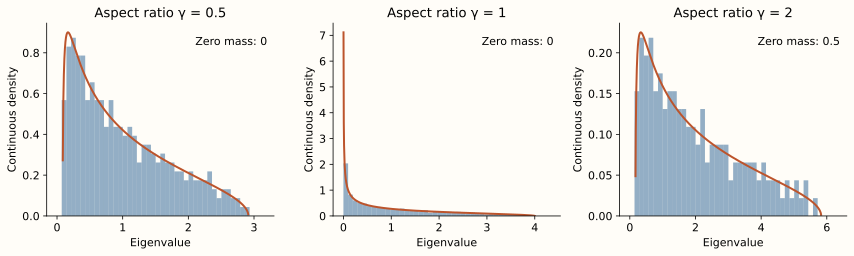
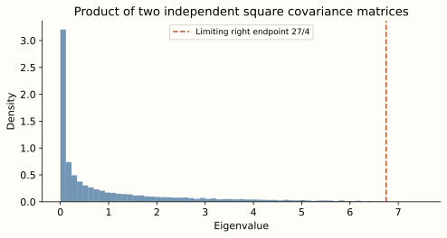

[The complete series](../../free-probability.qmd) · Part 6 of 6

A sample covariance matrix is already a product. If the columns of $X\in\mathbb C^{n\times m}$ are independent observations, then
$$
C=\frac1mXX^*
$$
measures their spread across directions. Even when the population covariance is the identity, the eigenvalues of $C$ need not all be close to one when the dimension and sample count grow together.

We will calculate the limiting law, then multiply two independently oriented covariance matrices. This brings both transforms from the series into one example.

## Aspect ratio and the Marchenko-Pastur law {#fix-the-aspect-ratio-before-naming-the-law}

Take independent standard complex Gaussian entries, with $\mathbb E X_{ij}=0$ and $\mathbb E|X_{ij}|^2=1$. Let $n,m\to\infty$ with
$$
\frac nm\longrightarrow\gamma\in(0,\infty).
$$
We normalize the spectral measure by $1/n$, over all $n$ eigenvalues of $C$. Its limiting mean is one.

The Marchenko-Pastur theorem identifies the limit. One moment formulation for this Gaussian model is
$$
m_k=\sum_{\pi\in NC(k)}\gamma^{k-|\pi|}.
$$
This result comes from Gaussian moment expansion and counting the index sums that survive at leading order. We use that random-matrix theorem as input, rather than proving it from the transform identities. [Nica and Speicher, Lecture 22](https://www.math.uni-sb.de/ag/speicher/publikationen/Nica-Speicher.pdf) develop Gaussian moment methods and their connection to Wishart matrices.

Comparing with the free moment-cumulant formula gives
$$
\kappa_k=\gamma^{k-1},\qquad
R(w)=\frac1{1-\gamma w}.
$$
In particular, $m_1=1$, $m_2=1+\gamma$, and the limiting spectral variance is $\gamma$.

Different references use different parameters for the free Poisson or Marchenko-Pastur law. In the free-Poisson convention with rate $\lambda$ and jump size $c$, cumulants are $\lambda c^k$. Our convention has $\lambda=1/\gamma$ and $c=\gamma$.

## The density and the atom at zero {#derive-the-density-and-remember-the-zero-atom}

Insert the R-transform into the Cauchy-transform equation:
$$
z=\frac1G+\frac1{1-\gamma G}.
$$
After rearranging,
$$
\gamma zG^2-(z+\gamma-1)G+1=0.
$$
Let
$$
a=(1-\sqrt\gamma)^2,\qquad b=(1+\sqrt\gamma)^2.
$$
The branch satisfying $G(z)\sim1/z$ is
$$
G(z)=\frac{z+\gamma-1-\sqrt{(z-a)(z-b)}}{2\gamma z},
$$
where the square root is asymptotic to $z$ at infinity. Stieltjes inversion gives the law
$$
\boxed{
\mu_\gamma=
\left(1-\frac1\gamma\right)_+\delta_0
+\frac{\sqrt{(b-x)(x-a)}}{2\pi\gamma x}
\mathbf1_{(a,b)}(x)\,dx.
}
$$
Here $(r)_+=\max(r,0)$. The continuous density has mass $\min(1,1/\gamma)$, with the rest at zero.

The atom is also visible before taking a limit. When $n>m$, a Gaussian $n\times m$ matrix has rank $m$ almost surely. Thus $C$ has exactly $n-m$ zero eigenvalues, a fraction approaching $1-1/\gamma$. Keeping only the nonzero eigenvalues and renormalizing them would produce a different probability measure.

{fig-alt="Three covariance histograms with Marchenko-Pastur density curves for gamma 0.5, 1, and 2. The last panel labels zero mass 0.5. Its positive histogram has total area 0.5 rather than being renormalized to one."}

Each panel uses one matrix with $n=320$. In the final panel, the zero eigenvalues are omitted from the density bars, but their probability mass is retained in the normalization and annotated separately.

## Find the S-transform without another integral

Let $w=\psi(t)$ and $M(t)=1+w$. The moment-cumulant equation from Part III gives
$$
w=t(1+w)R(t(1+w))
=\frac{t(1+w)}{1-\gamma t(1+w)}.
$$
Solve for $t$:
$$
\chi(w)=\frac{w}{(1+w)(1+\gamma w)}.
$$
Consequently,
$$
\boxed{S_{\mu_\gamma}(w)=\frac1{1+\gamma w}.}
$$
For two free covariance laws with aspect ratios $\gamma_1,\gamma_2$, multiplication gives
$$
S(w)=\frac1{(1+\gamma_1w)(1+\gamma_2w)}.
$$
The first derivative at zero confirms that the mean-one product has variance $\gamma_1+\gamma_2$.

## Multiplying square covariance matrices {#a-complete-product-calculation-in-the-square-case}

Set $\gamma_1=\gamma_2=1$. Consider independent square Gaussian covariance matrices $A_n,B_n$, each normalized by $1/n$, and the positive product
$$
P_n=A_n^{1/2}B_nA_n^{1/2}.
$$
These independent Gaussian covariance ensembles are unitarily invariant and asymptotically free. Their norm control and marginal convergence justify using the positive product law. The limiting S-transform is
$$
S(w)=\frac1{(1+w)^2}.
$$
With $t=\chi(w)$, this gives the exceptionally simple equation
$$
\boxed{w=t(1+w)^3.}
$$
Because $w=\sum_{k\geq1}m_kt^k$, its coefficients are the desired moments. The first terms follow by substitution:
$$
w=t+3t^2+12t^3+55t^4+\cdots.
$$
For all orders, the Lagrange inversion identity for $w=t\phi(w)$ states
$$
[t^k]w=\frac1k[u^{k-1}]\phi(u)^k.
$$
Using $\phi(u)=(1+u)^3$ yields
$$
m_k=\frac1k\binom{3k}{k-1}
=\boxed{\frac1{2k+1}\binom{3k}{k}}.
$$
These are the order-two Fuss-Catalan numbers. The terminology is useful, but the equation $w=t(1+w)^3$ already gives a direct way to compute them.

The same equation locates the positive right edge. With $t=1/z$,
$$
z=\frac{(1+w)^3}{w}.
$$
Starting at large positive $z$, the physical solution has small positive $w$. Its first positive turning point satisfies
$$
\frac{d}{dw}\frac{(1+w)^3}{w}
=\frac{(1+w)^2(2w-1)}{w^2}=0.
$$
Thus $w=1/2$ and the right endpoint is $z=27/4$. The resulting law has support $[0,27/4]$. A detailed analysis of this branch and its density appears in [Młotkowski, Nowak, Penson, and Życzkowski, Section IV.2.1](https://arxiv.org/html/1407.1282#S4.SS2.SSS1).

## Check the product numerically

For eight independent draws at $n=384$, the first four moments are:

::: {.table-responsive}

:::

The last column is the sample standard deviation across the eight matrices, not a confidence interval or an error bound. Higher moments fluctuate more because they give greater weight to large eigenvalues.

{fig-alt="A covariance-product spectral histogram concentrated near zero with a long right tail. A dashed line marks the limiting support endpoint 6.75."}

The histogram is an illustration. The moment table compares the numerical calculation with exact quantities derived before the experiment. Neither establishes a theorem about finite-dimensional extreme eigenvalues.

<!-- The [full script](../../tools/free_probability_figures.py) constructs $A_n^{1/2}$ by a Hermitian eigendecomposition and diagonalizes $A_n^{1/2}B_nA_n^{1/2}$. It also checks the first eight Fuss-Catalan coefficients by recursively expanding the cubic equation, independently of the closed formula. [Part IV](../free-prob-4/index.qmd#reproduce-the-figures) gives reproduction instructions.
 -->

## Assumptions to check on a new problem {#what-i-would-check-before-using-this-on-a-new-problem}

The calculations depend on more than knowing the marginal eigenvalue histograms. First specify the normalized matrix and the aspect ratio. Then justify the joint asymptotic-freeness statement. For a product, choose the positive representative and check that the mean permits the ordinary S-transform. Finally, retain the correct Cauchy-transform branch and any atoms when recovering the law.

These checks prevent several tempting mistakes: multiplying eigenvalues coordinate by coordinate, discarding zero eigenvalues, or choosing a convenient root of an algebraic equation without checking its asymptotics.

The series began with the observation that individual eigenvalues leave out relative geometry. Freeness supplies one precise limiting description of that geometry. Cumulants, the R-transform, and the S-transform then turn it into calculations we can test.

## Exercises {#try-it-before-finishing}

1. What are the limiting mean, variance, and zero mass for $\gamma=2$?
2. Compute the second moment of a free product with $\gamma_1=1/2$ and $\gamma_2=2$.
3. What moment equation would a product of $r$ free square covariance variables satisfy?

Answer sketches

1. Mean one, variance two, zero mass one half. The mean is averaged over all eigenvalues, including the zeros.
2. The variance is $1/2+2=5/2$, so the second moment is $1+5/2=7/2$.
3. Its S-transform is $(1+w)^{-r}$, so $w=t(1+w)^{r+1}$. Lagrange inversion gives $m_k=\binom{(r+1)k}{k}/(rk+1)$.

## Further reading

[Mingo and Speicher, Free Probability and Random Matrices](https://www.math.uni-sb.de/ag/speicher/publikationen/Mingo-Speicher.pdf) develops the random-matrix foundations. [Penson and Życzkowski](https://arxiv.org/abs/1103.3453) study the Fuss-Catalan laws arising from squared singular values of products. [Młotkowski and collaborators](https://arxiv.org/abs/1407.1282) explain the S-transform calculations and explicit densities. Their normalization conventions should be checked against the mean-one convention used here.

[Previous: the S-transform](../free-prob-5/index.qmd) · [Return to the complete series](../../free-probability.qmd)
