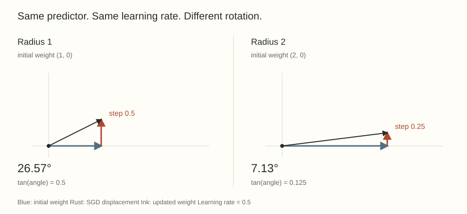

Take a neural network, multiply some weights by two, and leave its predictions unchanged. Should its next training step also stay unchanged?

It is tempting to say yes. The network represents the same function, sees the same data, and uses the same learning rate. Yet even ordinary gradient descent can move the two copies to different functions after one step.

The missing ingredient is the geometry of the parameters. A learning rate measures motion in the coordinates we gave the optimizer. Two coordinates can describe the same predictor without assigning the same size to a useful change in that predictor.

I want to understand this distinction before discussing weight decay or matrix optimizers. We can see it in two dimensions, without a training run.

## A predictor that forgets its radius

Let $w\in\mathbb R^2$ be nonzero and define

$$
f_w(x)=\frac{w^\top x}{\|w\|_2}.
$$

For every positive $c$, $f_{cw}(x)=f_w(x)$. The predictor remembers the direction of $w$ and forgets its length. The restriction $c>0$ matters: a negative multiplier reverses the prediction.

Write $w=Re$, where $R=\|w\|_2>0$ and $\|e\|_2=1$. All points on the positive ray through $e$ describe the same function. The parameter vector has two coordinates, but this predictor has only one directional degree of freedom.

For a fixed dataset, any differentiable loss built only from these predictions satisfies

$$
L(cw)=L(w).
$$

This is an assumption about a particular parameter block with everything else fixed. We will spend the next post checking when normalization actually gives us this assumption.

## Two derivatives tell us what SGD sees

Differentiate $L(cw)=L(w)$ with respect to $c$ at $c=1$:

$$
\langle w,\nabla L(w)\rangle=0.
$$

The gradient is perpendicular to the weight. Moving directly along the ray has zero first-order effect on the loss, so the gradient has no radial component.

Next differentiate the same identity with respect to $w$, holding $c$ fixed. The chain rule gives

$$
c\nabla L(cw)=\nabla L(w).
$$

Doubling the weight therefore halves its gradient. These are standard scale-invariance identities. Their implication for effective learning rates is developed in [van Laarhoven's analysis of regularization and normalization](https://arxiv.org/abs/1706.05350v1), especially Section 3.1.

Let $g(e)=\nabla L(e)$. Since $\nabla L(Re)=g(e)/R$, one raw SGD step is

$$
w^+=Re-\frac{\eta}{R}g(e)
=R\left(e-\frac{\eta}{R^2}g(e)\right).
$$

The outside factor $R$ does not affect our predictor. The directional change is governed by **$\eta/R^2$**, rather than $\eta$ alone.

One factor of $1/R$ comes from the smaller gradient. The other comes from comparing that displacement with a longer weight vector.

## One exact step, with numbers

Use the single input $x=(0,1)$, target $1$, and squared loss

$$
L(w)=\frac12\left(\frac{w_2}{\sqrt{w_1^2+w_2^2}}-1\right)^2.
$$

Start one copy at $w=(1,0)$ and another at $\widetilde w=(2,0)$. Both predict zero and have loss $1/2$. Their gradients are

$$
\nabla L(1,0)=(0,-1),
\qquad
\nabla L(2,0)=(0,-1/2).
$$

With the same learning rate $\eta=1/2$, the updated weights are

$$
w^+=(1,1/2),\qquad
\widetilde w^+=(2,1/4).
$$

Their slopes are $1/2$ and $1/8$. The rotation angles are approximately $26.57^\circ$ and $7.13^\circ$. Their new predictions are $1/\sqrt5\approx0.4472$ and $1/\sqrt{65}\approx0.1240$.

{fig-alt="Two SGD steps from equivalent predictors. At radius one the tangent step is one half and the rotation is 26.57 degrees. At radius two the tangent step is one quarter and the rotation is 7.13 degrees."}

The second copy moved less in parameter space and started farther from the origin. Both effects reduced its rotation. The initial function was identical, but the optimizer did not treat the two representations identically.

To recover the first copy's new direction, the second copy would need learning rate $2$, four times as large. That statement concerns this corresponding step. Maintaining equivalence through a whole run requires tracking how radii and optimizer states evolve.

## The angle is exact, the effective step is local

Because $g(e)$ is perpendicular to $e$, the angle $\theta$ between $w$ and $w^+$ obeys

$$
\tan\theta=\frac{\eta\|g(e)\|_2}{R^2}.
$$

This is an exact finite-step identity for the stated update. Calling $\eta/R^2$ an effective learning rate describes the coefficient in the normalized directional update. It is not a claim that the angle equals that coefficient for a large step.

The next radius also changes:

$$
\|w^+\|_2^2
=R^2+\frac{\eta^2}{R^2}\|g(e)\|_2^2.
$$

A tangent displacement leaves the radius unchanged to first order, but a finite tangent step ends outside the original circle. Repeated SGD steps can grow the radius and thereby change subsequent directional steps. We do not need an equilibrium approximation to see this feedback.

## Where weight decay will enter

For the update convention

$$
w^+=(1-\eta\lambda)w-\eta\nabla L(w),
$$

assume $1-\eta\lambda>0$. The decay term shortens the radial part while the gradient remains tangent. The same right triangle now gives

$$
\tan\theta
=\frac{\eta\|g(e)\|_2}{(1-\eta\lambda)R^2}.
$$

Decay alone preserves the predictor in this model, but decay inside a training update can alter the direction learned next. This is the first reason to be suspicious of the phrase "scale does not matter."

The equation is for raw SGD with this decay convention. With momentum, the accumulated update need not remain tangent to the current weight. With a normalized update, the displacement need not shrink as $1/R$. We will derive those cases separately rather than reuse the SGD formula.

An angular change is also not a universal measure of progress. Our example changes one prediction by a known amount. In a large network, a rotation could help, hurt, or barely affect the output.

## The coordinates we choose become part of learning

The example isolates three different objects: the function, its redundant parameter representation, and the rule that moves that representation. Equality of the first does not imply equality of the third.

That distinction will connect the rest of this series. Weight decay changes radii. Normalization determines which rescalings preserve a function. Layer norms specify which perturbations count as small. Modula combines those local choices into a network geometry. Before choosing any constraint, we need to know which of these scales it controls.

The next post asks where the exact symmetry comes from, and why normalizing the input to a matrix does not usually make that matrix's own scale disappear.

## Try the calculation

1. Start a third copy at $(3,0)$. What learning rate makes its first updated direction agree with the radius-one copy using $\eta=1/2$?
2. Use the unit update $u=\nabla L(w)/\|\nabla L(w)\|_2$ instead of the raw gradient. What is $\tan\theta$ when the gradient is nonzero?
3. Why can a tangent step increase the radius even though the directional derivative of the squared radius is zero?

Answer sketches

1. The coefficient $\eta/R^2$ must equal $1/2$, so $\eta=9/2$.
2. The displacement has length $\eta$ and is perpendicular to $w$, so $\tan\theta=\eta/R$. The squared-radius law for raw SGD no longer applies to this normalized update.
3. Expanding the squared norm gives the zero first-order cross term plus the positive second-order term $\eta^2\|\nabla L(w)\|_2^2$.

## Yo twin, go read... {#sources-and-scope}

[Twan van Laarhoven, L2 Regularization versus Batch and Weight Normalization (2017)](https://arxiv.org/abs/1706.05350v1) supplies the foundational scale-to-step argument. The two-dimensional numerical example above is a direct calculation under the explicitly defined predictor and squared loss.

[Zhiyuan Li and Sanjeev Arora, An Exponential Learning Rate Schedule for Deep Learning (ICLR 2020)](https://arxiv.org/abs/1910.07454v3) develops stronger trajectory equivalences with normalization, decay, and momentum. Matching a whole trajectory involves more than matching the one scalar learning rate in our example.
