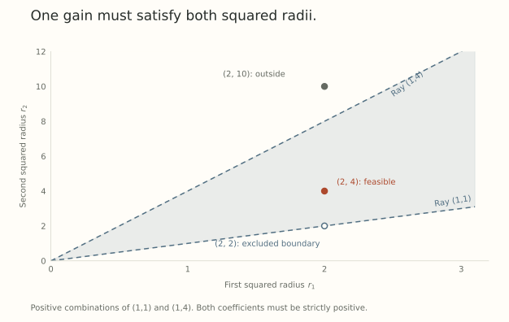

A normalization gain can absorb a matrix's scale. What happens when several matrices share that gain and each receives its own norm constraint?

One compensating parameter must now satisfy several requirements at once. The existence of a symmetry for a single matrix does not prove that all the constraints can be imposed simultaneously.

This note concerns frozen input features and prescribed branch maps. Within that setting, we can state the compatibility question exactly and derive a fitting floor when the scales disagree.

## Specify what must be preserved

Let $z(x)\in\mathbb R^d$ be fixed features, and let several branches compute

$$
f_i(x)=A_i z(x),\qquad
A_i=W_i\operatorname{diag}(\gamma).
$$

We prescribe the target matrices $A_i\in\mathbb R^{m_i\times d}$ and require

$$
\lVert W_i\rVert_F=R_i>0
$$

for every branch. Every gain entry must be finite and nonzero. The question is whether one shared gain vector can represent all those target maps while meeting all the radii.

Preserving each branch map is stronger than preserving the final network function. We keep the stronger requirement visible rather than quietly switching between them.

## The compatibility problem becomes linear

Define a nonnegative matrix of target column energies and a vector of squared radii:

$$
C_{ij}=\lVert A_i[:,j]\rVert_2^2,
\qquad r_i=R_i^2.
$$

Then the representation exists if and only if

$$
Cq=r\quad\text{for some }q\in(0,\infty)^d.
$$

For necessity, the target identity forces $W_i[:,j]=A_i[:,j]/\gamma_j$, so

$$
R_i^2=\sum_j\frac{\lVert A_i[:,j]\rVert_2^2}{\gamma_j^2}.
$$

Set $q_j=\gamma_j^{-2}$. This gives the positive linear system.

For sufficiency, given such a $q$, choose $\gamma_j=q_j^{-1/2}$ and $W_i[:,j]=q_j^{1/2}A_i[:,j]$. The effective maps and every required radius then follow directly.

The criterion uses squared Frobenius lengths. It is not automatically a criterion for spectral or Stiefel constraints. It also excludes zero gain entries, which can hide nonzero weight columns when their target columns vanish.

## Two branches make the geometry visible

Assume the first branch has positive column energies $C_{1j}>0$. For any feasible $q>0$,

$$
\frac{r_2}{r_1}
=\sum_j\omega_j\frac{C_{2j}}{C_{1j}},
\qquad
\omega_j=\frac{C_{1j}q_j}{\sum_s C_{1s}q_s}>0,
\quad\sum_j\omega_j=1.
$$

The required squared-radius ratio must be a positive weighted average of the column-energy ratios. If those ratios are not all equal, feasibility is equivalent to

$$
\min_j\frac{C_{2j}}{C_{1j}}
<\frac{r_2}{r_1}
<\max_j\frac{C_{2j}}{C_{1j}}.
$$

Conversely, choose strictly positive averaging weights with the required mean and set $q_j=r_1\omega_j/C_{1j}$. If all energy ratios equal a constant, the required radius ratio must equal that constant too.

Take target rows $A_1=(1,1)$ and $A_2=(1,2)$. Then

$$
C=\begin{pmatrix}1&1\\1&4\end{pmatrix}.
$$

The squared-radius vector $r=(2,4)$ is feasible, with $q=(4/3,2/3)$. The gain magnitudes are approximately $(0.866025,1.224745)$.

The boundary target $r=(2,2)$ would require $q_2=0$. It is not feasible with a finite nonzero second gain. Allowing nonnegative coefficients can therefore admit limits that the original parameterization does not attain.

{fig-alt="Positive combinations of the column-energy vectors one-one and one-four fill the open wedge between their rays. The target squared radii two-four lies inside. Two-two is on the excluded boundary, and two-ten lies outside."}

## Finite gain bounds impose more than formal feasibility

If $0<g_{\min}\leq|\gamma_j|\leq g_{\max}<\infty$, then the exact condition becomes

$$
Cq=r,\qquad
g_{\max}^{-2}\leq q_j\leq g_{\min}^{-2}.
$$

This is a box-constrained linear feasibility problem. A representation can exist in principle while requiring gain magnitudes outside a chosen stable range.

In the example above, restricting both gain magnitudes to $[1,2]$ forces $q_j\in[1/4,1]$. The first equation $q_1+q_2=2$ then forces both coefficients to one, making the second equation equal five rather than four. The formally feasible target is no longer feasible under these gain bounds.

## A proportional pair is incompatible at equal radii

If $A_2=2A_1\ne0$, then $C_{2j}=4C_{1j}$ for every column. Any shared-gain representation must satisfy $r_2=4r_1$.

Equal imposed radii contradict that requirement. Increasing the number of columns does not repair this particular obstruction while the target relation $A_2=2A_1$ is preserved.

That is an exact local statement. Learned upstream features, independent branch multipliers, or other function-preserving transformations can change the question. They are not included in this prescribed-map criterion.

## A scalar gain gives an exact fitting floor

Now use one shared scalar $g\geq0$ instead of a channelwise vector. Assume fixed features satisfy $\mathbb E[zz^\top]=I$, and supervise all branch outputs with targets $A_i z$. The population loss is

$$
\mathcal L(g,W)=\frac12\sum_i\lVert gW_i-A_i\rVert_F^2,
\qquad \lVert W_i\rVert_F=R_i.
$$

Write $b_i=\lVert A_i\rVert_F>0$. For a fixed positive $g$, Cauchy-Schwarz shows that an optimal $W_i$ aligns with its target, giving

$$
\min_W\mathcal L(g,W)=\frac12\sum_i(gR_i-b_i)^2.
$$

Minimizing this scalar quadratic yields

$$
g_* =\frac{\sum_iR_ib_i}{\sum_iR_i^2},
$$

$$
\mathcal L_* =\frac12\left(\sum_i b_i^2
-\frac{(\sum_iR_ib_i)^2}{\sum_iR_i^2}\right).
$$

The floor vanishes exactly when the target norm vector is proportional to the radius vector. For $R=(1,1)$ and $b=(1,2)$, the optimal gain is $3/2$ and the minimum loss is $1/4$.

No learning-rate correction can remove a global fitting floor inside this model. The formula does not say that every optimizer reaches the optimum, or that an end-to-end attention task has this same floor.

## Grouping changes the feasible set

Replace the individual radii with a joint constraint

$$
\sum_i\lVert W_i\rVert_F^2=R^2.
$$

For any nonzero target tuple, choose

$$
g=\frac{\sqrt{\sum_i\lVert A_i\rVert_F^2}}{R},
\qquad W_i=A_i/g.
$$

All target maps are preserved and the joint constraint holds. Independent learned branch multipliers provide another way to restore the missing amplitude freedom.

The distinction is *which scales the constraint fixes*. Individual radii fix relative branch norms as well as total scale. A group radius leaves those relative norms available.

The next post asks whether this local obstruction predicts a failure in a real module. Before making that claim, we need to let attention use its own factorization freedoms and run controls that could overturn the proposed explanation.

## Try the compatibility test

1. Verify $Cq=(2,4)$ for the example's $q=(4/3,2/3)$.
2. If $A_2=3A_1\ne0$, what ratio $R_2/R_1$ is necessary under a shared gain?
3. In the scalar-gain model, take $R=(1,1)$ and $b=(1,3)$. Find the optimum and fitting floor.

Answer sketches

1. The row sums are $4/3+2/3=2$ and $4/3+4(2/3)=4$.
2. Squared energies scale by nine, so $R_2/R_1=3$.
3. $g_*=2$ and $\mathcal L_*=[(2-1)^2+(2-3)^2]/2=1$.

## Yo twin, go read... {#sources-and-scope}

The cone criterion and scalar fitting-floor calculation are elementary derivations from the displayed model. They are not claims of publication priority or a theorem about a full trainable Transformer.

[Hyperball Optimization](https://arxiv.org/abs/2606.16899v2), Section 4.1, gives the matrix-and-gain rescaling that motivates asking whether several constraints are compatible. [Learnable Multipliers](https://arxiv.org/abs/2601.04890v1), Sections 2 and 4.1 and Appendix C, supplies established multiplier and symmetry baselines. Neither citation substitutes for checking the exact consumers and constraints in a proposed application.
