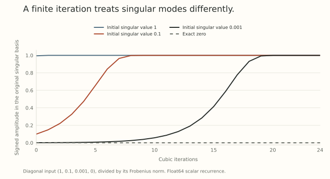

Part 6 gave us an exact answer: under a spectral update budget, the steepest direction is a polar factor. An optimizer still has to compute that direction, usually many times per training step.

That is where a geometric definition becomes a numerical method. We choose an initial scaling, apply a short sequence of matrix products, and stop with an approximation. The number of iterations and the singular values of the input determine what that approximation actually does.

The useful question is *what the finite computation preserves*. Convergence eventually is one property. The update returned after five iterations is another object we should understand directly.

## Keep the target and its zero modes visible

Let $M\in\mathbb R^{m\times n}$ be the matrix we want to dualize. It might be the current gradient or a momentum buffer. Using only its positive singular values, write

$$
M=U_r\Sigma_rV_r^\top,
\qquad P(M)=U_rV_r^\top.
$$

This compact polar factor has operator norm one when $M\ne0$, and it attains

$$
\langle M,P(M)\rangle_F=\lVert M\rVert_{\mathrm{nuc}}.
$$

At $M=0$, choose $P(0)=0$. This fixes a convention rather than dividing by a zero norm.

Rank matters. If $M$ has a nullspace, then $P(M)^\top P(M)=V_rV_r^\top$ is a projector. It need not equal the identity. A numerical test that demands full orthogonality from this rank-deficient target is asking for a different object.

Part 6 allowed other support maximizers on unused subspaces. Here the compact convention gives us a definite target for checking an iteration.

## A matrix polynomial acts separately on singular modes

Consider an odd scalar polynomial

$$
p(s)=a s+b s^3+c s^5.
$$

Its rectangular matrix implementation is

$$
\mathcal P(X)=aX+bX(X^\top X)+cX(X^\top X)^2.
$$

If $X=U\operatorname{diag}(s_i)V^\top$, direct multiplication gives

$$
\mathcal P(X)=U\operatorname{diag}(p(s_i))V^\top.
$$

The large matrix calculation therefore reduces to a scalar transformation applied to every mode. Repeating polynomials composes their scalar maps.

The formula also explains why ordinary $X^3$ is the wrong notation for the rectangular calculation. It may not be defined, and even for a square nonsymmetric matrix it generally differs from $XX^\top X$.

If an intermediate amplitude becomes negative, its orientation has flipped relative to the original polar target. Its singular value is the absolute amplitude. Plotting only absolute values would hide that error.

## Derive the classical cubic

For $M\ne0$, initialize

$$
X_0=\frac{M}{\lVert M\rVert_F}.
$$

Every singular value starts in $[0,1]$. Seek a cubic $p(s)=as+bs^3$ that fixes one and is flat there:

$$
a+b=1,\qquad a+3b=0.
$$

Solving gives

$$
p_3(s)=\frac32s-\frac12s^3,
\qquad
X_{k+1}=\frac32X_k-\frac12X_kX_k^\top X_k.
$$

For $0<s<1$,

$$
p_3(s)-s=\frac12s(1-s^2)>0,
\qquad p_3'(s)=\frac32(1-s^2)>0.
$$

Thus a positive amplitude grows while remaining at most one, and its limit is one. A zero amplitude stays zero. In exact arithmetic, this initialization and iteration approach the compact polar factor.

Writing $s=1-e$ gives the error recurrence

$$
e_{k+1}=\frac32e_k^2-\frac12e_k^3.
$$

The convergence is quadratic near the target. Near zero, however, $p_3(s)\approx1.5s$. A tiny mode needs many constant-factor increases before it reaches that fast-convergence region.

*Local convergence order does not describe the whole journey.*

## Look at the endpoint after a fixed number of products

Take

$$
M=\operatorname{diag}(1,\,0.1,\,0.001,\,0).
$$

Its compact polar factor is $\operatorname{diag}(1,1,1,0)$. The initial amplitudes are the displayed entries divided by $\sqrt{1.010001}$.

The numerical example below uses the classical cubic in float64. The curves are scalar evaluations of the exact recurrence. They are not a training benchmark or a low-precision kernel comparison.

{fig-alt="Classical cubic polar iterations rapidly flatten the large singular modes while the mode starting near one thousandth spends many iterations growing. The exact zero remains zero."}

| Cubic iterations | Largest active-mode error | Fraction of optimal support |
| --- | --- | --- |
| 0 | 0.999005 | 0.912795694 |
| 5 | 0.992444 | 0.967883127 |
| 10 | 0.942671 | 0.999143804 |
| 20 | 6.89063e-05 | 0.999999937 |
| 24 | $<10^{-12}$ | 1.000000000 |

The table reports the poorest active-mode error and the fraction of the momentum's optimal spectral-ball support value. They measure different things. A small singular value can be poorly resolved while contributing little to the momentum-weighted sum.

For an exact illustration, set $M=\operatorname{diag}(1,\varepsilon)$ with $0<\varepsilon<1$. Compare $P=I$ with $D=\operatorname{diag}(1,0)$. Then

$$
\lVert P-D\rVert_{\mathrm{op}}=1,
\qquad
\langle M,P-D\rangle_F=\varepsilon.
$$

The worst-mode error stays one while the lost support tends to zero. This does not establish that the missing mode is unimportant to the current loss. If its gradient is $G=\operatorname{diag}(0,1)$, that mode carries all of the displayed current slope. A momentum buffer and a current gradient can disagree.

## Higher-degree filters choose a different compromise

A classical quintic can fix one while setting its first two derivatives there to zero. Solving those three conditions gives

$$
p_5(s)=\frac{15s-10s^3+3s^5}{8}.
$$

Its error is cubic near one, but a tiny amplitude initially grows by only about $15/8$. Faster local convergence still leaves an early-stage problem.

[The Polar Express](https://arxiv.org/abs/2505.16932v5) designs stage-dependent odd polynomials for a whole singular-value interval. Its exact minimax result concerns a specified composition class and positive spectral interval. The practical recipe adds numerical safeguards, so that ideal theorem and the finite-precision implementation have separate qualifications.

Our figure uses the elementary cubic, making its assumptions and arithmetic easy to inspect. It does not reproduce the Polar Express coefficient schedule.

An arbitrary coefficient change can also alter feasibility. The illustrative polynomial $q(s)=2s-s^3$ sends $0.8$ to $1.088$. Applying it to a matrix of operator norm $0.8$ can produce a direction outside the operator-unit ball. A direction's approximate similarity to a polar factor does not by itself certify the update budget.

## Rectangular shape changes how to evaluate the same formula

Associativity gives

$$
X(X^\top X)=(XX^\top)X.
$$

For a wide matrix, the left Gram matrix is smaller. For a tall matrix, the right one is smaller. A $512\times2048$ input offers a $512\times512$ Gram matrix instead of a $2048\times2048$ one, reducing the number of Gram entries by a factor of sixteen.

This is an arithmetic and storage observation, not a measured speedup. Product ordering, precision, hardware, and kernel implementation affect actual runtime. Equivalent exact formulas can also round differently.

The initial normalization deserves the same attention. Changing its scale changes the finite scalar starting points. Adding a fixed denominator stabilizer also changes exact rescaling properties. A zero-input convention, a known safe initial interval, and a consistent rank policy belong in the algorithm description.

## What should count as a useful approximation?

For a proposed step $-\eta\widehat P$, the first-order loss change uses

$$
-\eta\langle G,\widehat P\rangle_F,
$$

where $G$ is the current gradient. Polar error, support for $M$, actual update norm, and alignment with $G$ are distinct diagnostics. Curvature and finite step size enter the actual loss change too.

A practical comparison should record the numerical work, the returned update's scale, and the training outcome. Correcting a tiny singular mode more accurately may be worthwhile, irrelevant at the tested budget, or harmful through a changed step. The approximation error alone does not choose among those possibilities.

The next post adds another finite-computation question. Before we apply this nonlinear map, how should we combine noisy gradients?

## Try following the singular values

1. Start a cubic iteration at $s=1/2$. Compute the next amplitude and its error from one.
2. For a rank-three matrix in four dimensions, why can $\lVert P^\top P-I\rVert_{\mathrm{op}}$ equal one even at the exact compact polar factor?
3. A matrix is $128\times1024$. How many entries do the smaller and larger Gram matrices contain?
4. In the two-mode example, find the support lost by dropping the weak mode when $\varepsilon=10^{-3}$.

Answer sketches

1. $p_3(1/2)=11/16$. The remaining error is $5/16$, also obtained from $3e^2/2-e^3/2$ at $e=1/2$.
2. The compact polar factor has a zero direction. Its Gram matrix is a rank-three projector, so subtracting the full identity leaves eigenvalue minus one on that direction.
3. The counts are $128^2=16{,}384$ and $1024^2=1{,}048{,}576$. The larger has sixty-four times as many entries.
4. The lost momentum support is $10^{-3}$, while the operator-norm approximation error remains one.

## Yo twin, go read... {#sources-and-scope}

[The Polar Express: Optimal Matrix Sign Methods and Their Application to the Muon Algorithm](https://arxiv.org/abs/2505.16932v5), Sections 1.2, 2, and 3, Appendix G, and Appendix J, supplies the numerical context and interval-based construction. Section 4.3 and Appendix H distinguish approximation measurements from training outcomes.

[Old Optimizer, New Norm](https://arxiv.org/abs/2409.20325v2), Story II and Appendix A, connects the polar direction to normed optimization. The compact rank convention, diagonal example, table, and elementary iteration calculations here are direct checks of the displayed formulas.
