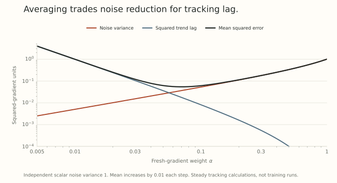

A norm oracle is nonlinear. That makes the order of two familiar operations consequential: combining gradients and choosing a normalized update.

Part 4 followed a momentum buffer through a changing weight direction. Here we ask a statistical question about that buffer. What information does averaging retain before the oracle discards magnitude?

We can answer the first part with a two-point distribution. No large model or training curve is needed to see the difference.

## Put the averaging operation in the update rule

For a norm $N$, choose a positive support direction

$$
D(s)\in\operatorname*{arg\,max}_{N(D)\leq1}\langle s,D\rangle.
$$

Use $D(0)=0$ as a zero-slope convention. A descent proposal of radius $\rho$ is $-\rho D(s)$. For the Euclidean norm, $D(s)=s/\lVert s\rVert_2$ when $s\ne0$. For a spectral matrix budget, one choice is the compact polar factor.

One way to incorporate stochastic gradients is

$$
m_t=(1-\alpha)m_{t-1}+\alpha g_t,
\qquad \Delta w_t=-\eta\rho D(m_t),
$$

where $0<\alpha\leq1$ is the weight given to the fresh gradient. The more usual old-buffer coefficient is $\beta=1-\alpha$.

Another rule first applies the oracle:

$$
p_t=(1-\alpha)p_{t-1}+\alpha D(g_t),
\qquad \Delta w_t=-\eta\rho p_t.
$$

Both rules can obey the same norm budget. If $N(p_0)\leq1$, convexity gives $N(p_t)\leq1$. But they combine different information, so their directions can differ even under identical samples and coefficients.

The placement of averaging is *part of the optimizer*, just as the choice of norm is.

## An unbiased gradient can become an uphill normalized update

At one evaluation point, suppose the scalar sampled gradient is

$$
g=\begin{cases}
4,&\text{with probability }1/4,\\
-1,&\text{with probability }3/4.
\end{cases}
$$

Its expectation is $\mathbb E[g]=1/4$. The unit-ball support direction in one dimension is the sign. Therefore

$$
\mathbb E[-D(g)]
=-\frac14+\frac34=\frac12.
$$

The expected normalized proposal points in the positive direction, while descent for the mean derivative points in the negative direction. Its expected first-order loss change is $\eta\rho/8>0$.

This distribution can occur at $w=1/4$ for $L(w)=w^2/2$, using sample gradients $g=w+\epsilon$ with $\epsilon=15/4$ or $-5/4$ at the stated probabilities. The noise has mean zero. With $\rho=1$, the exact expected one-step loss increase is

$$
\mathbb E[L(w-\eta D(g))-L(w)]
=\frac\eta8+\frac{\eta^2}{2}.
$$

The rare large gradient mattered to the mean. Normalizing each sample first erased the magnitude that let it offset the common smaller gradients.

## Average samples while that magnitude is still available

Freeze this evaluation point and average $B$ independent copies before applying the sign. If $K$ samples equal four, then

$$
K\sim\operatorname{Binomial}(B,1/4),
\qquad \bar g_B=\frac{5K-B}{B}.
$$

With the zero convention at a tie,

$$
\mathbb E[-D(\bar g_B)]
=\Pr(5K<B)-\Pr(5K>B).
$$

We can evaluate these probabilities exactly by summing binomial probabilities. The following table uses those sums, with no sampling error.

| Gradients per average $B$ | Expected unit descent proposal |
| --- | --- |
| 1 | +0.500000 |
| 2 | +0.125000 |
| 4 | -0.367188 |
| 16 | -0.190026 |
| 64 | -0.688311 |
| 256 | -0.933480 |

{fig-alt="The two-point gradient distribution has a positive mean even though most samples are negative. Averaging independent gradients before taking their sign changes the expected descent proposal as batch size grows. Small-batch values need not improve monotonically because of the discrete distribution and ties."}

As $B$ grows, $\bar g_B$ concentrates around $1/4$, and the expected unit proposal approaches minus one. The small-batch values need not change monotonically. In particular, exact ties change which probability mass contributes zero.

This calculation concerns a frozen evaluation point. A moving optimizer also changes the gradient it is trying to estimate.

## What an exponential average does to stationary noise

For a fixed mean $\mu$ and independent scalar noise, write $g_t=\mu+\epsilon_t$, with variance $\sigma^2$. Start $m_0=0$. Expanding the average gives

$$
m_t=\alpha\sum_{j=1}^t(1-\alpha)^{t-j}g_j.
$$

Independence lets us add variances:

$$
\operatorname{Var}(m_t)
=\frac{\alpha\sigma^2}{2-\alpha}
\left[1-(1-\alpha)^{2t}\right].
$$

The limiting variance is $\alpha\sigma^2/(2-\alpha)$. With $\alpha=0.1$, this equals the variance of an average of nineteen independent samples. With $\alpha=0.01$, the corresponding variance-equivalent count is 199.

Those are variance comparisons under this stationary model. They are not literal buffer lengths or assurances that the estimator tracks a changing gradient equally well.

The startup mean is $\mu[1-(1-\alpha)^t]$. Dividing by that positive scalar removes this mean bias. For an exact support oracle and a consistent choice among ties, a positive scalar correction does not change the selected direction. It still does not remove sampling uncertainty.

## Averaging also creates lag

Let the mean instead follow the simple trend $\mu_t=\nu t$. If the expected tracking error settles to a constant, its recurrence gives

$$
e=(1-\alpha)(e-\nu),
\qquad e=-\frac{1-\alpha}{\alpha}\nu.
$$

Reducing $\alpha$ suppresses independent noise while increasing this trend lag. At $\nu=0.01$, the limiting lag is $-0.09$ for $\alpha=0.1$ and $-0.99$ for $\alpha=0.01$.

{fig-alt="For a scalar mean increasing by 0.01 per step with independent noise variance one, smaller fresh-sample weights reduce stationary noise variance but increase squared tracking lag. Their sum has an intermediate minimum in this specified trend model."}

This is an exact calculation for the displayed trend model. It is not a model of every training trajectory or a rule for choosing a universal momentum coefficient.

For an actual moving parameter, write $h_t=\nabla L(w_t)$, $g_t=h_t+\epsilon_t$, and $e_t=m_t-h_t$. Then

$$
e_t=(1-\alpha)
\left[e_{t-1}+h_{t-1}-h_t\right]+\alpha\epsilon_t.
$$

Assuming the fresh noise has zero conditional mean given the previous samples and optimizer state, its cross term vanishes in the conditional Euclidean squared-error calculation. The remaining terms contain both noise variance and the drift $h_{t-1}-h_t$.

The statistical problem is therefore *denoising while tracking*. Small fresh-sample weights do not solve both parts automatically. The Euclidean variance calculation also needs an appropriate norm conversion before it controls error in a chosen matrix dual norm.

## How estimator error reaches the support direction

Let $h$ be the current true gradient and $m$ its estimate. Duality gives

$$
\begin{aligned}
\langle h,D(m)\rangle
&\geq N^*(m)-N^*(h-m)\\
&\geq N^*(h)-2N^*(h-m).
\end{aligned}
$$

The first line uses the oracle's optimal support for $m$ and its unit primal norm. The second uses the reverse triangle inequality for $N^*$.

Thus a sufficiently accurate estimate provides a direction aligned with the current derivative. A large tracking error can consume the entire guarantee. Actual finite loss decrease additionally needs step-size and curvature control.

Part 13 introduces another error. If an approximate direction $\widehat D$ stays in the unit ball and loses at most $\delta$ of the estimate's support, then the same argument yields

$$
\langle h,\widehat D\rangle
\geq N^*(h)-2N^*(h-m)-\delta.
$$

Estimation and numerical approximation appear as separate terms. This bound requires feasibility of the approximate direction, which an arbitrary polynomial filter may fail to preserve.

## What remains to specify in a practical optimizer

The new-sample coefficient, buffer initialization, oracle convention, matrix normalization, and update radius all affect the rule. Nesterov variants change the matrix sent to the oracle again.

[Training Deep Learning Models with Norm-Constrained LMOs](https://arxiv.org/abs/2502.07529v2) makes gradient averaging before the oracle explicit. Its stochastic analysis also needs assumptions controlling noise, smoothness, and motion. The two operations cannot be exchanged merely because both resulting proposals remain bounded.

The next post uses that boundedness for a different purpose. Once each proposal has a norm bound, decoupled decay can control where the weights themselves are allowed to go.

## Try changing the order

1. Compute the variance of the two-point sampled gradient.
2. Average four samples before taking the sign. What is the expected unit descent proposal?
3. Under the fixed-mean independent-noise model, what variance-equivalent sample count corresponds to $\alpha=0.2$?
4. If $N^*(h)=1$ and $N^*(h-m)=0.2$, what lower bound follows for exact unit-ball support alignment? What if the numerical support defect is $0.1$?

Answer sketches

1. $\mathbb E[g^2]=19/4$ and $(\mathbb E[g])^2=1/16$, giving $\operatorname{Var}(g)=75/16$.
2. Only an all-negative block has a negative mean. The expectation is $2(3/4)^4-1=-47/128\approx-0.367188$.
3. The count is $(2-\alpha)/\alpha=9$.
4. Exact alignment is at least $1-2(0.2)=0.6$. With the stated feasible approximation it is at least $0.5$.

## Yo twin, go read... {#sources-and-scope}

[Training Deep Learning Models with Norm-Constrained LMOs](https://arxiv.org/abs/2502.07529v2), Sections 2, 3, and 5, provides the stochastic oracle framework. Distinguish its constrained and unconstrained parameter updates from the norm constraint inside the oracle.

[Old Optimizer, New Norm](https://arxiv.org/abs/2409.20325v2), Prologue and Story I, explains the support-direction perspective and the assumptions behind removing moment averages. The binomial table, EMA variance, trend model, and support-error inequalities above follow directly from their displayed definitions.
