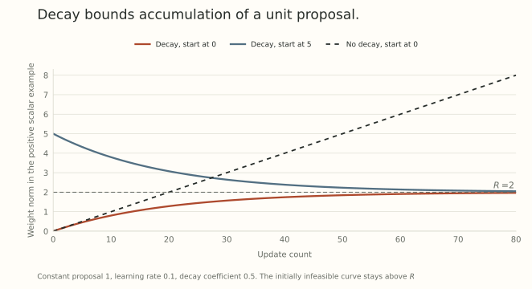

A bound on each update does not bound the weight forever. Repeated bounded steps can all point in the same direction.

Weight decay changes that accumulation. When the proposed direction is bounded in a known norm, decay can turn the parameter update into a convex combination with a point in a fixed ball. The resulting norm bound is elementary, and its assumptions are worth keeping explicit.

This gives us another interpretation of decay alongside Part 3's radius-dependent learning clock. Here we will use a bounded proposal, with no scale-invariance assumption on the loss.

## Separate the direction budget from the parameter update

Let $N$ be a norm, and suppose every proposal obeys

$$
N(v_t)\leq\rho.
$$

For a norm oracle, $v_t$ could be the descent output $-\rho D(m_t)$ from Part 14. It could also be another bounded proposal. The norm argument below only needs its bound.

Without decay, the update is

$$
w_{t+1}=w_t+\eta_t v_t,
\qquad\eta_t\geq0.
$$

Telescoping and the triangle inequality give

$$
N(w_t)\leq N(w_0)+\rho\sum_{j=0}^{t-1}\eta_j.
$$

The right side can grow without bound. A unit direction budget is a limit on each displacement, not a fixed feasible region for the weights.

Now use decoupled decay with coefficient $\lambda>0$:

$$
w_{t+1}=(1-\eta_t\lambda)w_t+\eta_t v_t.
$$

This convention ties the decay multiplier to the same learning rate as the proposal. Other conventions need their own calculation.

## The update is a convex combination

Define

$$
a_t=\eta_t\lambda,
\qquad R=\frac\rho\lambda,
\qquad z_t=\frac{v_t}{\lambda}.
$$

Then $N(z_t)\leq R$, and

$$
w_{t+1}=(1-a_t)w_t+a_tz_t.
$$

If $0\leq a_t\leq1$ and $N(w_t)\leq R$, both points in this convex combination lie in the radius-$R$ ball. Therefore

$$
N(w_{t+1})\leq(1-a_t)R+a_tR=R.
$$

Induction proves an invariant ball whenever the initialization is feasible. The argument works for Euclidean, spectral, Frobenius, or any other genuine norm on the specified block.

For an exact linear minimization oracle, $z_t=v_t/\lambda$ is an oracle output over the enlarged ball of radius $\rho/\lambda$, with a consistent choice among ties. The parameter recurrence is then the conditional-gradient update with coefficient $a_t$. This is the SCG/uSCG connection developed in [Training Deep Learning Models with Norm-Constrained LMOs](https://arxiv.org/abs/2502.07529v2).

The connection concerns a ball and an update rule. It does not force every weight to have norm exactly $R$. For example, starting at zero with $a_t<1$ generally places the first iterate strictly inside the ball.

## Initialization leaves a decaying memory

What if $N(w_0)>R$? The same one-step estimate remains valid, but it no longer proves immediate feasibility.

Write

$$
P_t=\prod_{j=0}^{t-1}(1-a_j),\qquad P_0=1.
$$

Unrolling the scalar inequality gives

$$
N(w_t)\leq P_tN(w_0)+R(1-P_t)
\leq\max\{N(w_0),R\}.
$$

This includes the initial radius instead of silently assuming it away. An initially infeasible trajectory can approach the ball from outside at every finite step.

The coefficient $P_t$ is *the surviving weight of the initialization*. If it tends to zero, the upper envelope approaches $R$. If a schedule leaves a positive product, some of that initial contribution survives in the bound.

## A scalar example saturates the bound

Choose $v_t=1$, $\rho=1$, $\lambda=1/2$, and $\eta_t=0.1$. Then $R=2$, $a_t=0.05$, and

$$
w_{t+1}=0.95w_t+0.1.
$$

The exact solution is

$$
w_t=2+(w_0-2)(0.95)^t.
$$

Starting at zero approaches two from below. Starting at five approaches from above and remains above two for every finite $t$. Both exactly attain the scalar envelope while they remain positive.

With zero initialization, the no-decay trajectory is $w_t=0.1t$.

{fig-alt="A constant unit proposal accumulates without bound when decay is absent. With learning rate 0.1 and decay coefficient one half, the radius-two bound is approached from below for a zero initialization and from above for an initialization of five."}

At twenty updates, decay gives approximately $1.283028$ from an initialization of zero and $3.075458$ from an initialization of five. The no-decay value is two at that particular step and continues increasing.

These are exact recurrence calculations. They illustrate the envelope, rather than demonstrate improved generalization or a training advantage.

## The learning rate changes the memory time

For constant $a\in(0,1)$, $P_t=(1-a)^t$. The number of updates needed to halve the initial coefficient is

$$
t_{1/2}=\frac{\log(1/2)}{\log(1-a)}.
$$

At $a=0.05$, this is about $13.51$ updates. When $a$ is small, the approximation is $t_{1/2}\approx\log2/a$.

For a varying schedule,

$$
P_t\leq\exp\left(-\lambda\sum_{j=0}^{t-1}\eta_j\right),
$$

using $1-a\leq e^{-a}$. Cumulative learning-rate exposure controls this initial-memory bound. If the nonnegative exposure diverges, the product vanishes. A finite exposure does not force it to vanish.

Keeping $\rho$ and $\lambda$ fixed preserves the radius $\rho/\lambda$ in this convention, while changing $\eta_t$ changes how quickly the recurrence forgets its starting point. It also changes the weights given to successive proposals. Matching one of these quantities is not automatically matching the whole trajectory.

## Read the decay convention before inferring a radius

Suppose an implementation instead uses a separate shrinkage $d_t$:

$$
w_{t+1}=(1-d_t)w_t+\eta_t v_t.
$$

For $0<d_t\leq1$, this is a convex combination with the point $(\eta_t/d_t)v_t$. Its possible radius at that step is

$$
R_t=\frac{\eta_t\rho}{d_t}.
$$

A common invariant radius needs a common upper bound on those ratios. Setting $d_t=\eta_t\lambda$ recovers the earlier constant radius. A decay multiplier independent of the learning rate produces a different relation.

The distinction matters when reading hyperparameters, changing accumulation conventions, or transferring schedules. A parameter called weight decay does not specify its numerical action without the update equation.

## The conditions have consequences

**Large coefficients can overshoot.** The convex-combination proof uses $a_t\leq1$. With $w_0=0$, $z_t=R$, and $a_t=1.5$, the next weight is $1.5R$, already outside the ball. Larger coefficients can even make the constant-proposal recurrence diverge. This does not mean every coefficient above one diverges.

**An approximate oracle needs a measured bound.** If numerical evaluation only guarantees $N(v_t)\leq\rho(1+\delta)$ for a uniform $\delta\geq0$, the same calculation gives radius $\rho(1+\delta)/\lambda$. If no useful uniform proposal bound is available, the claimed fixed radius has lost a premise. Part 13 showed how a polynomial filter can overshoot its intended spectral budget.

**A bounded proposal can still be unhelpful.** Part 14's averaged normalized proposal stays bounded even in its uphill example. The parameter bound says where the iterates may go. Descent alignment, task progress, and stationarity require additional arguments.

**The bound belongs to the chosen block.** It does not automatically bound an effective map involving a moving gain, or control the full network while other parameter groups evolve freely. Parts 10 and 11 explain those dependencies.

## A penalty inside the oracle changes another part of the rule

Decoupled decay acts after the oracle has selected a direction. Adding an L2 penalty to the gradient before a nonlinear oracle changes that selection instead.

For a Euclidean unit oracle, take $w=(1,0)$, $g=(0,1)$, $\lambda=1/2$, and $\eta=0.1$. The decoupled update is

$$
w^+_{\rm dec}=(0.95,-0.1).
$$

Putting the penalty inside the normalized gradient, with no separate shrinkage, gives

$$
w^+_{\rm coupled}
=(1,0)-0.1\frac{(1/2,1)}{\sqrt{5/4}}
\approx(0.955279,-0.089443).
$$

The two formulas have different directions and radial effects. Raw Euclidean gradient descent has a linear update map that makes the familiar equivalence possible. A nonlinear norm oracle changes that algebra.

We now have three distinct ingredients to keep track of: how accurately a numerical method evaluates the direction, how a stochastic estimator supplies its input, and how accumulation with decay limits parameter motion. Together they turn a norm choice into a much more complete optimizer description.

## Try setting a norm budget

1. Let $\rho=3$, $\lambda=1/2$, and $\eta=0.2$. What radius and convex-combination coefficient follow?
2. Under those values, take $N(w_0)=9$. What upper bound follows after two updates?
3. In the plotted example, an approximate proposal has norm at most $1.2$. What radius replaces two?
4. Why does an invariant norm ball fail to establish that every proposed update decreases the current loss?

Answer sketches

1. $R=\rho/\lambda=6$ and $a=\eta\lambda=0.1$.
2. $P_2=0.9^2=0.81$, giving $0.81(9)+0.19(6)=8.43$. An initially infeasible point need not enter the ball immediately.
3. The bound becomes $1.2/(1/2)=2.4$, under the same coefficient and initialization qualifications.
4. The argument only uses proposal size. A bounded direction may point uphill, be based on stale gradients, or overshoot because of curvature.

## Yo twin, go read... {#sources-and-scope}

[Training Deep Learning Models with Norm-Constrained LMOs](https://arxiv.org/abs/2502.07529v2), Section 3, Algorithms 1 and 2, and the connection to weight decay, supplies the conditional-gradient interpretation. The initialization envelope and examples above are obtained directly from the displayed recurrence.

[The earlier clock calculation](../scale-geometry-3/index.html) studies exact block scale invariance. [The averaging discussion](../scale-geometry-14/index.html) explains why a bounded oracle output still needs a statistical and directional analysis. The present bound does not reproduce a paper's training comparison or establish a whole-network capacity result.
