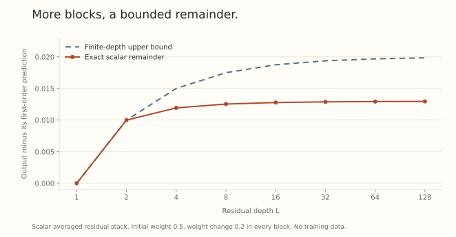

A layer budget is a local promise. It controls what one parameter change can do to that layer's output, for features in a specified region. A network contains many such changes, and the output of one layer becomes the input of another.

In [Part 7](../scale-geometry-7/index.html), we allocated budgets once a first-order network bound was available. Now we will build that bound through a complete residual stack, keep the second derivatives, and turn the result into a finite-step statement. The central question is whether adding more blocks forces the remainder to grow with depth.

There is a useful construction where it does not. Its residual multiplier, activation bounds, and parameter norm all belong in the statement.

## First follow both routes through a composition

Write a two-module network as

$$
h=F(w_1,x),\qquad y=G(w_2,h).
$$

Hold $x$ fixed and perturb both parameter groups. The differential is

$$
\delta y
=D_hG[D_{w_1}F[\delta w_1]]
+D_{w_2}G[\delta w_2].
$$

The first change travels through the downstream module. The second is created there directly. If the local parameter bounds are $N_1,N_2$, and $\|D_hG\|\leq s_2$ for $s_2>0$, then

$$
\|\delta y\|\leq s_2N_1(\delta w_1)+N_2(\delta w_2).
$$

For positive shares $p_1+p_2=1$, define

$$
N(\delta w)=\max\left\{
\frac{s_2N_1(\delta w_1)}{p_1},
\frac{N_2(\delta w_2)}{p_2}\right\}.
$$

Then $\|\delta y\|\leq N(\delta w)$. This is the budget allocation from Part 7 with the downstream coefficient derived from the chain rule. For more modules, repeat the calculation up the tree. A parallel branch combined by a sum needs a sum bound. A concatenation needs its declared output norm. Architecture alone does not specify that geometry.

Even two scalar multiplications already produce curvature. With $F(w_1,x)=w_1x$ and $G(w_2,h)=w_2h$, take $w_i(t)=w_i+t\Delta w_i$. Although each map is linear in its own weight,

$$
\frac{d^2y(t)}{dt^2}=2\Delta w_1\Delta w_2x.
$$

One weight change alters the feature multiplying the other. Dropping these *mixed derivatives* would incorrectly predict zero network curvature.

## State the local promises along the whole path

Consider independent blocks $f_l(w_l,h)$, all using the same activation norm $\|\cdot\|$. Let $N_l$ be a fixed norm for the parameters of block $l$. Assume the maps are twice continuously differentiable on a neighborhood of the states we visit, with

$$
\begin{aligned}
\|D_hf_l[z]\|&\leq\|z\|,\\
\|D_wf_l[v]\|&\leq N_l(v),\\
\|D^2_{ww}f_l[v,v']\|&\leq A N_l(v)N_l(v'),\\
\|D^2_{wh}f_l[v,z]\|&\leq B N_l(v)\|z\|,\\
\|D^2_{hh}f_l[z,z']\|&\leq C\|z\|\|z'\|.
\end{aligned}
$$

Here $A,B,C\geq0$ are common upper bounds. Every line must hold along the interpolation $w_l(t)=w_l+t\Delta w_l$, for $0\leq t\leq1$, at the resulting moving features. Checking these inequalities only at initialization would not justify the argument.

The three curvature bounds record weight-weight, weight-feature, and feature-feature interactions. Compatible activation spaces matter. So do restrictions such as a bounded incoming feature or a normalization denominator separated from zero.

## A residual stack whose sensitivity stays controlled

Use $L$ blocks of the form

$$
h_l(t)=\left(1-\frac1L\right)h_{l-1}(t)
+\frac1L f_l(w_l(t),h_{l-1}(t)),
\qquad h_0(t)=x.
$$

The skip and branch coefficients sum to one. Under our input-derivative assumption, each complete block has sensitivity at most one.

Give the joint parameter change the norm

$$
N(\Delta w)=\max_{1\leq l\leq L}N_l(\Delta w_l),
\qquad N(\Delta w)\leq\varepsilon.
$$

For this averaged residual stack, equal allocation of the budget gives precisely this maximum norm: each branch contributes its local change divided by $L$, and there are $L$ branches.

Let $s_l(t)=\|\dot h_l(t)\|$. Differentiating once yields

$$
\dot h_l=
\left[\left(1-\frac1L\right)I+\frac1L D_hf_l\right]\dot h_{l-1}
+\frac1L D_wf_l[\Delta w_l].
$$

Consequently,

$$
s_l\leq s_{l-1}+\frac\varepsilon L,
\qquad s_0=0,
\qquad s_l\leq\frac lL\varepsilon.
$$

In particular, $\|\dot h_L\|\leq\varepsilon$. Integration gives the finite bound $\|h_L(1)-h_L(0)\|\leq\varepsilon$ too. This does not yet describe the error of the linear prediction.

## Keep the second derivative

Set $q_l(t)=\|\ddot h_l(t)\|$. The full chain rule gives

$$
\begin{aligned}
\ddot h_l={}&
\left[\left(1-\frac1L\right)I+\frac1L D_hf_l\right]\ddot h_{l-1}\\
&+\frac1L\left(
D^2_{ww}f_l[\Delta w_l,\Delta w_l]
+2D^2_{wh}f_l[\Delta w_l,\dot h_{l-1}]
+D^2_{hh}f_l[\dot h_{l-1},\dot h_{l-1}]
\right).
\end{aligned}
$$

The factor two is the mixed interaction seen in the scalar example. Applying the local bounds,

$$
q_l\leq q_{l-1}+\frac1L\left(
A\varepsilon^2+2B\varepsilon s_{l-1}+Cs_{l-1}^2\right).
$$

Insert $s_{l-1}\leq(l-1)\varepsilon/L$ and sum. Since $q_0=0$,

$$
q_L\leq H_L\varepsilon^2,
\quad
H_L=A+B\frac{L-1}{L}
+C\frac{(L-1)(2L-1)}{6L^2}.
$$

The coefficients come from $\sum_{j=0}^{L-1}j$ and $\sum_{j=0}^{L-1}j^2$. In particular,

$$
H_L\leq A+B+\frac C3.
$$

Taylor's integral remainder now gives

$$
\left\|h_L(1)-h_L(0)-\dot h_L(0)\right\|
\leq\frac12H_L\varepsilon^2.
$$

This is a *depth-independent upper bound* under the stated assumptions. It is not an exact curvature value. Replacing the averaged residual block by $h+f_l(w,h)$ changes the sensitivity calculation. Tying parameters across blocks changes the parameter space. Neither alteration inherits this proof automatically.

## A scalar stack we can calculate exactly

Take $f_l(w,h)=wh$, $h_0=1$, and keep $w,h\in[0,1]$. With absolute-value norms, $A=C=0$ and $B=1$. Choose every initial weight as $1/2$ and every change as $\varepsilon=0.2$. The path stays in the required region, and

$$
y(t)=\left(1-\frac{0.5}{L}+\frac{0.2t}{L}\right)^L,
\qquad
y'(0)=0.2\left(1-\frac{0.5}{L}\right)^{L-1}.
$$

Compute the actual remainder $y(1)-y(0)-y'(0)$ and compare it with $0.02(1-1/L)$. At depth two both equal $0.01$. As depth grows, the actual remainder approaches

$$
e^{-0.3}-1.2e^{-0.5}\approx0.0129814,
$$

while the bound approaches $0.02$.

{fig-alt="Exact remainder and theoretical upper bound for the scalar averaged residual stack, from depth one to 128. Both remain bounded, with the actual remainder approaching about 0.013."}

These are evaluations of a scalar polynomial, not training measurements. Increasing $L$ also changes the branch multiplier. A comparison with an unscaled network must account for that change and its chosen joint norm.

## From output motion to a loss bound

Suppose the scalar loss $\ell(y)$ has output derivative norm at most $b$ and Hessian bilinear norm at most $c$ throughout the output path. Then

$$
\frac{d^2}{dt^2}\ell(h_L(t))
=D^2\ell[\dot h_L,\dot h_L]+D\ell[\ddot h_L],
$$

so its absolute value is at most $(c+bH_L)\varepsilon^2$. Thus, for $\mathcal L(w)=\ell(h_L(w))$,

$$
\mathcal L(w+\Delta w)
\leq\mathcal L(w)+D\mathcal L[\Delta w]
+\frac12(c+bH_L)N(\Delta w)^2.
$$

A finite empirical average obeys the same bound if its examples share these constants. A population expectation additionally needs justification for exchanging differentiation and expectation.

For a unit support direction $D(g)$ of the joint norm, a step $\Delta w=-\varepsilon D(g)$ has linear term $-\varepsilon N^*(g)$. The quadratic term tells us when that local prediction guarantees descent. Approximate or stochastic directions also carry the alignment errors from [Part 14](../scale-geometry-14/index.html). A budget by itself does not establish descent.

## Where the local promises come from

For a dense map $Wh$, the mixed derivative is $\Delta W\Delta h$. The RMS operator norm from Part 5 controls it. For a periodic convolution $f(C,x)=K^{-1}\sum_{s=1}^K C_sS_sx$, using Euclidean feature norms and norm-preserving spatial shifts, the triangle inequality gives

$$
\|D_Cf[H]\|\leq\max_s\|H_s\|_{\rm op}\|x\|.
$$

Thus a maximum over channel-matrix slices is a natural parameter norm for that explicitly averaged convolution. Input sensitivity at most one additionally needs $\max_s\|C_s\|_{\rm op}\leq1$. Stride, padding, and different normalization factors need their own estimates.

For attention, split the module into projections, the bilinear score map, softmax, and value aggregation. For scores $QK^\top$, the differential is $\Delta QK^\top+Q\Delta K^\top$, and the mixed second derivative contains $\Delta Q\Delta K^\top$. Bounds therefore need limits on the relevant query and key norms, as well as the chosen sequence norms. A normalized projection introduces an additional denominator. [Part 18](../scale-geometry-18/index.html) will calculate why this can be the fragile part.

The recursive bookkeeping works once those local promises hold. Establishing their region of validity is part of the network argument.

## Try carrying the budget through

1. In the two-module bound, take $s_2=3$, $p_1=p_2=1/2$, and $N(\Delta w)\leq0.1$. What local budgets follow?
2. For $A=0$, $B=1$, $C=0$, $L=4$, and $\varepsilon=0.2$, what is the output remainder bound?
3. Why would retaining only weight-weight curvature miss the scalar residual example?
4. If $b=2$, $c=3$, and $H_L\leq1$, what quadratic coefficient appears in the loss remainder?

Answer sketches

1. $N_1(\Delta w_1)\leq0.1/6$ and $N_2(\Delta w_2)\leq0.05$. Their transported contributions sum to at most $0.1$.
2. $\tfrac12(3/4)(0.2)^2=0.015$.
3. Each scalar block has zero weight-weight curvature, but its mixed derivative equals one. Simultaneously moving weights creates a nonzero second-order product.
4. $c+bH_L\leq5$, so the remainder is at most $\tfrac52N(\Delta w)^2$.

## Yo twin, go read... {#sources-and-scope}

[Scalable Optimization in the Modular Norm](https://arxiv.org/abs/2405.14813v1), Sections 3.2 to 3.4, Proposition 4, and Appendices B, C, and E, develops composition, sharpness triples, and the averaged residual construction. Its Proposition 5 connects output error bounds to loss smoothness. The pathwise calculation above spells out the first and second directional derivatives for independent blocks. The scalar example and figure evaluate the displayed polynomial directly.

The result concerns this declared norm, residual multiplier, and region of differentiability. It does not show that an arbitrary trained attention network satisfies the local constants, or that a depth-independent upper bound makes its best learning rate depth independent.
