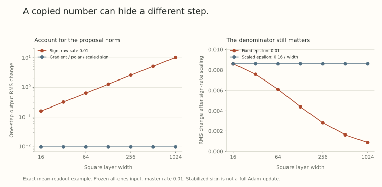

Suppose a learning rate works at width 256. You make the hidden layers four times wider. Should you copy the number?

Before answering, we need to know what that number multiplies. A raw gradient, an entrywise sign, and a matrix polar factor have different width dependence. Even if their implementations call the multiplier a learning rate, equal numbers can produce very different feature changes.

The useful transferable quantity is often a *master rate* whose layerwise conversion accounts for those differences. We can see the mechanism in an exact one-step calculation, then separate it from the much stronger claim that the best training hyperparameter transfers.

## Start with the units of a layer change

For $W\in\mathbb R^{m\times n}$, measure incoming and outgoing features in RMS norm. [Part 5](../scale-geometry-5/index.html) derived

$$
\|\Delta Wh\|_{\rm RMS}
\leq\sqrt{\frac nm}\|\Delta W\|_{\rm op}\|h\|_{\rm RMS}.
$$

A matrix budget that gives a width-independent upper bound on RMS motion is therefore

$$
N(\Delta W)=\sqrt{\frac nm}\|\Delta W\|_{\rm op}.
$$

Write the raw optimizer step as $\Delta W=-\eta_{\rm raw}\Psi$. If the proposal has nonzero spectral norm $q(m,n)$, then setting

$$
\eta_{\rm raw}
=\bar\eta\frac{\sqrt{m/n}}{q(m,n)}
$$

gives $N(\Delta W)=\bar\eta$. If we know only an asymptotic scale for $q$, the resulting statement is an asymptotic scale too, not this exact equality.

This quotient is useful because it makes the dependency visible: initialization and optimizer details determine proposal scales, while $\bar\eta$ specifies the common budget. In practical parametrizations, one normally derives fixed shape factors rather than measuring and cancelling the exact proposal norm at every step. Those are distinct algorithms.

## A spectral upper bound does not force feature motion

Let $u,v,z$ be unit vectors, with $z\perp v$, and let $h=\sqrt n\,v$. The matrices

$$
D_1=uv^\top,\qquad D_2=uz^\top
$$

both have spectral norm one. Yet

$$
D_1h=\sqrt n\,u,\qquad D_2h=0.
$$

The budget allows a maximal change and a zero change. To get a lower bound on feature motion, we also need overlap with the actual incoming feature.

A single-example gradient supplies a clear form of alignment. If the derivative with respect to the layer output is $\delta$, then

$$
G=\delta h^\top,
\qquad
Gh=\delta\|h\|_2^2,
\qquad
\|Gh\|_2=\|G\|_{\rm op}\|h\|_2.
$$

The same example that created the update saturates the operator bound. A different example need not. A minibatch sum or a history-dependent optimizer changes the geometry again.

In a moving network,

$$
\Delta(Wh)=\Delta Wh+W\Delta h+\Delta W\Delta h.
$$

Even a large first term can be cancelled by the other terms. A sufficient lower-bound condition is

$$
\|\Delta(Wh)\|_2\geq c\|\Delta Wh\|_2
$$

for a width-independent $c>0$. An upper bound alone cannot supply this condition. This distinction is central to reading [A Spectral Condition for Feature Learning](https://arxiv.org/abs/2310.17813v2), especially its single-example argument and extensions in Section 3.

## Three update maps on the same exact example

Use a square width-$d$ layer. Let the incoming feature be $h=\mathbf1_d$, and choose an output derivative $\delta=\mathbf1_d/d$. This derivative arises, for example, from the mean readout $\ell(z)=d^{-1}\sum_i z_i$. Then

$$
G=\frac1d\mathbf1_d\mathbf1_d^\top.
$$

This rank-one matrix has a single nonzero singular value equal to one. Its partial polar factor is itself. Its entrywise sign is the all-ones matrix.

Keeping the input fixed, the resulting output RMS changes are

$$
\begin{array}{c|c|c}
\text{proposal }\Psi&\|\Psi\|_{\rm op}&\|\Delta Wh\|_{\rm RMS}\\
\hline
G&1&\eta_{\rm raw}\\
\operatorname{polar}(G)&1&\eta_{\rm raw}\\
\operatorname{sign}(G)&d&d\eta_{\rm raw}
\end{array}
$$

Thus gradient and polar steps use $\eta_{\rm raw}=\bar\eta$ in this example, while sign steps use $\eta_{\rm raw}=\bar\eta/d$. For $\bar\eta=0.01$:

| Width | Gradient or polar | Sign with raw rate 0.01 | Sign with raw rate $0.01/d$ |
| --- | --- | --- | --- |
| 16 | 0.01 | 0.16 | 0.01 |
| 64 | 0.01 | 0.64 | 0.01 |
| 256 | 0.01 | 2.56 | 0.01 |
| 1024 | 0.01 | 10.24 | 0.01 |

Every entry is an exact one-step feature change. The example has no optimizer history, no training trajectory, and no validation loss. It isolates the shape factor that a raw rate must compensate.

{fig-alt="Two exact one-step calculations. The left panel compares a width-growing unscaled sign step with constant gradient, polar, and rescaled sign steps. The right panel compares fixed and width-scaled denominator stabilizers."}

The rectangular version is also instructive. With $h=\mathbf1_n$ and $\delta=\mathbf1_m/m$, the gradient spectral norm is $\sqrt{n/m}$. Rates producing the same RMS change $\bar\eta$ are

$$
\begin{aligned}
\eta_{\rm gradient}&=\bar\eta\,m/n,\\
\eta_{\rm polar}&=\bar\eta\sqrt{m/n},\\
\eta_{\rm sign}&=\bar\eta/n.
\end{aligned}
$$

These formulas follow from this particular mean-readout example. They are not a table for every layer of every optimizer. Input, hidden, and readout layers can have different dimensional roles, and an implementation may already include a shape factor inside its proposal.

## A small stabilizer can change the width regime

Replace the sign by the elementwise map

$$
\Psi_{ij}=\frac{G_{ij}}{|G_{ij}|+\epsilon},\qquad\epsilon\geq0.
$$

This is a stabilized sign map, not a complete Adam update. In our square example, each entry equals $1/(1+d\epsilon)$. Even with the sign rate $\bar\eta/d$, the RMS feature change becomes

$$
\frac{\bar\eta}{1+d\epsilon}.
$$

For fixed positive $\epsilon$, it vanishes as width grows. If instead $\epsilon=c/d$, the change is $\bar\eta/(1+c)$, independent of width.

The figure uses $\epsilon=0.01$ and the matched scaled choice $0.16/d$, which agree at width 16. The large stabilizer makes the effect visible. These values are illustrative, not recommended Adam settings. Actual moment estimates, bias corrections, and placement before or after a square root require their own formula.

[Tensor Programs V](https://arxiv.org/abs/2203.03466v2), Appendix B.3, explicitly discusses when a non-negligible Adam epsilon needs width scaling. The broader lesson is that the asymptotic regime belongs to the entire denominator. A constant called tiny can become dominant relative to a shrinking gradient.

## Initialization is a separate calculation

The update quotient assumes features and proposals have the scales used in its derivation. Initialization helps establish those conditions, but it does not determine the learning-rate rule by itself.

For a square Gaussian hidden matrix, entry standard deviation proportional to $d^{-1/2}$ gives spectral scale of order one. A rectangular matrix needs its aspect ratio considered. A readout with a fixed output dimension is different again. Even at the same initial weight scale, changing the loss reduction from a mean to a sum changes the gradient in our example by a factor $d$.

This is why a width-transfer recipe needs to declare parameter multipliers, initialization, forward scaling, loss reduction, and optimizer equations together. [Extending $\mu$P](https://arxiv.org/abs/2602.20937v1), Section 4.1, uses the proposal-norm quotient as a generic organizing calculation. Applying it to a new optimizer still requires its proposal norm and the assumptions behind any claimed lower bounds. A history buffer can change rank and alignment. Damping can change the active scale.

Width and depth are also different questions. [Part 16](../scale-geometry-16/index.html) used a specific $1/L$ averaged residual construction with sensitivity assumptions. It did not derive a general depth-transfer rule for ordinary Transformers. Changing depth, batch size, or training duration alongside width introduces more variables than a width-only argument controls.

## What would successful transfer actually measure?

Let $V_d(\bar\eta)$ be validation loss at width $d$, after a declared training budget, using all layerwise conversions of the master rate. Tune $\bar\eta_0$ at a source width. For a target width, define grid transfer regret

$$
R(d)=V_d(\bar\eta_0)-\min_{\bar\eta\in\mathcal G}V_d(\bar\eta),
$$

where the comparison grid $\mathcal G$ includes $\bar\eta_0$. This quantity is nonnegative. A small value means the transferred rate performs near the best rate *on that tested grid and budget*.

A convincing study reports the whole target curve, repeated seeds, uncertainty, and whether the optimum hits a grid boundary. It holds data, schedule conventions, token budgets, and tuning opportunities to a declared comparison. If a boundary wins, expand the grid before treating it as an optimum. A grid minimum is not the unknown optimum over all positive rates.

Stable activation RMS and width-independent one-step motion are useful diagnostics. Neither guarantees low transfer regret or useful learned representations. Tensor Programs V studies actual hyperparameter transfer, beyond the algebraic example here. We have not run a new training sweep for this post.

## Try changing width without changing the budget

1. At square width 512, what raw sign rate gives RMS change $0.02$ in our example?
2. For $m=64$, $n=256$, and $\bar\eta=0.01$, compute the three rectangular rates.
3. With $d=1000$, $\epsilon=0.001$, and $\bar\eta=0.01$, what change does the stabilized sign map produce?
4. If transferred validation loss is 2.31 and the best tested target loss is 2.29, what is grid transfer regret? Does a feature RMS plot determine it?

Answer sketches

1. $0.02/512=0.0000390625$.
2. Gradient: $0.0025$. Polar: $0.005$. Sign: $0.0000390625$.
3. $0.01/(1+1)=0.005$.
4. $0.02$. It requires validation losses, so a feature RMS plot alone does not determine it.

## Yo twin, go read... {#sources-and-scope}

[A Spectral Condition for Feature Learning](https://arxiv.org/abs/2310.17813v2), Sections 3 and 4, connects spectral scaling to feature motion under its alignment, non-cancellation, and network assumptions. Its star notation denotes spectral norm. Here $\|\cdot\|_{\rm op}$ keeps that convention explicit.

[Extending $\mu$P: Spectral Conditions for Feature Learning Across Optimizers](https://arxiv.org/abs/2602.20937v1), Sections 3.3 and 4.1, organizes optimizer-dependent rate scalings. The conditional quotient does not remove the need to check each optimizer's history and regularization regime.

[Tensor Programs V: Tuning Large Neural Networks via Zero-Shot Hyperparameter Transfer](https://arxiv.org/abs/2203.03466v2), Sections 4 and 6 and Appendix B, treats parametrization, transfer, limitations, and optimizer conventions. Our mean-readout matrices and stabilized-sign curves are direct calculations, not reproductions of its experiments or full infinite-width results.
