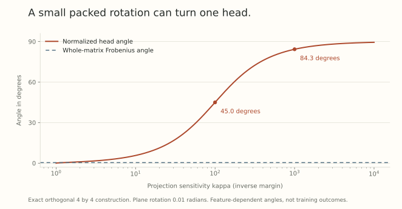

A spectral budget controls the largest raw output change of a linear map. After normalization, the relevant output is a direction. A small raw vector can change direction substantially under a perturbation that is small on the scale of the whole matrix.

This gives us a concrete way to examine the regional assumptions in Part 16 and the upper bounds in Part 17. The missing quantity is a *projection margin*: how much of the incoming feature survives the particular projection we normalize.

We will derive the exact local sensitivity, then make the effect happen while a packed matrix stays exactly orthogonal. No singular value needs to deteriorate.

## Differentiate the normalized projection

Let $A\in\mathbb R^{p\times d}$, $h\ne0$, and

$$
z=Ah\ne0,\qquad r=\|z\|_2,\qquad u=\frac zr.
$$

Assume $p\geq2$. Differentiating $r$ gives $dr=u^\top dz$. Therefore

$$
du=\frac{dz}{r}-\frac{z\,dr}{r^2}
=\frac{(I-uu^\top)dz}{r}.
$$

Normalization discards the radial component and divides the transverse component by the current output radius. For a frozen input and a weight change,

$$
D_Au[\Delta A]
=\frac{(I-uu^\top)\Delta Ah}{\|Ah\|_2}.
$$

Give the matrix a relative spectral budget

$$
\|\Delta A\|_{\rm op}\leq\eta\|A\|_{\rm op},
\qquad
\kappa(A,h)=\frac{\|A\|_{\rm op}\|h\|_2}{\|Ah\|_2}.
$$

The spectral inequality implies $\kappa\geq1$ and

$$
\|D_Au[\Delta A]\|_2\leq\eta\kappa(A,h).
$$

This upper bound is attained. Choose a unit vector $e\perp u$ and set

$$
\Delta A=\eta\|A\|_{\rm op}\,e\frac{h^\top}{\|h\|_2}.
$$

It has exactly the permitted spectral norm, and its action on $h$ is entirely transverse. Thus

$$
\sup_{\|\Delta A\|_{\rm op}\leq\eta\|A\|_{\rm op}}
\|D_Au[\Delta A]\|_2=\eta\kappa(A,h).
$$

This is a differential statement over the ambient spectral ball. It is not yet a finite angle bound or an oracle restricted to a weight manifold. For $p=1$, there is no transverse direction: the ideal normalized scalar is locally constant away from zero, so the displayed supremum equality requires $p\geq2$.

## Perfect nonzero singular values do not protect a projection

Consider

$$
A=\begin{pmatrix}1&0&0\\0&1&0\end{pmatrix},
\qquad
h=\begin{pmatrix}\varepsilon\\0\\\sqrt{1-\varepsilon^2}\end{pmatrix},
\qquad0<\varepsilon\leq1.
$$

The rows of $A$ are orthonormal. Its two nonzero singular values are both one, and $\|h\|_2=1$. Nevertheless,

$$
Ah=(\varepsilon,0)^\top,
\qquad\kappa(A,h)=1/\varepsilon.
$$

Most of the feature lies in the projection's kernel. Perfect row geometry does not give a positive lower bound on $\|Ah\|$ for all unit inputs of a wide projection.

Nor does changing the global radius fix the relative margin. For any nonzero scalar $a$,

$$
\kappa(aA,h)=\kappa(A,h).
$$

Positive rescaling also leaves the ideal normalized output unchanged. [Part 15](../scale-geometry-15/index.html) showed how decay can bound a parameter radius. That bound alone does not improve this data-dependent ratio instantly. Decay can still affect future directions, optimizer history, and features.

## Keep the packed matrix exactly orthogonal

Now use a four-dimensional packed projection $Q$, and call its first two output coordinates one head. Start from $Q_0=I_4$ and take

$$
h=(\varepsilon,0,\sqrt{1-\varepsilon^2},0)^\top.
$$

Rotate output coordinates two and three:

$$
Q_\alpha=
\begin{pmatrix}
1&0&0&0\\
0&\cos\alpha&\sin\alpha&0\\
0&-\sin\alpha&\cos\alpha&0\\
0&0&0&1
\end{pmatrix}.
$$

This matrix is exactly orthogonal. Its selected head sees

$$
(Q_\alpha h)_{1:2}
=(\varepsilon,\sin\alpha\sqrt{1-\varepsilon^2})^\top.
$$

The normalized head starts along the first coordinate. Its new angle is exactly

$$
\theta_{\rm head}
=\arctan\left(|\sin\alpha|\sqrt{\kappa^2-1}\right),
\qquad\kappa=1/\varepsilon.
$$

The full matrix's spectral displacement and Frobenius angle are

$$
\|Q_\alpha-I\|_{\rm op}=2|\sin(\alpha/2)|,
\qquad
\cos\theta_{\rm matrix}
=\frac{\langle I,Q_\alpha\rangle_F}{\|I\|_F\|Q_\alpha\|_F}
=\frac{2+2\cos\alpha}{4}.
$$

At $\alpha=0.01$ radians, the spectral displacement is about $0.01$ and the whole-matrix angle is about $0.405$ degrees. A feature with $\kappa=100$ has a head angle of about $45.0$ degrees. With $\kappa=1000$, the angle is about $84.3$ degrees.

{fig-alt="For a plane rotation of 0.01 radians, the selected normalized head angle increases from zero at kappa one toward 90 degrees as kappa grows. The whole-matrix Frobenius angle stays near 0.405 degrees."}

This example is not an artifact of leaving the manifold. It is also compatible with a spectral support direction. The initial velocity $J=\left.\frac{d}{d\alpha}Q_\alpha\right|_0$ is skew-symmetric, tangent at the identity, and has spectral norm one. For the cost covector $G=-J$,

$$
\langle G,J\rangle_F=-2=-\|G\|_*.
$$

Here $\|\cdot\|_*$ denotes nuclear norm. The tangent direction attains the ambient spectral-ball lower bound, so it also solves the tangent-constrained linear problem for this cost. A polar retraction of $I+tJ$ yields the same plane rotation with angle $\arctan t$.

We chose this cost to demonstrate attainability. We have not shown that an ordinary task gradient selects it frequently. The construction establishes a limitation of weight-only control, not a probability of training failure or a prediction of worse loss.

## Turn the derivative into a finite-step statement

Write the new projected feature as $z^+=z+e$. If

$$
\frac{\|e\|_2}{\|z\|_2}\leq q<1,
$$

then

$$
\angle(z,z^+)\leq\arcsin q.
$$

To see the geometry, place a radius-$q\|z\|$ ball around $z$. It excludes the origin. The ray from the origin tangent to that ball makes angle $\arcsin q$ with $z$, and every possible $z^+$ is inside that angular cone. The bound is sharp. The corresponding normalized Euclidean displacement is at most $2\sin(\tfrac12\arcsin q)$.

For frozen $h$, the relative spectral budget gives $q\leq\eta\kappa$. If $\eta\kappa\geq1$, that upper bound provides no useful angular certificate. It does not imply the actual update has a large angle.

The whole-matrix and head angles above are different observables. Controlling the angle between packed matrices does not directly control the angle between every normalized head feature. A head that uses the entire orthogonal output has no projection kernel, so this particular amplification mechanism needs a proper subspace.

## The incoming feature moves too

In a complete network, let

$$
\|\Delta A\|_{\rm op}\leq\eta\|A\|_{\rm op},
\qquad
\|\Delta h\|_2\leq\tau\|h\|_2.
$$

The exact raw change is

$$
e=(A+\Delta A)(h+\Delta h)-Ah
=\Delta Ah+A\Delta h+\Delta A\Delta h.
$$

The last term matters for a finite step. Applying the triangle inequality gives

$$
\frac{\|e\|_2}{\|Ah\|_2}
\leq\kappa(A,h)(\eta+\tau+\eta\tau).
$$

Whenever the right side is below one, insert it into the arcsine bound. For example, $\kappa=5$, $\eta=0.01$, and $\tau=0.02$ give $q=0.151$ and an angle bound of about $8.69$ degrees.

A bound using the observed post-update $\tau$ checks an inequality after the event. A pre-update certificate needs an independently valid upstream bound on $\tau$. Part 16 illustrates what such recursive reasoning can look like under strong local assumptions. It does not establish a cheap, tight certificate for an arbitrary Transformer.

Similarly, if the effective head map is a selector applied to $QE$ with a learned upstream matrix $E$, an orthogonality constraint on $Q$ does not alone constrain that complete map. The module boundary needs to match the actual forward computation.

## Epsilon changes the Euclidean derivative

Real normalization often uses a positive stabilizer. For the explicitly defined map

$$
n_\epsilon(z)=\frac{z}{\sqrt{\|z\|_2^2+\epsilon}},
\qquad\epsilon>0,
$$

write $s=\sqrt{\|z\|_2^2+\epsilon}$. Its Jacobian is

$$
Dn_\epsilon(z)=\frac Is-\frac{zz^\top}{s^3}.
$$

Transverse eigenvalues are $1/s$, while the radial eigenvalue is $\epsilon/s^3$. At zero all directions have derivative $1/\sqrt\epsilon$. The derivative is globally bounded by that value, but the bound can be large. The radial derivative no longer vanishes, and exact scale invariance is lost.

For nonzero $z$, this stabilized output points in the same direction as $z$, so our angular argument still concerns its orientation. Its Euclidean displacement uses the new Jacobian. RMS conventions, epsilon placement, and learned gains change the actual formula and must be included when applying it.

## What to measure before drawing a training conclusion

The same weights can have small $\kappa$ on one context and large $\kappa$ on another. A matrix singular-value plot alone will miss that difference. Inspect the distribution and tails of projection margins on actual features, raw and normalized feature changes, incoming-feature motion, and the task's actual update directions.

Large internal motion can be useful. Small internal motion can still be badly aligned. To argue for a different geometry, we would need comparisons against tuned scalar step corrections, matched schedules, and completed training budgets, with downstream loss measured. The exact example above supplies a diagnostic question for that study. It does not supply its outcome.

## Try checking the margin

1. In the row-orthogonal example, take $\varepsilon=0.01$. What is $\kappa$? What happens to it if we multiply $A$ by ten?
2. With frozen features, $\kappa\leq20$, and a target angle of at most five degrees, what relative spectral budget is sufficient?
3. Why is $\kappa(\eta+\tau)$ insufficient for the general finite moving-feature bound?
4. What changes in the ideal differential formula when the normalized output dimension is one?

Answer sketches

1. $\kappa=100$, and positive rescaling leaves it at 100.
2. $\eta\leq\sin(5\pi/180)/20\approx0.00435779$.
3. It omits $\Delta A\Delta h$. Aligned scalar changes already require the additional $\eta\tau$ term.
4. Away from zero, $u=\pm1$ and $I-uu^\top=0$. There is no nonzero transverse direction, although a finite sign crossing can still occur through zero.

## Yo twin, go read... {#sources-and-scope}

Return to [Part 2](../scale-geometry-2/index.html) for exact normalization symmetries, [Part 8](../scale-geometry-8/index.html) for tangent constraints and retractions, and [Part 16](../scale-geometry-16/index.html) for pathwise module bounds. The Jacobian, witness, orthogonal construction, and moving-input estimate here follow directly from the displayed maps. They express possible behavior under explicit budgets, with no new benchmark claim.

[Scalable Optimization in the Modular Norm](https://arxiv.org/abs/2405.14813v1), Appendix A.3 and the module-design discussion in Appendix B, gives the surrounding normalization and module perspective. A norm's sensitivity promise belongs to its declared map and admissible region. The packed, headwise normalized construction above should not be read as a description of every attention module using that framework.
