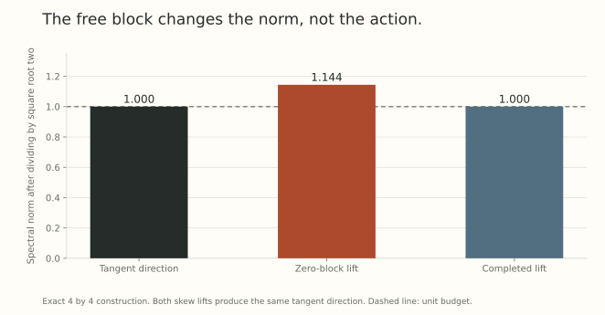

An ambient spectral update is easy to describe: take the negative polar factor of the cost matrix. Requiring the direction to be tangent to an orthogonality constraint changes the problem. [Part 8](../scale-geometry-8/index.html) showed why computing the ambient answer and projecting it afterward can waste the budget.

There is an exact solution to the tangent problem. Its central move is to represent a rectangular tangent direction using a square skew-symmetric generator. The subtle point is proving that this representation preserves the entire spectral ball. Feasibility in one direction would not establish optimality.

## Specify the local optimization problem

Let $X\in\mathbb R^{n\times p}$ satisfy $X^\top X=I_p$, with $n>p$. Given a cost matrix $M$ of the same shape, solve

$$
\min_B\langle M,B\rangle_F
\quad\text{subject to}\quad
X^\top B+B^\top X=0,
\quad\|B\|_{\rm op}\leq1.
$$

The cost could be the current gradient or a momentum estimate. The oracle is optimal for that supplied cost. If it is momentum, exact oracle evaluation does not make it the steepest direction for the current loss automatically.

The tangent equation follows by differentiating $X(t)^\top X(t)=I_p$ at zero. It requires $X^\top B$ to be skew-symmetric, rather than zero. The direction can rotate columns within the current span as well as move them into its orthogonal complement.

## Lift the direction to a skew generator

For any $Y\in\mathbb R^{n\times n}$ with $Y^\top=-Y$, set $B=YX$. Then

$$
X^\top B+B^\top X=X^\top(Y+Y^\top)X=0,
\qquad\|B\|_{\rm op}\leq\|Y\|_{\rm op}.
$$

Thus every skew contraction gives a feasible tangent direction. Define

$$
N=\operatorname{skew}(MX^\top)
=\frac12(MX^\top-XM^\top).
$$

Cyclic trace and orthogonality of symmetric and skew matrices give

$$
\langle M,YX\rangle_F
=\langle MX^\top,Y\rangle_F
=\langle N,Y\rangle_F.
$$

We have transformed the objective. To replace the original feasible set, however, we still need the converse: can every tangent contraction be lifted without increasing its norm?

## The converse is a norm-preserving completion problem

Complete $X$ to an orthogonal basis $Q=[X\ X_\perp]$. For a tangent $B$, write

$$
A=X^\top B,\qquad S=X_\perp^\top B.
$$

In this basis, any skew lift taking $X$ to $B$ has the form

$$
Q^\top YQ=
\begin{pmatrix}A&-S^\top\\S&D\end{pmatrix},
\qquad D^\top=-D.
$$

The first block column is prescribed, while $D$ has no effect on $YX$. Setting $D=0$ always gives a lift, but can make its norm too large.

Here is the nontrivial ingredient. The norm-preserving block-completion theorem used in [Muon on the Stiefel Manifold Admits an Exact Closed-Form Update](https://arxiv.org/abs/2608.06218v1), Proposition 3, supplies an unrestricted block $D_0$ such that

$$
H_0=\begin{pmatrix}A&-S^\top\\S&D_0\end{pmatrix}
\quad\text{has}\quad
\|H_0\|_{\rm op}=\|B\|_{\rm op}.
$$

It applies because the fixed first block row and column have the same norm $\|B\|_{\rm op}$. We are using this completion theorem, rather than proving it from elementary inequalities here.

Now take $H=\operatorname{skew}(H_0)$. Since $A$ is already skew and the off-diagonal blocks already match, this changes only the free block. Moreover,

$$
\|H\|_{\rm op}\leq\|H_0\|_{\rm op}=\|B\|_{\rm op}.
$$

The fixed first block column gives the opposite inequality $\|H\|_{\rm op}\geq\|B\|_{\rm op}$. Hence equality holds. With $Y=QHQ^\top$, we get a skew lift satisfying $YX=B$ and exactly the same norm.

Together, the two directions prove

$$
\{YX:Y^\top=-Y,\ \|Y\|_{\rm op}\leq1\}
=\{B:X^\top B+B^\top X=0,\ \|B\|_{\rm op}\leq1\}.
$$

This is equality of feasible images, not a one-to-one correspondence. Several generators can act identically on $X$.

## Why the apparently unused block matters

Take $n=4$, $p=2$, and

$$
X=\begin{pmatrix}I_2\\0\end{pmatrix},
\quad J=\begin{pmatrix}0&1\\-1&0\end{pmatrix},
\quad B=\begin{pmatrix}J\\I_2\end{pmatrix}.
$$

Here $\|B\|_{\rm op}=\sqrt2$. The zero-block lift and a completed lift are

$$
H_z=\begin{pmatrix}J&-I_2\\I_2&0\end{pmatrix},
\qquad
H_c=\begin{pmatrix}J&-I_2\\I_2&-J\end{pmatrix}.
$$

Both have the same action on the first two coordinate vectors. But

$$
\|H_z\|_{\rm op}=\frac{1+\sqrt5}{2},
\qquad\|H_c\|_{\rm op}=\sqrt2.
$$

The first identity follows from the eigenvalues $(3\pm\sqrt5)/2$ of $H_z^\top H_z$. The second follows from $H_c^\top H_c=2I_4$. Divide all three matrices by $\sqrt2$: the tangent direction and completed lift are contractions, while the zero-block lift is not.

{fig-alt="Three spectral norms after division by square root two. The tangent direction and completed skew lift have norm one, while the zero-block lift has norm about 1.144. Both lifts act identically on the frame."}

The free block matters because the constraint controls the *whole generator*, including directions outside the current frame.

## Solve the lifted problem with a support polar factor

For a square skew cost $N$, the spectral-ball lower bound is

$$
\langle N,Y\rangle_F\geq-\|N\|_*,
\qquad\|Y\|_{\rm op}\leq1,
$$

where $\|N\|_*$ is nuclear norm. Retain only positive singular values in a compact SVD $N=U_r\Sigma_rV_r^\top$ and define $P_N=U_rV_r^\top$. Set $P_0=0$.

A real skew matrix has an orthogonal block decomposition into positive multiples of $J$ and a zero block. Its support polar factor replaces each positive multiple by $J$ and leaves the zero block at zero. Thus $P_N$ is itself skew, has norm at most one, and

$$
\langle N,-P_N\rangle_F=-\|N\|_*.
$$

Feasibility and equality to the lower bound certify the solution

$$
\boxed{B_*=-P_NX,
\qquad\langle M,B_*\rangle_F=-\|N\|_*.}
$$

The feasible-image theorem is what makes this a certificate for the original tangent problem.

## Specify what happens at zero singular values

Rank deficiency is routine here: $\operatorname{rank}(N)\leq2p$, so $n>2p$ forces a kernel. A real skew matrix of odd dimension is singular too.

The support convention gives a canonical selection, with no action on the kernel. A full square SVD product $UV^\top$ can add an orthogonal action there and need not be skew. The safe alternative $-\operatorname{skew}(UV^\top)X$ is also optimal in exact arithmetic, but can choose a different tangent direction at the same cost.

In particular, a purely normal cost $M=XS$ with $S=S^\top$ gives $N=0$. Every feasible direction then has zero cost. Returning zero is a deliberate, reproducible choice.

Floating-point evaluation needs a rank threshold. Treating a genuinely positive singular value as zero changes the exact support value. Keeping roundoff-sized modes can instead select a large direction from a nearly zero cost. State the convention and measure the resulting support defect.

## Compress before evaluating the polar factor

When $2p\leq n$, form the thin QR factorization

$$
F=[-X\ M]=Q_cR,
\qquad
J_p=\begin{pmatrix}0&I_p\\-I_p&0\end{pmatrix}.
$$

Block multiplication gives $FJ_pF^\top=2N$. Therefore

$$
K=\tfrac12RJ_pR^\top,
\quad N=Q_cKQ_c^\top,
\quad B_*=-Q_cP_K(Q_c^\top X).
$$

The polar evaluation now uses a $2p\times2p$ matrix. QR and reconstruction cost order $np^2$, with a dense small factorization costing order $p^3$. These are arithmetic estimates, excluding cost-matrix construction, rather than measured training speedups. A rank-deficient $F$ makes $R$ singular without invalidating the factorization or requiring its inverse.

For example, $n=1024$, $p=32$ gives a 64 by 64 compressed cost. If $2p>n$, this declared QR shape is unavailable. Use the dense formulation or justify another reduction.

## A direction still needs a finite step

For a tangent $B$, polar retraction gives

$$
X^+=(X+\eta B)(I_p+\eta^2B^\top B)^{-1/2}.
$$

Its columns are orthonormal in exact arithmetic, and

$$
X^+=X+\eta B-\tfrac12\eta^2XB^\top B+O(\eta^3).
$$

The correction is not part of the tangent direction. An exact oracle does not make an arbitrary finite step decrease a nonlinear loss. A polynomial approximation to $P_N$ adds another issue: skewing its output enforces skewness but does not prove unit norm or optimal support. [Part 13](../scale-geometry-13/index.html) explains those numerical distinctions.

## Try checking the certificate

1. For $p=1$, let $x$ be unit and $g=m-x(x^\top m)\ne0$. What direction solves the tangent problem?
2. What should the canonical oracle return for $M=XS$ with symmetric $S$?
3. Why does $D=0$ fail as a general proof of norm-preserving lifting?
4. Does identical oracle objective imply identical directions under different kernel conventions?

Answer sketches

1. $-g/\|g\|_2$, the unit descent direction orthogonal to $x$. The lifted nuclear norm equals $\|g\|_2$.
2. Zero. The cost vanishes on every tangent direction.
3. The explicit lift above has norm $(1+\sqrt5)/2>\sqrt2$, exceeding the norm of its prescribed action.
4. No. A zero-cost kernel action can change the selected direction while preserving feasibility and optimal value.

## Yo twin, go read... {#sources-and-scope}

[Muon on the Stiefel Manifold Admits an Exact Closed-Form Update](https://arxiv.org/abs/2608.06218v1), Sections 2 to 4 and Appendix A.3, supplies the skew formulation, norm-preserving completion argument, rank discussion, and compressed algorithm. Proposition 3 is the imported completion result. Section 5 adds assumptions for convergence of a sequence of retracted steps. The explicit lift comparison above checks the algebra and is not a reproduction of the paper's runtime experiments.
