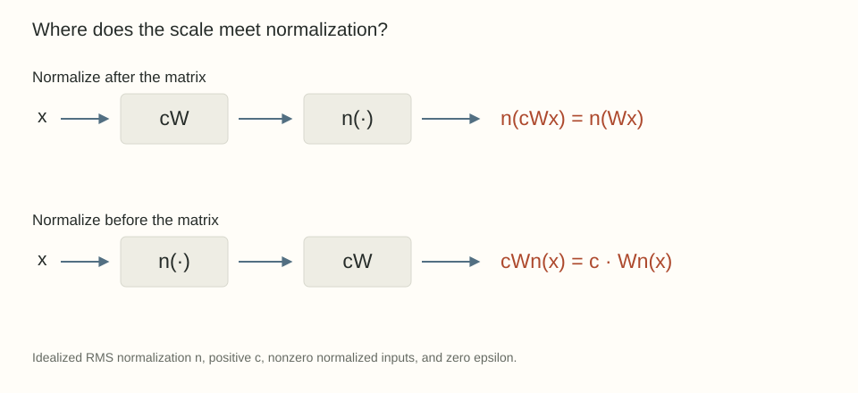

The previous post started from a strong assumption: multiply one weight vector by any positive constant and the loss stays exactly the same. Under that assumption, a raw SGD step depends on the radius through $\eta/\|w\|_2^2$.

Now consider a common-looking block:

$$
x\longmapsto W\,\operatorname{RMSNorm}(x).
$$

There is normalization right beside the matrix. Does that make $W$ scale invariant?

No. Rescaling $W$ rescales the output of this block. The normalization acts on what enters the matrix, not what leaves it. A later operation could compensate, but we would need to identify it and check the whole expression.

The placement of normalization matters as much as its name.

## First ask what is being rescaled

For a vector $h\in\mathbb R^d$, define its root mean square by

$$
s(h)=\sqrt{\frac1d\sum_{j=1}^d h_j^2}.
$$

Ignore the stabilizing epsilon for a moment, assume $h\ne0$, and use the gain-free normalization $n(h)=h/s(h)$. For $c>0$,

$$
n(ch)=\frac{ch}{c\,s(h)}=n(h).
$$

Now compare the two compositions:

$$
n(Wx)
\qquad\text{and}\qquad
Wn(x).
$$

In the first, replacing $W$ by $cW$ disappears inside the normalization, provided $Wx\ne0$ on the inputs under discussion. In the second, it multiplies the output by $c$.

If the rest of the computation uses $W$ only through $n(Wx)$, the first expression gives blockwise scale invariance. If $W$ has another consumer, that consumer must be checked too. This is a statement about the computation graph, not just a property of a normalization formula.

{fig-alt="Normalization after a matrix cancels a common positive matrix scale in the idealized formula. Normalization before a matrix leaves its output scale visible."}

The [RMSNorm paper by Zhang and Sennrich](https://arxiv.org/abs/1910.07467v1) studies normalization by root mean square. The cancellation above follows directly from its idealized denominator. It should not be read as permission to rescale arbitrary matrices in a model that uses RMSNorm.

## LayerNorm cancels a particular common scale too

Write the mean and variance across channels as

$$
\mu(h)=\frac1d\sum_j h_j,
\qquad
v(h)=\frac1d\sum_j(h_j-\mu(h))^2.
$$

The gain-free, zero-epsilon LayerNorm expression is

$$
\ell(h)=\frac{h-\mu(h)\mathbf1}{\sqrt{v(h)}}.
$$

For $c>0$ and any scalar $b$, provided $v(h)>0$,

$$
\ell(ch+b\mathbf1)=\ell(h).
$$

The common shift cancels in the numerator. The common positive scale cancels between numerator and denominator. This does not say that separately rescaling each channel leaves the result unchanged. Such a transformation usually changes both the centered direction and the relative channel magnitudes.

[Ba, Kiros, and Hinton's Layer Normalization paper](https://arxiv.org/abs/1607.06450v1) defines these per-example statistics and examines the associated invariances in Section 5. The axis used to compute the statistics determines what a common rescaling means. BatchNorm uses different statistics, and frozen inference statistics require their own check.

## Epsilon makes the ideal identity approximate

With a fixed $\epsilon>0$, the RMS expression becomes

$$
n_\epsilon(h)=\frac{h}{\sqrt{s(h)^2+\epsilon}}.
$$

For positive $c$,

$$
n_\epsilon(ch)
=\frac{h}{\sqrt{s(h)^2+\epsilon/c^2}}.
$$

This is generally different from $n_\epsilon(h)$. The approximation is useful when epsilon is negligible relative to the squared activation scale, but the exact symmetry is gone. LayerNorm has the corresponding change from $\epsilon$ to $\epsilon/c^2$ after factoring out a common positive scale.

For example, take $h=(1,2)$, so $s(h)^2=5/2$. The denominators for $n_1(h)$ and $n_1(2h)$, expressed using the same numerator $h$, are $\sqrt{7/2}$ and $\sqrt{11/4}$. They are visibly unequal. The deliberately large epsilon makes the difference easy to see.

An exact theorem needs the exact identity it assumes. A practical approximation needs a scale regime in which the discrepancy is small.

## A learned gain creates a different symmetry

Suppose $z(x)$ already denotes normalized features and the next operation is

$$
f(x)=W\operatorname{diag}(\gamma)z(x).
$$

The effective linear map is $A=W\operatorname{diag}(\gamma)$. Replacing only $W$ by $cW$ changes $A$. Replacing both parameters according to

$$
W\mapsto cW,
\qquad
\gamma\mapsto\gamma/c
$$

preserves $A$ exactly. This cancellation does not depend on neglecting epsilon because the already-computed features $z(x)$ are unchanged.

There is redundancy in the pair $(W,\gamma)$, but that is not independent scale invariance of $W$. The elementary loss

$$
L(w,g)=\frac12(wg-1)^2
$$

makes the distinction concrete. At $(w,g)=(1,1)$ the loss is zero. At $(2,1)$ it is $1/2$. At $(2,1/2)$ it is zero again. The joint transformation preserves the function. Changing one coordinate alone does not.

If a normalized output also includes a learned additive offset, rescaling the entire downstream matrix requires compensating that offset as well. The displayed identity assumes the bias-free form written above.

## Sharing a gain couples its consumers

Let two branches consume the same gained features:

$$
f_1(x)=W_1\operatorname{diag}(\gamma)z(x),
\qquad
f_2(x)=W_2\operatorname{diag}(\gamma)z(x).
$$

One gain can compensate a common rescaling of both matrices. If we rescale only $W_1$ and divide the gain to compensate, we also change the second branch. The bookkeeping is no longer local to one matrix.

The scalar version is enough to expose the issue. Take a nonzero scalar feature $z$ and require branch outputs $z$ and $2z$:

$$
g w_1=1,\qquad g w_2=2.
$$

A shared gain allows many representations, for example $(g,w_1,w_2)=(1,1,2)$ and $(2,1/2,1)$. But requiring both $|w_1|=1$ and $|w_2|=1$ makes those two target equations incompatible. Their magnitude ratio must remain two, while the constraints force it to one.

That is a claim about prescribed branch outputs with fixed features and one shared scalar gain. It does not prove that a complete trainable attention network loses an entire class of functions. Other factorizations, later layers, or changing features may compensate. The later research posts will ask which of these freedoms matter.

The useful lesson already holds: the existence of one function-preserving rescaling does not prove that every proposed collection of norm constraints is harmless.

## Residual paths keep relative scales visible

For a residual expression

$$
y=x+Wn(x),
$$

scaling $W$ changes the branch relative to the skip path. Even a normalization after the addition does not generally erase that change: the sum's direction can change rather than only its magnitude.

For a direct example, take $x=(1,0)$ and a branch output $(0,1)$. The sums $(1,1)$ and $(1,2)$ are not positive scalar multiples of one another. RMS normalization preserves their different directions.

This is why a blanket statement about all matrices in a normalized architecture is too coarse. We need to trace where the scale travels and which quantities meet at each addition, product, or shared parameter.

## Three questions before imposing a constraint

When I see a claim that a weight norm can be fixed without changing the model, I now want three things specified:

1. Which parameters move, and which remain fixed?
2. Which output or final function is preserved, under what exact assumptions?
3. Can all the proposed constraints be satisfied simultaneously by a representative of that function?

The first post explains why a redundant radius can still affect learning. This post identifies where that redundancy actually lives. The next step is to put decay back into the dynamics and distinguish its direct penalty from the training path it induces.

## Try the symmetries

1. For $h=(1,2)$, compare zero-epsilon LayerNorm before and after multiplying only the first channel by three.
2. In the two-branch scalar example, replace the shared gain by independent gains $g_1,g_2$. Can both weights now have magnitude one?
3. For nonzero channel gains, find a channelwise transformation of $\gamma_j$ and every consuming column $W_i[:,j]$ that preserves all effective maps.

Answer sketches

1. The normalized first vector is $(-1,1)$. The transformed vector is $(3,2)$, whose normalized form is $(1,-1)$. Both variances are nonzero, but the direction has changed.
2. Yes. Take $w_1=w_2=1$, $g_1=1$, and $g_2=2$. The missing relative scale is now a learnable parameter.
3. For any $d_j>0$, set $\gamma_j'=d_j\gamma_j$ and $W_i'[:,j]=W_i[:,j]/d_j$ for every consumer $i$. A shared gain requires the compensation at every consuming branch.

## Yo twin, go read... {#sources-and-scope}

[Layer Normalization (Ba, Kiros, and Hinton, 2016)](https://arxiv.org/abs/1607.06450v1), especially Section 5, and [Root Mean Square Layer Normalization (Zhang and Sennrich, 2019)](https://arxiv.org/abs/1910.07467v1), especially Sections 3 and 4, provide the normalization definitions and invariance context.

[L2 Regularization versus Batch and Weight Normalization (van Laarhoven, 2017)](https://arxiv.org/abs/1706.05350v1) explains why the scope of scale invariance matters for optimization. The placement comparisons, epsilon calculation, and scalar shared-gain example above follow directly from their displayed definitions. They do not establish an empirical optimizer ranking or a full-network expressivity result.
