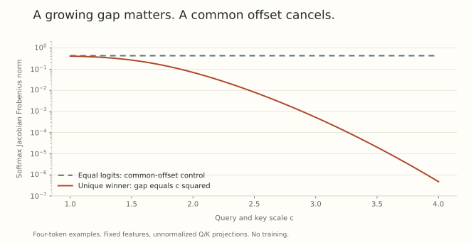

Choosing a matrix geometry is also choosing which scales remain free. Query and key scales can change a competitive routing distribution. Hidden MLP scales enter an elementwise activation and an output projection. Those roles give us a reason to investigate different constraints, without supplying a universal assignment rule.

We will separate three questions: what a feasible set permits, what a particular update actually does, and what measurements would explain its training outcome.

## Orthogonal columns can still have free lengths

For a tall matrix $W\in\mathbb R^{m\times n}$, $m\geq n$, consider

$$
\mathrm{St}(m,n)=\{W:W^\top W=I_n\},
$$

and the diagonal-Gram set

$$
\mathrm{DG}(m,n)=\{W:\operatorname{Off}(W^\top W)=0\}.
$$

Here $\operatorname{Off}$ keeps the off-diagonal entries. Stiefel fixes all $n$ singular values at one. Diagonal Gram, or DGram, requires mutually orthogonal columns while allowing their lengths to vary.

Indeed, if $W=[w_1,\ldots,w_n]$ is in DGram,

$$
W^\top W=\operatorname{Diag}(\|w_1\|_2^2,\ldots,\|w_n\|_2^2).
$$

Its singular values are the column lengths, as a multiset. Thus $\|W\|_{\rm op}=\max_j\|w_j\|_2$. If all lengths are positive, write $W=QD$ with $Q^\top Q=I$ and positive diagonal $D$. Zero columns are feasible in the stated set, but require care when discussing a smooth manifold or using $D^{-1}$.

This is different from unit-column normalization, which fixes lengths while permitting correlations. DGram *permits* unbounded operator norm. It does not require the norm to grow along any particular training trajectory.

## Query and key scales multiply

Use a bias-free, unnormalized attention head with token-row matrix $H\in\mathbb R^{T\times D}$ and effective projections $W_Q,W_K\in\mathbb R^{D\times d}$. Its logits are

$$
Z=\frac{HW_QW_K^\top H^\top}{\sqrt d}.
$$

Submultiplicativity gives

$$
\|Z\|_{\rm op}\leq
\frac{\|H\|_{\rm op}^2\|W_Q\|_{\rm op}\|W_K\|_{\rm op}}{\sqrt d}.
$$

Scaling both projections by $c$ scales actual logits by $c^2$ at fixed $H$. Scaling one by $c$ and the other by $c^{-1}$ leaves them unchanged. If the growing directions do not overlap with the features, even the first amplification can disappear.

This formula is not the forward map of a head that separately normalizes queries and keys. Positive projection scales cancel in an ideal unit normalization, while learned temperatures introduce other scales. Use the actual map, including epsilon and gains, before importing the argument. [Part 18](../scale-geometry-18/index.html) treats the normalized projection itself.

## Gaps, rather than common offsets, sharpen softmax

For one finite logit row $z$, let $p=\operatorname{softmax}(z)$. Adding a common scalar to all logits changes nothing. Suppose there is a unique largest entry $z_1$ and gap

$$
\Delta=z_1-\max_{j\ne1}z_j.
$$

Dividing numerator and denominator by $e^{z_1}$ gives

$$
1-p_1\leq(T-1)e^{-\Delta}.
$$

The softmax Jacobian is

$$
J_{\rm sm}=\operatorname{Diag}(p)-pp^\top.
$$

It is positive semidefinite. Write $e=1-p_1$. Since

$$
\operatorname{tr}J_{\rm sm}=1-\sum_i p_i^2
\leq1-p_1^2\leq2e,
$$

and a positive semidefinite matrix has Frobenius norm at most its trace,

$$
\|J_{\rm sm}\|_F\leq2(T-1)e^{-\Delta}.
$$

At fixed support size, a diverging unique-winner gap makes every Jacobian singular value small. Large logit magnitude alone does not. The row $(a,a,a,a)$ remains uniform for arbitrarily large $a$.

For an explicit DGram example, take $D=d=1$, four token features $(1,0,0,0)^\top$, and $W_Q=W_K=c$. The first row is $(c^2,0,0,0)$. Its gap grows and its Jacobian shrinks. By contrast, four identical token features give a common-offset row and uniform probabilities at every $c$.

{fig-alt="Exact four-token examples with query and key scale c from one to four. The unique-winner row has a rapidly decreasing softmax Jacobian norm, while a row of equal logits has constant norm square root three divided by four."}

This is a constructed possibility within the feasible set, not a prediction of optimizer behavior. A causal mask requires applying the argument only to allowed keys. A row with one allowed key has zero Jacobian regardless of the weight geometry.

## What a bounded projection can guarantee

Suppose each token satisfies $\|h_i\|_2\leq R$ and both projections are contractions. Then every allowed logit has magnitude at most $M=R^2/\sqrt d$.

For a support of size $s\geq2$, every probability is at least

$$
a=e^{-2M}/s.
$$

It is also at most $1-a$, because there is another allowed competitor with probability at least $a$. Therefore every diagonal Jacobian entry obeys $p_i(1-p_i)\geq a(1-a)$, giving

$$
\|J_{\rm sm}\|_F\geq\sqrt s\,a(1-a)>0.
$$

This lower bound depends on the feature radius and support. It can be numerically tiny. Every softmax Jacobian still annihilates the constant vector, so a positive Frobenius norm does not ensure response to every upstream derivative. Useful end-to-end gradients additionally involve values, residual paths, and the loss.

Exact Stiefel projections remove one unbounded weight-scale pathway. They do not establish a universal training-stability theorem.

## The MLP has a different nonlinearity

For a bias-free MLP $f(x)=W_o\phi(W_ix)$,

$$
Df(x)=W_o\operatorname{Diag}(\phi'(W_ix))W_i.
$$

For exact GELU, $\phi(t)=t\Phi(t)$ and

$$
\phi'(t)=\Phi(t)+t\varphi(t),
$$

where $\Phi$ and $\varphi$ are the standard Gaussian distribution function and density. Its derivative approaches one on the positive tail and zero on the negative tail. There is no probability-sum constraint forcing all coordinates into a shared winner competition.

This supports a structural distinction from attention. It does not bound the product of MLP weight norms. DGram can still amplify MLP outputs and derivatives. In a pre-normalized residual block $x+\operatorname{MLP}(\operatorname{LN}(x))$, normalizing the branch input does not erase arbitrary growth of the branch relative to the skip connection.

## A published assignment comparison, with its scope

[Different Layers, Different Manifolds](https://arxiv.org/abs/2606.13276v1), Table 1, reports these outcomes for GPT-2 small on OpenWebText:

| Attention | MLP | Reported validation outcome |
| --- | --- | --- |
| Unconstrained | Unconstrained | 3.3855 |
| Stiefel | Stiefel | 3.3679 |
| Stiefel | DGram | 3.3544 |
| DGram | DGram | Unstable |
| DGram | Stiefel | Unstable |

These are shared-setting point estimates, with no seed distribution in the table. The unconstrained and manifold-managed weights also use different decay rules. The table motivates a module-specific hypothesis rather than establishing the best separately tuned geometry.

There are implementation details to resolve before attributing the result solely to feasible sets.

**Packing changes the constraint.** For a stacked projection $B=[B_Q^\top\ B_K^\top\ B_V^\top]^\top$, exact Stiefel gives $B_Q^\top B_Q+B_K^\top B_K+B_V^\top B_V=I$. Each component is a contraction, but individual heads need not be isometries. Packed DGram need not diagonalize each head's own Gram. Wide stored matrices require stating which transpose is constrained.

**Feasible restoration need not be a retraction.** The paper's Appendix A uses $R_{\rm DG}(Y)=(UV^\top)\Sigma$ for a descending-order SVD $Y=U\Sigma V^\top$. Its output has diagonal Gram. But at the already feasible point $W=\operatorname{Diag}(1,2)$, the polar factor is $I$ and sorted singular values are $(2,1)$, so $R_{\rm DG}(W)=\operatorname{Diag}(2,1)\ne W$. A manifold retraction must fix its base point at zero step. This formula can reassign column scales without a proposed displacement.

**Actual update norms matter.** If every trial direction has norm at most one and DGram restoration preserves singular values, triangle inequality gives

$$
\|W_N\|_{\rm op}\leq\|W_0\|_{\rm op}+\sum_{t<N}\eta_t.
$$

The stated 50,000-step schedule with peak rate 0.02 permits growth of at most 1000 under those exact premises. Figure 2 displays attention-group norms in the hundreds of thousands. This discrepancy calls for checking actual numerical direction norms, run settings, and logs. It does not identify which premise failed. Finite polar approximations are one reason to audit the unit-budget premise explicitly.

The [pinned accompanying implementation](https://github.com/kiratoyoshihara/module-wise-manifold-muon/blob/f283b76e680243a7e894e33123ba27b26d8fd834/manifold_muon.py#L33-L47) matches the stated DGram restoration. Its exact relationship to the plotted runs is not established by the snapshot alone.

## What would test the proposed explanation?

At the same checkpoints and on the same examples, measure effective per-head query and key norms, realized row gaps, entropy, Jacobian response, and loss. A maximum over the entire attention parameter group can be driven by values or output projections, so it does not locate the proposed query-key mechanism.

Then intervene on the suspected pathway. Compare controlled query-key scales or temperatures, a zero-step-preserving restoration, and a verified spectral cap. Keep the assignment experiment distinct from these interventions because each changes the algorithm. Report tangent residuals, restoration displacement, learning-rate and decay searches, repeated seeds, and compute.

If scale control improves loss while preventing the predicted gap and derivative changes, that supports the mechanism. If the weight statistic changes but gaps do not, the proposed mediator has not moved. If another restoration changes the outcome, constraint geometry alone is an incomplete explanation.

## Try separating permission from consequence

1. Does $\operatorname{Diag}(2,3)$ belong to DGram? What is its spectral norm?
2. What happens to softmax after adding 1000 to every logit?
3. With four allowed keys and gap ten, give the upper bound above for the Jacobian Frobenius norm.
4. Why does an already feasible matrix provide a useful restoration test?

Answer sketches

1. Yes. Its Gram is diagonal, and its spectral norm is three.
2. Nothing changes. Common offsets cancel.
3. $6e^{-10}\approx0.000272400$.
4. Zero proposed displacement should return the same point for a retraction. A changed matrix exposes behavior beyond simply enforcing feasibility.

## Yo twin, go read... {#sources-and-scope}

[Different Layers, Different Manifolds: Module-Wise Weight-Space Geometry in Transformer Optimization](https://arxiv.org/abs/2606.13276v1), Sections 2 to 5 and Appendix A, supplies the assignment experiment and the proposed attention mechanism. The Gram, gap, and restoration calculations above make their assumptions explicit. The tighter trace-based Jacobian upper bound follows directly from positive semidefiniteness. No training result has been reproduced for this post.

Read [Part 19](../scale-geometry-19/index.html) for an exact Stiefel tangent oracle and [Part 15](../scale-geometry-15/index.html) for why a bounded proposal does not by itself prevent accumulated weight growth. Different feasible sets, numerical solvers, and finite restoration rules are separate parts of the algorithm.
