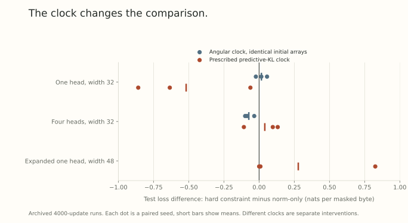

A mathematical construction can show that a normalized feature may rotate substantially under a small matrix step. A training experiment asks which directions the optimizer actually chooses, which functions it reaches, and whether those choices improve the task loss.

Our archived experiments offer a useful case study in moving between those questions. An early comparison suggested that a hard query-key constraint hurt a single-head model but helped a four-head model. Later controls changed that interpretation. The measurements remain useful precisely because the first explanation did not survive intact.

This post reports the existing November 4 experiment records. It adds algebra and aggregation checks, not a new training run.

## First declare the experimental world

The core comparison used two complete Transformer blocks, width 32, and either one or four heads. The task predicted independently masked WikiText-2 bytes in 64-byte bidirectional contexts, with minibatches of 16 sequences. Features, values, output paths, learned temperatures, embeddings, and readout remained trainable.

The two treatments differed in their query-key matrix geometry. One restored the packed matrices to a fixed Frobenius radius, allowing their shape to vary. The other restored them to a Stiefel constraint. The matrix proposals used a custom angular Adam-based rule with its recorded moment and normalization conventions. This was not a reproduction of Modula, ordinary Euclidean Adam, or the exact spectral oracle in Part 19.

Later comparisons added an expanded one-head parametrization with shared width 48. The primary paired seeds were 0, 1, and 2, with 4000 updates as one endpoint. An additional endpoint used 60 seconds of process CPU time spent on training and functional calibration. That clock excluded evaluation and checkpoint serialization. It was neither total wall time nor a GPU throughput measurement.

These details define what the evidence can address. A masked-byte network at fixed width does not directly test learning-rate transfer across model widths or large causal language-model pretraining.

## A tiny initialization operation was not innocuous

The archived hard-constraint branch applied an additional polar restoration to an already orthogonal saved initialization. The norm-only branch did not. This changed entries by at most about $3\times10^{-8}$, while initial probe logits differed by less than $2.1\times10^{-7}$.

Faithful replays recovered the archived terminal losses. Replays that instead started the two methods from exactly identical arrays produced a different comparison:

| Angular-clock comparison | One head | Four heads |
| --- | --- | --- |
| Archived mean hard minus norm-only test loss | +0.035325 | -0.092984 |
| Identical-array replay mean | +0.016543 | -0.072930 |

Units are nats per masked byte. Positive means the hard constraint has higher loss. Every mean uses three paired seeds.

For the identical-array one-head replay, the individual differences were $-0.022846$, $+0.056520$, and $+0.015955$. The original single-head penalty became a mixed sign pattern. The four-head replay retained negative differences in all three seeds.

The representational class did not change when we removed a rounding-sized initialization operation. Its effect on a long trajectory therefore cannot, by itself, be evidence of a capacity difference. It also does not identify which later optimizer component amplified the perturbation.

## Match predictive motion, rather than matrix angle

Equal matrix angles need not mean equal function changes. Parts 9 and 18 explain two reasons: numerical schedules can change the actual angular step, and a normalized head's sensitivity depends on its feature margin.

The next intervention matched *complete-network forward predictive KL*:

$$
K(\theta,\theta^+)
=\mathbb E_x D_{\rm KL}\bigl(p_\theta(\cdot\mid x)\|p_{\theta^+}(\cdot\mid x)\bigr).
$$

Each setting received a target sequence frozen from a separate development seed before the main paired runs. At each update, a scalar controller rescaled the entire proposed parameter path. Calibration used eight fresh unlabeled training contexts, independently of the gradient minibatch. Optimizer moments advanced once per minibatch, rather than during controller trials.

At 4000 updates, the recorded test differences were:

| Setting | Mean hard minus norm-only loss | Individual paired differences |
| --- | --- | --- |
| One head, width 32 | -0.518126 | -0.634254, -0.061582, -0.858540 |
| Four heads, width 32 | +0.040624 | -0.107966, +0.097471, +0.132368 |
| Expanded one head, width 48 | +0.278463 | +0.000372, +0.009585, +0.825431 |

The simple head-dependent ordering did not persist. The expanded mean is dominated by one seed. These are heterogeneous paired observations, not a clean winner ranking.

{fig-alt="Each dot is one paired seed's hard-minus-norm-only test loss at 4000 updates. Identical-array angular replays and predictive-KL-controlled runs have different signs and dispersions. A zero line separates which geometry has lower loss."}

The controller also created new limitations. Some accepted path multipliers exceeded 100, making these steps large extrapolations of the native proposal. Although calibration error was below 0.5 percent, independent contexts did not match the target equally well. One expanded checkpoint had a mean validation KL ratio of about 2.09 for the norm-only method.

Thus the intervention tests a specified predictive clock with an empirical controller. It does not perfectly remove functional speed while leaving all other aspects of training unchanged.

## Why matching can remove a real source of benefit

Locally, for direction $d$ and predictive Fisher matrix $F$,

$$
K(\theta,\theta+\eta d)
=\tfrac12\eta^2d^\top Fd+O(\eta^3).
$$

For positive target $k$ and $d^\top Fd>0$, the quadratic matching rule is

$$
\eta(d)=\sqrt{\frac{2k}{d^\top Fd}}.
$$

If the total direction is multiplied by $a>0$, then $\eta(ad)ad=\eta(d)d$. To leading order, this control removes any benefit that operates only through a positive global rescaling of that direction.

It does not remove arbitrary reallocations across layers or heads. Nor does it imply that functional matching is a bad experiment. It tells us which question it asks: does the proposal help beyond an online scalar predictive-step controller? Ordinary training with a practical schedule asks another question. Both comparisons can be informative.

## Separate a smaller class from a particular optimizer

At a common row-isometric checkpoint, the Stiefel tangent lies inside the fixed-radius sphere tangent. After applying the complete-network Jacobian $J$,

$$
\operatorname{range}(JT_{\rm hard})
\subseteq\operatorname{range}(JT_{\rm sphere}).
$$

In predictive-Fisher-whitened coordinates, let these accessible linear subspaces be $\mathcal R$, and let $r$ be the task's linear descent covector represented in those coordinates. At radius $\rho$, the best possible linearized decrease in a subspace is

$$
\max_{u\in\mathcal R,\ \|u\|_2\leq\rho}\langle r,u\rangle
=\rho\|P_{\mathcal R}r\|_2.
$$

Inclusion means the hard model cannot have a better ideal local oracle at the same radius. A particular hard optimizer can still beat a particular sphere optimizer through direction selection, noise, conditioning, or implicit regularization. Neither method necessarily implements this ideal output-space oracle.

The expanded parametrization added a separate control for generic representability under ideal normalization. Its conversion checks preserve complete-network probe logits approximately at finite epsilon and precision. That control weakens global class exclusion as a sufficient explanation there. It does not equate local conditioning, optimizer access, singular boundary cases, or implicit bias.

## An exact identity is not a successful forecast

Let old logits be $z$, a finite logit change be $\Delta z$, old probabilities be $p=\operatorname{softmax}(z)$, and label distribution be $q$. Expanding log-sum-exp gives the exact identity

$$
\operatorname{CE}(q,z+\Delta z)-\operatorname{CE}(q,z)
=D_{\rm KL}(p\|p^+)-(q-p)^\top\Delta z.
$$

At equal KL on the scoring examples, immediate loss ordering is determined by signed task alignment. But substituting the observed finite change after updating is an *accounting check*.

To forecast before updating, use the full-network velocity $v=J\Delta\theta$ and the quadratic approximation

$$
\widehat{\Delta L}
=\tfrac12\mathbb E[v^\top C_pv]
-\mathbb E[(q-p)^\top v],
\qquad C_p=\operatorname{Diag}(p)-pp^\top.
$$

Estimate this on one set of contexts and score actual finite changes on another. Comparing prediction with observation then tests transfer across samples as well as linearization.

## The conservative prediction test exposed that distinction

A follow-up used 64 calibration contexts and chose a target no larger than either raw proposal's KL. Accepted path multipliers stayed at most one. A diagnostic split drew 1024 nonoverlapping validation contexts from across the stream, assigning 512 to prediction and 512 to scoring.

At step 4000, each setting used three checkpoints, one per seed, with eight fresh gradient minibatches per checkpoint:

| Setting | Correct independent update signs | Correct same-example Taylor signs | Correct checkpoint-mean signs |
| --- | --- | --- | --- |
| One head | 20/24 | 24/24 | 2/3 |
| Four heads | 12/24 | 23/24 | 1/3 |
| Expanded one head | 18/24 | 22/24 | 3/3 |

The four-head prediction failed at two of three checkpoint means, despite a mean absolute paired scoring-KL mismatch of about 0.51 percent. Opposite errors partly cancelled in the pooled mean. The 24 updates are not 24 independent trained networks.

Accurate same-example Taylor scores show that local calculus can describe a small step. They do not establish reliable prediction across contexts. Nor does an accurate one-step forecast establish the ordering of losses thousands of steps later.

## A broader benchmark is still an open experiment

The later scale audit qualified the negative result. This small, short-horizon, CPU harness with online calibration does not settle whether modular geometry helps ordinary training or width transfer. A changed task, scale, or horizon could matter, but none has been identified as the cause of the observed failures.

A frozen-checkpoint diagnostic also rejected the simplest claim that the small task did not use attention routing. Across five saved checkpoints, mean validation loss was 2.22732 with learned routing, 3.65161 after making block 0's routing uniform, and 2.30671 after doing so in block 1. Values and output paths remained. This intervention measures reliance at those checkpoints. It does not tell us how a retrained uniform-routing model would perform.

The next useful benchmark should first recover a relevant known behavior, then compare native schedules and matched functional steps as separate treatments. Tune rates and decay at the intended training horizon with comparable search budgets. Vary width and depth separately, report paired seeds and learning curves, and measure actual end-to-end compute on the chosen hardware.

More scale can test external validity. It cannot repair an unsupported mathematical implication or turn an unsuccessful prediction into a demonstrated mechanism. Our current record supports a narrower conclusion: the tested explanations and allocations have not established an advantage beyond their stated controls in this regime. The broader training question remains open.

## Try identifying the claim being tested

1. Does a lower terminal loss from one custom constrained optimizer prove greater representational capacity?
2. Which part of the direction does quadratic KL matching cancel under positive rescaling?
3. What is missing if we verify the exact cross-entropy identity only after the update?
4. Why should the three checkpoints remain visible when a table reports 24 minibatch probes?

Answer sketches

1. No. Finite-time optimization and statistical effects can differ even within the same generic class.
2. An overall positive scalar on the complete direction. Relative layer or head allocations generally remain.
3. An independent before-update prediction, followed by evaluation on disjoint scoring examples.
4. The probes share trained states. Counting them as independent networks would overstate the replication.

## Yo twin, go read... {#sources-and-scope}

The empirical values come from our archived November 4 functional-step study and later scale audit. This article recomputes their aggregates and checks the displayed algebra. It does not rerun training, tune a new method, or claim a large-model result. The initialization replays, primary KL-controlled trajectories, and later diagnostic probes are separate experiments.

Read [Part 12](../scale-geometry-12/index.html) for the difference between a frozen-feature obstruction and a research claim, [Part 17](../scale-geometry-17/index.html) for a transfer protocol, and [Part 18](../scale-geometry-18/index.html) for the pointwise normalized-head bound.

[Scalable Optimization in the Modular Norm](https://arxiv.org/abs/2405.14813v1), Section 4, asks a broader scaling question than our fixed-width custom angular comparison. Its experiments provide a reference behavior to reproduce in a suitable benchmark, rather than an outcome established or refuted by these local controls.
