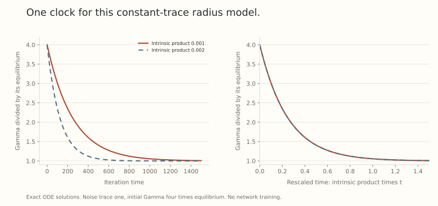

A redundant weight radius can still influence the trajectory. Part 3 made this visible in one exact SGD step: shrinking the radius increases the effective directional rate. Noise adds a second effect. Tangent kicks increase the squared radius, while decay contracts it.

That competition motivates the *intrinsic learning rate*, the product $\delta=\eta\lambda$ in a particular normalized-SGD model. The product is useful, but the model also contains a covariance field, an initial radius, and a choice of time convention. We will keep those ingredients visible.

## Require the symmetry for every sampled loss

Let $w=ru$, with $r>0$ and $\|u\|_2=1$. Suppose each differentiable sampled loss is invariant under $w\mapsto cw$ for $c>0$. Write its unit-radius gradient as

$$
\widehat g(u)=g(u)+\xi(u),
\qquad \mathbb E[\xi(u)\mid u]=0,
\qquad C(u)=\mathbb E[\xi(u)\xi(u)^\top\mid u].
$$

Differentiating the symmetry gives $u^\top\widehat g(u)=0$ and $\widehat g(ru)=r^{-1}\widehat g(u)$. Consequently the mean gradient and noise are tangent, and $C(u)u=0$.

Invariance of the population average alone would not establish tangency of every sampled gradient. Batch construction and normalization statistics belong in that assumption.

For constant $\eta>0$, $\lambda\geq0$, and $a=1-\eta\lambda>0$, the exact update is

$$
w^+=ar u-\frac\eta r\widehat g(u).
$$

Orthogonality gives

$$
(r^+)^2=a^2r^2+\frac{\eta^2}{r^2}\|\widehat g(u)\|_2^2.
$$

Thus the conditional expected kick contains both $\|g(u)\|^2$ and $\operatorname{tr}C(u)$. This is a finite-step identity, with no diffusion approximation yet.

## Declare the continuous stochastic model

Use iteration time, so one unit represents one update, and model the noise by an Itô stochastic differential equation:

$$
dw=-\delta w\,dt-\eta\nabla L(w)\,dt
+\eta S(w)\,dB_t,
\qquad S(w)S(w)^\top=C(w).
$$

Brownian increments satisfy $\mathbb E[dB_t\,dB_t^\top]=I\,dt$. Choose the tangent noise factor with $S(ru)=r^{-1}S(u)$. The sign of the Brownian term is a convention that does not change its law.

This is a model of discrete SGD, rather than an exact representation of its finite steps. Within this model, however, Itô calculus gives exact identities. Define $G=r^2$ and $T(u)=\operatorname{tr}C(u)$. Then

$$
dG=\left(-2\delta G+\frac{\eta^2}{G}T(u)\right)dt.
$$

The stochastic linear term vanishes because the noise is tangent. Its quadratic variation still contributes the positive trace term. Ordinary deterministic differentiation would miss it.

For the direction,

$$
du=-\frac\eta G g(u)\,dt
+\frac\eta G S(u)\,dB_t
-\frac{\eta^2T(u)}{2G^2}u\,dt.
$$

The last, normal drift is necessary. Its contribution to $d\|u\|^2$ cancels the noise's quadratic variation, preserving unit norm. It is not an additional arbitrary weight penalty.

These are the direction-and-radius equations in [The Intrinsic Learning Rate](https://arxiv.org/abs/2010.02916v1), Theorem 5.1, with an explicit iteration-time convention.

## Remove the arbitrary scale of the raw rate

Let

$$
\Gamma=\frac{r^4}{\eta^2}=\left(\frac G\eta\right)^2,
\qquad q=\Gamma^{-1/2}=\frac\eta{r^2}.
$$

Since $G$ has finite variation in this tangent-noise model,

$$
\frac{d\Gamma}{dt}=-4\delta\Gamma+2T(u).
$$

The directional equation becomes

$$
du=-qg(u)\,dt+qS(u)\,dB_t
-\frac{T(u)}{2\Gamma}u\,dt.
$$

The raw $\eta$ has disappeared from these two equations. Their remaining inputs include $\delta$, $g$, $C$, and $(u_0,\Gamma_0)$. If the raw rate changes, matching $\Gamma_0$ requires changing the initial radius proportionally to $\sqrt\eta$.

Thus equal products $\eta\lambda$ do not give an unconditional equivalence when we keep every initial weight array fixed. Nor do they equate models with different noise covariances, minibatch sizes, or scale-sensitive paths.

## Solve the radius equation before claiming equilibrium

For general $T(u_t)$,

$$
\Gamma_t=e^{-4\delta t}\Gamma_0
+2\int_0^t e^{-4\delta(t-s)}T(u_s)\,ds.
$$

It is an exponentially weighted history of the noise trace. If $T(u_t)=T_0>0$ is constant and $\delta>0$, then

$$
\Gamma_t=\Gamma_*+(\Gamma_0-\Gamma_*)e^{-4\delta t},
\qquad\Gamma_*=\frac{T_0}{2\delta},
\qquad q_*=\sqrt{\frac{2\delta}{T_0}}.
$$

The equilibrium formula concerns $q=\eta/r^2$, so taking the reciprocal correctly matters. Larger $\Gamma$ means a smaller directional coefficient.

For $T_0=1$ and $\delta=0.001$, we get $\Gamma_*=500$, $q_*\approx0.0447214$, and a half-life of $\log2/(4\delta)\approx173.287$ iteration-time units. This is the half-life of $\Gamma_t-\Gamma_*$, not necessarily of the radius or of a loss statistic.

{fig-alt="Exact constant-trace radius ODE solutions with intrinsic products 0.001 and 0.002, each starting at four times its equilibrium Gamma. Curves have different iteration-time relaxation and coincide after rescaling time by the intrinsic product."}

There is a legitimate constant-trace example. Take sampled losses $\ell_\xi(w)=\xi^\top w/\|w\|$, with centered isotropic $\xi$ of covariance $\sigma^2I$ in dimension $d$. Their mean loss is zero, while $C(u)=\sigma^2(I-uu^\top)$ and $T_0=(d-1)\sigma^2$. The figure evaluates the resulting radius equation, rather than simulating a trained network.

## Noise strength and noise shape play different roles

At the constant-trace balance, the trace of directional quadratic variation per unit time is

$$
q_*^2T_0=2\delta.
$$

This scalar does not specify which directions receive noise. Two tangent covariance matrices can have the same trace and different eigenvectors or rank. Their normalized trajectories can behave differently even when their radius equations agree.

For independent averaging over $B$ samples at a fixed state, covariance scales as $C_B=C_1/B$. In that idealization $q_*\propto\sqrt B$ at fixed $\delta$, while $q_*^2T_B$ remains $2\delta$. The mean-gradient drift coefficient changes along with the covariance. This is not a general batch-size transfer rule. Correlations, sampling, and parameter motion can alter its premises.

## The discrete process retains terms the SDE drops

Set $Z=\|\widehat g(u)\|^2$. Squaring the exact finite-step radius identity gives

$$
\Gamma^+=a^4\Gamma+2a^2Z+\frac{Z^2}{\Gamma}.
$$

Its conditional expectation depends on $\mathbb E Z$ and $\mathbb E Z^2$, including the mean gradient and a fourth-moment term. It is not the linear ODE above. The ODE is useful in a justified diffusion regime, but a finite step, heavy tails, or changing covariance can make its omitted terms consequential.

The deterministic boundary is especially revealing. If $C=0$, the SDE radius simply contracts exponentially. Discrete gradient descent still has the $\eta^2\|g(u)\|^2/r^2$ radius kick. That finite-step effect will be central to the sharpness-bias calculation in [Part 23](../scale-geometry-23/index.html).

If $\delta=0$ and $T_0>0$, the modeled $\Gamma$ grows linearly instead of approaching a finite equilibrium. If the trace itself changes across the visited region, the exponential filter remains valid, while the constant-trace equilibrium does not describe the whole trajectory.

## Radius relaxation is not function-space mixing

The Intrinsic Learning Rate separately proposes a Fast Equilibrium Conjecture about function-space distributions. It should remain separate from the proved radial identities. Losing memory of $\Gamma_0$ in a scalar equation does not prove that two normalized parameter processes explore the same regions, forget their initial directions, or attain the same validation loss.

A practical comparison should therefore record norms, directional steps, covariance information where feasible, initialization conventions, and actual loss trajectories. If two runs with the same $\eta\lambda$ differ, the first step is to inspect those declared ingredients. A single product is a compact description of a particular model, rather than a replacement for the optimizer equation.

## Try reading the stochastic clock

1. With $T_0=2$ and $\delta=0.002$, find $\Gamma_*$ and $q_*$.
2. Halve $\eta$ while preserving $\delta$ and $\Gamma_0$. How must $\lambda$ and the initial radius change?
3. Why can two equal-trace covariance fields produce different directional behavior?
4. Does convergence of $\Gamma_t$ establish the Fast Equilibrium Conjecture?

Answer sketches

1. $\Gamma_*=500$ and $q_*=1/\sqrt{500}\approx0.0447214$.
2. Double $\lambda$ and divide the initial radius by $\sqrt2$.
3. Trace sums noise energy without recording its allocation across tangent directions.
4. No. Radius relaxation is one scalar statement, whereas mixing concerns distributions of represented functions.

## Yo twin, go read... {#sources-and-scope}

[Reconciling Modern Deep Learning with Traditional Optimization Analyses: The Intrinsic Learning Rate](https://arxiv.org/abs/2010.02916v1), Sections 3 and 5, Theorem 5.1, Lemma 5.2, and Conjecture 5.3, supplies the normalized-network SDE and the separate mixing conjecture. The equilibrium and figure here follow from the displayed constant-trace ODE. The exact finite-step fourth-moment identity makes explicit a distinction that the diffusion model does not erase.

The argument assumes exact sampled-loss scale invariance, tangent gradient noise, constant raw hyperparameters for the stated change of variables, and an SDE valid away from zero. It does not assert the same one-product description for arbitrary AdamW or Muon trajectories.
