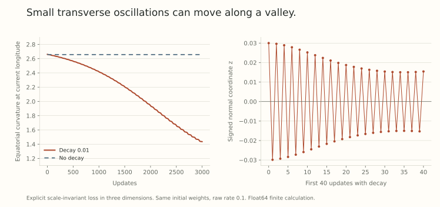

If changing a weight radius leaves the network's predictions unchanged, that radius cannot identify a different predictor directly. It can still change which predictor the optimization process eventually reaches.

The distinction becomes concrete near a valley of equal-loss solutions. Small oscillations across the valley can create a slow drift along it. Weight decay can sustain those oscillations by changing the effective directional rate, even under full-batch gradient descent with no minibatch noise.

This is a *finite-step selection mechanism*. We will calculate it in a small smooth loss, then locate the assumptions behind the corresponding sharpness-reduction theorem.

## Fix the curvature measurement before comparing flatness

For a twice differentiable scale-invariant loss,

$$
L(cw)=L(w),
\quad \nabla L(cw)=c^{-1}\nabla L(w),
\quad \nabla^2L(cw)=c^{-2}\nabla^2L(w).
$$

An ordinary Hessian eigenvalue can therefore be made arbitrarily small by increasing the radius, without changing the predictor. Raw parameter-space flatness is not an invariant ranking of functions.

One way to remove this particular ambiguity is to examine curvature on the unit sphere. At a unit stationary point $u$, restrict the Hessian to tangent directions $v\perp u$ with $\|v\|=1$. Define the local spherical sharpness by the largest eigenvalue of this restriction.

At a scaled stationary point $w=ru$, the equivalent radial correction is $r^2$ times the corresponding Euclidean curvature. This removes global radius scaling. It does not remove every other reparametrization of a network or turn sharpness into a universal generalization metric.

## Exact gradient flow gives a useful control

Consider

$$
\dot w=-\nabla L(w)-\lambda w.
$$

Since $w^\top\nabla L(w)=0$, its radius obeys $r(t)=e^{-\lambda t}r(0)$. Setting $z(t)=e^{\lambda t}w(t)$ gives

$$
\dot z=-e^{2\lambda t}\nabla L(z).
$$

Thus $z(t)$ follows the no-decay gradient-flow path with a faster clock, on intervals where the solutions exist away from zero. This exact continuous-time identity does not provide a new directional bias by itself.

The finite-step update contains a different ingredient. Let $a=1-\eta\lambda>0$, $w=ru$, and $g=\nabla L(u)$. Then

$$
u^+=\frac{u-qg}{\sqrt{1+q^2\|g\|^2}},
\qquad q=\frac{\eta}{ar^2}.
$$

Near a stationary direction, decay shrinks $r$ and can raise $q$. Discrete normal motion becomes important when this coefficient approaches a local stability threshold.

## A valley with different transverse curvatures

For $u=w/\|w\|\in\mathbb S^2$, define

$$
L(w)=\frac12\left[2+0.8(u_x^2-u_y^2)\right]u_z^2.
$$

This loss is smooth away from $w=0$ and scale invariant. Its bracket lies between 1.2 and 2.8, so every equatorial direction $u_z=0$ is a global minimizer.

Parametrize a neighborhood of that equator by

$$
u=(\sqrt{1-z^2}\cos\phi,\sqrt{1-z^2}\sin\phi,z).
$$

Then

$$
L=\tfrac12 A(\phi)z^2-0.4\cos(2\phi)z^4,
\qquad A(\phi)=2+0.8\cos(2\phi).
$$

The equatorial sharpness is $A(\phi)$. Motion along the equator has zero curvature, while the unit transverse direction has curvature $A(\phi)>0$. The sharpest equatorial points have $A=2.8$, and the least sharp have $A=1.2$. All have the same training loss.

## Oscillations can create a one-way drift

For small $z$, the transverse update is

$$
z^+=(1-qA(\phi))z+O(z^3).
$$

The local linear stability condition is $0<qA<2$. Above one, the sign alternates while the magnitude contracts if the product remains below two. Near two, the normal motion is weakly damped and can interact with the changing radius.

The longitudinal gradient depends on $z^2$, not on the sign of $z$. To make this precise, put

$$
D(\phi,z)=A(\phi)-1.6\cos(2\phi)z^2.
$$

The horizontal part of $u-qg$ is the original horizontal vector multiplied by $1+qDz^2$, plus a rotated component with coefficient $-qA'(\phi)z^2/2$. Consequently the exact longitude change, on a continuous local angle branch, is

$$
\phi^+-\phi
=\operatorname{atan2}\left(-\tfrac12qA'(\phi)z^2,\ 1+qD(\phi,z)z^2\right).
$$

For bounded $q$ and small $z$,

$$
\phi^+-\phi=-\tfrac12qA'(\phi)z^2+O(z^4).
$$

Flipping $z$ does not flip the leading drift. When $A'(\phi)<0$, repeated small excursions push $\phi$ toward lower $A$. A vanishingly small transverse displacement would stop that motion, while persistent excursions can accumulate an effect.

This is why an oscillating coordinate can produce a consistent longitudinal bias. It is not necessary to insert an explicit sharpness penalty into the loss.

## A finite calculation, with the controls visible

Use $\eta=0.1$, $\lambda=0.01$, $\phi_0=0.3$, and $z_0=0.03$. Choose the initial radius to make $q_0=2/A(\phi_0)$. Compare the same initial weight vector with and without decay for 3000 float64 updates.

In the decayed run, the equatorial curvature at the current longitude falls from approximately 2.66027 to 1.43613. Without decay, it ends near 2.65708. In the displayed decayed run, $|z_t|$ stays below 0.037. These are finite calculations of the stated loss, rather than neural-network training measurements.

{fig-alt="Left: equatorial curvature at the trajectory longitude across 3000 exact-formula float64 updates, with and without decay. Right: the first normal-coordinate oscillations. The decayed run moves toward lower equatorial curvature, while the no-decay control changes little."}

The plotted curvature belongs to the equatorial minimizer at longitude $\phi_t$. It is not being substituted for the full off-equator Hessian at $w_t$. The experiment illustrates a local mechanism over a declared horizon, without proving an infinite-time outcome or a generalization benefit.

## What the published theorem adds

[Understanding the Generalization Benefit of Normalization Layers: Sharpness Reduction](https://arxiv.org/abs/2206.07085v3), Section 4.2, analyzes a smooth scale-invariant loss near a regular manifold $\Gamma$ of spherical minimizers. Its assumptions include nondegenerate transverse curvature, a unique largest Hessian eigenvalue, sufficiently small intrinsic rate, and a specified perturbed initialization near the stability boundary.

Under those conditions, the normalized discrete trajectory tracks a slow flow on the minimizer manifold. If $S$ denotes its spherical sharpness, that flow is

$$
\frac{d\zeta}{d\tau}
=-\frac{2\nabla_\Gamma\log S(\zeta)}
{4+\|\nabla_\Gamma\log S(\zeta)\|^2},
\qquad\tau=t\eta\lambda.
$$

The chain rule gives

$$
\frac d{d\tau}\log S(\zeta)
=-\frac{2\|\nabla_\Gamma\log S(\zeta)\|^2}
{4+\|\nabla_\Gamma\log S(\zeta)\|^2}\leq0.
$$

The theorem supplies a controlled connection between discrete dynamics and this flow. Our explicit valley calculation explains one source of its directional sign, without replacing that connection or its initialization requirements.

## An exact minimizer is a revealing exception

If we start exactly on the equator, $g=0$. Gradient descent with decay then simply rescales $w$ at every step. Its direction stays fixed, even at an equatorial point whose neighboring minimizers have lower sharpness.

Thus proximity to a minimizer manifold alone does not force the selection mechanism. A suitable transverse component matters. In the paper, the initialization scheme handles exceptional directions with a small random perturbation. It is not minibatch noise inserted throughout training.

Likewise, a repeated top eigenvalue changes the regularity of the sharpness function, and moving far from the local manifold leaves the stated approximation regime. Fixed norms, different tangent oracles, or coordinatewise adaptive states create different dynamics and need their own analysis.

## Lower sharpness still needs a task-dependent interpretation

Our example has no test distribution or notion of generalization. Its minimizers agree on the constructed training objective, while their transverse curvatures differ. Showing that an optimizer moves between them establishes a selection bias in this model.

Whether that bias helps a real task requires more: an appropriate curvature definition, a relationship to the predictor, and a controlled evaluation. A sharpness change caused only by parameter rescaling would not be such evidence. Nor would a lower Hessian number under a different normalization convention.

The useful conclusion is more specific. Redundant scales can change finite-step dynamics, and those dynamics can prefer different solutions even when the direct radial change leaves the represented function unchanged.

## Try separating scale from selection

1. Multiply a stationary weight vector by three. How does its raw Hessian change? What happens to the radius-corrected curvature?
2. For transverse curvature $A=2$, which effective rates give linear contraction of the normal coordinate?
3. Why does alternating the sign of $z$ not cancel the leading longitude drift?
4. What happens if the valley experiment starts with $z_0=0$ exactly?

Answer sketches

1. The Hessian is divided by nine, while multiplying by the new squared radius cancels that factor.
2. $0<q<1$. For $1/2<q<1$, the sign alternates while contracting in the linear approximation.
3. The drift is proportional to $z^2$, which has the same sign on both sides of the valley.
4. The gradient is zero, so decay changes only the radius. There is no motion along the equator.

## Yo twin, go read... {#sources-and-scope}

[Understanding the Generalization Benefit of Normalization Layers: Sharpness Reduction](https://arxiv.org/abs/2206.07085v3), Assumptions 4.5 and 4.6, Equation 3, and Theorem 4.7, states the local sharpness-reduction result and initialization scheme. Its Section 5 studies a particular normalized regression model. Neither statement is a universal generalization theorem for fixed-norm adaptive matrix optimizers.

[An Exponential Learning Rate Schedule for Deep Learning](https://arxiv.org/abs/1910.07454v3), Section 4, gives the gradient-flow time-change perspective. The polynomial-on-the-sphere example above is our own explicit calculation. It is not a reproduction of the sharpness paper's figure or its neural-network experiments.
