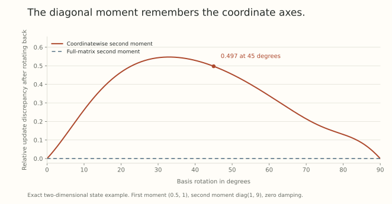

Two parameter arrays can represent the same function and still produce different next functions under an optimizer. The update rule contains more than the forward map: it also contains a metric, moments, damping, and often a choice of coordinate axes.

A symmetry-respecting comparison must transform that entire state. The right question is whether applying the symmetry and then updating gives the same result as updating and then applying the symmetry. This property is called *equivariance*.

There is another, separate question: does the update spend motion along a direction that changes no function at all? We will see that an optimizer can be equivariant while still producing such redundant motion.

## Gradients and displacements transform differently

Suppose an invertible linear map $T$ acts on parameters and preserves the model's predictions and every sampled loss. For $\theta'=T\theta$, the chain rule gives

$$
g'=T^{-\top}g.
$$

A parameter displacement representing the same transformed step instead obeys

$$
d'=Td.
$$

The gradient is a covector, while the displacement is a vector. Euclidean gradient descent identifies them using the chosen inner product. That identification respects orthogonal transformations, but not arbitrary invertible rescalings.

For an update $d=-Pg$ with a preconditioner mapping covectors to vectors, the required transformation is

$$
P'=TPT^\top.
$$

Then $-P'g'=T(-Pg)$. This is a transformation rule to check, not a property enjoyed automatically by any matrix called a preconditioner. Nonlinear parameter actions also need their derivative and a finite-step rule compatible with the action.

## A scale symmetry gives different raw-rate rules

Take a block with exact positive scale invariance, $w'=cw$, $c>0$. Then $g'=g/c$. For raw SGD with a common decay multiplier $a$,

$$
w^+=aw-\eta g,
$$

the transformed run requires $\eta'=c^2\eta$ to give $(w')^+=cw^+$. Copying the same raw rate does not satisfy that equation.

For a degree-zero direction such as a normalized gradient or the partial polar factor of a matrix gradient, positive rescaling leaves the direction unchanged. Its raw rate instead needs $\eta'=c\eta$.

| Proposal multiplied by the raw rate | Required raw rate after $w\mapsto cw$ |
| --- | --- |
| Raw gradient | $c^2\eta$ |
| Normalized gradient | $c\eta$ |
| Partial polar factor | $c\eta$ |

If $a=1-\eta\lambda$, preserving the same multiplier also requires adjusting $\lambda$ so that $\eta'\lambda'=\eta\lambda$. This calculation concerns the stated decoupled update, rather than every implementation's convention for a penalty inside a momentum buffer.

## Momentum and damping belong in the transformed checkpoint

For a gradient EMA,

$$
m_t=\beta m_{t-1}+(1-\beta)g_t,
$$

matching a scale transformation requires $m'_t=m_t/c$, including the buffer at the initial comparison point. That relation follows inductively only if the histories and starting states are coupled correctly.

For coordinatewise Adam-style moments, the corresponding rules are

$$
m'=m/c,\qquad v'=v/c^2.
$$

Consider the explicitly defined direction $m/(\sqrt v+\epsilon)$, with the square root and division taken coordinatewise. If $\epsilon'=\epsilon/c$, the transformed direction is unchanged, so $\eta'=c\eta$ gives the required weight displacement. Bias corrections preserve the relation when their coefficients and step counts match.

Keeping a fixed positive epsilon changes this identity, especially when it competes with $\sqrt v$. Resetting a buffer at a transformed checkpoint changes it too. A buffer storing velocity rather than raw gradient averages has another transformation rule. The update equation determines the answer.

Exact trajectory transformations with momentum already appear in [An Exponential Learning Rate Schedule for Deep Learning](https://arxiv.org/abs/1910.07454v3). The existence of a forward symmetry alone does not specify the needed state transformation.

## A rotation exposes the coordinate axes in a diagonal moment

Now consider an orthogonal action $O$. For a column-vector gradient, $g'=Og$. An EMA first moment transforms as $m'=Om$, while a full second moment $C=\mathbb E[gg^\top]$ transforms as

$$
C'=OCO^\top.
$$

The diagonal vector stores only coordinatewise squares. In general,

$$
\operatorname{diag}(OCO^\top)
$$

cannot be reconstructed from $\operatorname{diag}C$ alone, because off-diagonal correlations contribute after rotation. Thus even correctly transformed gradient histories can yield different diagonal-preconditioned directions in different bases.

Take

$$
m=(1/2,1)^\top,
\qquad C=\operatorname{Diag}(1,9),
\qquad d=\frac m{\sqrt{\operatorname{diag}C}}=(1/2,1/3)^\top.
$$

After a 45-degree rotation, both rotated diagonal variances equal five. Rotating the resulting direction back gives $(1/2,1)^\top/\sqrt5$, rather than $(1/2,1/3)^\top$. The relative discrepancy is about 0.49746. This is a state-level algebraic example, not a training comparison.

{fig-alt="Relative update discrepancy after rotating a two-dimensional moment state and mapping the update back. Diagonal normalization has a substantial discrepancy at intermediate angles and zero at axis permutations. Full-matrix normalization stays at numerical zero."}

## Full and scalar moments can respect this rotation

A full-matrix direction

$$
d=(C^{1/2}+\epsilon I)^{-1}m,
\qquad\epsilon>0,
$$

obeys $d'=Od$ because matrix square roots and inverses commute with orthogonal conjugation. Here epsilon sits outside the matrix square root, matching the stated diagonal convention. At zero damping, require positive definiteness or specify a support convention.

A shared scalar second moment based on $\|g\|^2$ is also invariant under orthogonal rotations, so dividing an equivariant first moment by that scalar preserves equivariance. It discards directional adaptivity that a full matrix retains. Storage, conditioning, numerical evaluation, and practical loss performance are additional considerations.

This orthogonal argument is not a proof of equivariance under arbitrary nonorthogonal actions. The preconditioner transformation law from the first section still has to hold for the actual symmetry being claimed.

## Equivariant does not mean free of redundant motion

Let $z\in\mathbb R^3$ be trainable logits for one example. Softmax and cross-entropy are invariant under $z\mapsto z+b\mathbf1$. At $z=0$ with class one as the label,

$$
g=(-2/3,1/3,1/3)^\top,
\qquad\mathbf1^\top g=0.
$$

For an undamped, bias-corrected first Adam step, the descent direction is $-\operatorname{sign}(g)=(1,-1,-1)^\top$. Its entries sum to $-1$. Coordinatewise normalization has introduced a component along the common-logit shift direction.

Yet this update is translation equivariant: shifting the starting logits leaves the gradient and a correspondingly coupled moment history unchanged. The updated logits remain shifted by exactly the same $b\mathbf1$.

Euclidean horizontality means a displacement has zero mean across logits. Projecting this particular direction gives

$$
d_H=d-\frac{\mathbf1^\top d}{3}\mathbf1
=(4/3,-2/3,-2/3)^\top.
$$

The projected and unprojected finite steps have identical probabilities because their difference is a common offset. We have removed redundant parameter motion, without improving the immediate represented function in this example.

Thus *equivariance and horizontality are different properties*. The first compares updates at symmetry-related states. The second chooses a complement to directions tangent to the symmetry orbit, using a declared metric. A quotient construction needs to state both the action and that choice.

## Check the architectural symmetry before conditioning it

For unpositioned attention, simultaneous right rotations $Q\mapsto QO$, $K\mapsto KO$ preserve $QK^\top$. Fixed positional operators can restrict that symmetry: an arbitrary rotation need not commute with RoPE's relative rotations. Shared consumers, tied weights, gains, and normalization epsilon can change other proposed actions as well.

A useful numerical test therefore starts with predictions. Transform all parameters required by the proposed symmetry and verify the same outputs on held-fixed examples. Next transform the optimizer state and compare one actual update. Repeat over a coupled sequence, recording damping, clipping, decay, retractions, and precision. A disagreement should first be traced to the claimed action or update rule.

[Dead-Direction Conditioners](https://arxiv.org/abs/2606.29176v1), Section 3.2, explores architecture-aware optimizer conditioning, including scalar and matrix second moments for rotation actions. That is an existing design direction. Our elementary tests here do not reproduce its optimizer or its training claims, and a generic claim about coordinatewise moments must still distinguish rotation dependence from the translation example above.

## What this adds to the scale story

The previous two posts described particular ways a redundant scale affects noise and finite-step solution selection. This post adds another source of dependence: the optimizer's stored state and coordinate geometry.

A symmetry can guide a reproducible comparison and suggest an update construction. It does not by itself prove useful learning, better generalization, or superiority to a tuned scalar control. Those claims need the kind of separate evaluation developed in Part 21.

## Try transforming the whole update

1. For $c=3$, how should the raw SGD rate and a gradient EMA transform?
2. For the stated Adam-style denominator, how should $v$ and epsilon transform?
3. Does a diagonal second moment generally preserve all information needed after a rotation?
4. Does nonzero common-logit motion prove that an optimizer fails translation equivariance?

Answer sketches

1. Multiply the rate by nine and divide the gradient EMA by three. Preserve the decay multiplier as well.
2. Divide $v$ by nine and epsilon by three, with the first moment divided by three and raw rate multiplied by three.
3. No. Rotated coordinate variances depend on correlations absent from the stored diagonal.
4. No. The explicit first-step example is translation equivariant while its displacement has a redundant common-offset component.

## Yo twin, go read... {#sources-and-scope}

[An Exponential Learning Rate Schedule for Deep Learning](https://arxiv.org/abs/1910.07454v3), Section 2 and Appendix A, derives exact scale and optimizer-state transformations for its specified momentum convention. The table above instead follows directly from the explicitly stated decoupled updates.

[Dead-Direction Conditioners: Gauge-Equivariant Preconditioning for Deep Networks](https://arxiv.org/abs/2606.29176v1), Sections 3.1 and 3.2, discusses symmetry-aware state and rotation-compatible second moments. We use the narrow covariance calculation here, with no claim to reproduce its quotient-rate theorem or benchmarks.

Return to [Part 12](../scale-geometry-12/index.html) for attention reparametrization controls and [Part 21](../scale-geometry-21/index.html) for why a local identity or invariance test remains distinct from a training outcome.
