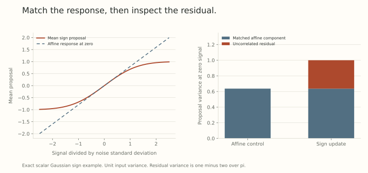

A polar update turns a noisy matrix into a direction with controlled singular values. That describes each realized update. Near a fitted solution, another question becomes important: what does the update do on average when the signal is small relative to the noise?

Matching the raw learning rate or even the norm of the realized step does not answer that question. Two update maps can have different average restoring responses. They can also have different fluctuations after that response has been matched.

This post develops a *local response comparison*. It will give us the coefficients for the feature-selection calculation in Part 26 and explain why the ordinary-network experiment in Part 27 needed more than matching matrix angles.

## Smooth the update by averaging over noise

Flatten a matrix gradient into a vector when necessary. Let $D:\mathbb R^k\to\mathbb R^p$ be the map producing the proposed update direction, with the descent step taken as $-\eta D$. Examples include a linear map, coordinatewise signs, a normalized vector, or a matrix polar factor followed by an explicit scaling convention.

Write the input as $s+\xi$, where $s$ is the signal and

$$
\xi\sim\mathcal N(0,C),\qquad C\succ0.
$$

Define

$$
F(s)=\mathbb E D(s+\xi),\qquad J(s)=DF(s).
$$

The matrix $J(s)$ describes how the *mean proposal* changes under a small common perturbation of the signal. It is not the covariance of the proposal or the derivative of one arbitrarily selected noisy update.

For measurable maps of at most polynomial growth, Gaussian convolution makes $F$ smooth. This includes bounded discontinuous maps such as a sign, so we do not need to differentiate the map at its exceptional points.

## Differentiate the Gaussian density

Write $F(s)$ as an integral over the actual input $x$:

$$
F(s)=\int D(x)\,\varphi_C(x-s)\,dx.
$$

The derivative of the density with respect to its mean is

$$
\nabla_s\varphi_C(x-s)=\varphi_C(x-s)C^{-1}(x-s).
$$

Differentiate under the integral, justified by Gaussian tails and the growth assumption. Substituting $x=s+\xi$ gives

$$
\boxed{J(s)=\mathbb E[D(s+\xi)\xi^\top]C^{-1}.}
$$

Centering $D$ by $F(s)$ does not change the right side because $\mathbb E\xi=0$. This is a Gaussian score identity, used for general nonlinear update maps in [Muon Under Gradient Noise](https://arxiv.org/abs/2609.32861v1), Theorem 4.1.

It is useful for polar updates because individual derivatives can be delicate near rank loss. The density argument concerns the averaged map. Singular covariance needs a separate treatment on its support, rather than inserting an ordinary inverse into this formula.

## Match the average response with an affine update

At a fixed signal $s$, define

$$
L_s(x)=F(s)+J(s)(x-s).
$$

It has the same mean proposal at $s$, and the same first-order change in that mean under a nearby signal perturbation. On the noisy input,

$$
D(s+\xi)=F(s)+J(s)\xi+R_s.
$$

By construction and the score identity,

$$
\mathbb E R_s=0,
\qquad \mathbb E[R_s\xi^\top]=0.
$$

Expanding the covariance therefore gives

$$
\boxed{\operatorname{Cov}(D(s+\xi))
=J(s)CJ(s)^\top+\operatorname{Cov}(R_s).}
$$

The residual covariance is positive semidefinite. Among affine functions of this Gaussian input, the matched map is the mean-square projection of the nonlinear proposal. No inverse of $J$ is required, and the input and output dimensions need not agree.

Uncorrelated does not mean independent. The residual can be a deterministic nonlinear function of the same noise. Nor does the covariance identity compare the realized lengths of every paired update.

## The scalar sign makes every term explicit

Take $D(x)=\operatorname{sign}(x)$ and scalar noise of standard deviation $\sigma>0$. Then

$$
F(s)=2\Phi(s/\sigma)-1,
\qquad J(0)=\sqrt{\frac2\pi}\frac1\sigma.
$$

At zero signal, the proposal has mean zero and variance one. The affine matched proposal is $J(0)\xi$, whose variance is $2/\pi$. Thus

$$
\operatorname{Var}(R_0)=1-\frac2\pi\approx0.363380.
$$

The residual is not a rounding error. Its covariance remains after we match the derivative of the average update exactly.

{fig-alt="Left: exact mean sign under unit Gaussian noise and its tangent line at zero signal. Right: variance two over pi for the affine control and total variance one for the sign update, decomposed into the affine part and residual one minus two over pi."}

The mean is nearly linear only locally. Using the tangent line at zero to describe a large signal would introduce another approximation, distinct from the exact covariance decomposition at the chosen signal.

## What this means for a polar matrix proposal

For square dimension $d$, define the Frobenius-unit polar proposal

$$
D(N)=\operatorname{polar}(N)/\sqrt d.
$$

A full-rank square input gives $D(N)^\top D(N)=I_d/d$. With independent centered Gaussian entries, symmetry makes the averaged proposal zero. Each coordinate then has variance $1/d^2$. The covariance is isotropic in the flattened matrix coordinates at zero signal.

The average response is also a scalar operator under isotropic matrix noise. Its scalar coefficient depends on the expected nuclear norm of the noise, rather than being one merely because the singular values of each polar factor are one.

Anisotropic input noise changes this picture. In the next post, a feature-energy matrix scales the gradient columns differently. The polar proposal still has equal coordinate variances by its symmetries, while its columnwise restoring responses differ. Equal update variance is not equal stationary parameter variance.

All these statements depend on the declared scaling of the polar map. A shape multiplier, norm graft, damping rule, or finite polynomial changes the actual $D$ whose response must be computed.

## Extra one-step noise is not a complete loss ranking

Suppose a frozen scalar surrogate has the same restoring coefficient $c>0$ in two comparisons:

$$
x_{t+1}=(1-\eta c)x_t-\eta\zeta_t,
\qquad \mathbb E\zeta_t=0,
\quad\operatorname{Var}(\zeta_t)=v.
$$

With independent innovations and $0<\eta c<2$, its stationary variance is

$$
\mathbb E x^2=\frac{\eta v}{2c-\eta c^2}.
$$

In this surrogate, increasing $v$ increases the stationary quadratic loss. For the scalar sign and its matched affine control at zero signal, the ratio of their innovation variances is $\pi/2$.

This is not an exact stationary-loss ratio for the full sign recursion. There, the state changes the signal seen by the nonlinearity. Momentum also introduces temporal correlations, so one-step covariance alone does not determine accumulated variance. Muon Under Gradient Noise explicitly separates its frozen-residual surrogate from the full feedback-dependent recursion.

## Do not use the Gaussian identity as a universal regression rule

Let $\xi$ instead take values $-1$ and $1$ equally, and let $D(x)=x^3$. Direct calculation gives

$$
F(s)=s^3+3s,
\qquad J(0)=3.
$$

The linear regression coefficient of $D(\xi)$ on $\xi$ is instead

$$
\frac{\mathbb E[D(\xi)\xi]}{\mathbb E\xi^2}=1.
$$

Both computations are correct. The derivative of a mean under a common shift and a regression on an arbitrary noise law are different objects. Gaussian integration by parts is what identifies them in the earlier setting.

A finite set of minibatches is generally non-Gaussian. With 12 possible batches, centered gradient noise has covariance rank at most 11, regardless of the matrix's parameter dimension. A regression on those outcomes cannot recover an unrestricted full response operator in a larger space.

One direct alternative is

$$
J=\frac1K\sum_{i=1}^K D'(g_i),
$$

where each derivative concerns a common perturbation of the batch gradient, with model parameters held fixed. This requires the derivatives to exist or a justified numerical evaluation. It matches the local mean response, without inheriting the Gaussian covariance ordering automatically.

## Matching the norm can change the response again

If an affine proposal $L(g)$ has variable length, normalizing it to match another method's angle changes its derivative:

$$
D\left(\frac{L}{\|L\|}\right)[h]
=\frac{I-qq^\top}{\|L\|}DL[h],
\qquad q=L/\|L\|.
$$

The projection and inverse length both matter. Equal angles and equal response are separate targets. After a graft or normalization, measure the response of the applied update, including retraction where appropriate.

This gives us three useful controls: match step size, match the mean response, and inspect the remaining update noise. The next two posts use them to distinguish a valid constructed mechanism from a stronger claim about independently learned features.

## Try separating response from variance

1. For sign updates with $\sigma=2$, what is $J(0)$? What is the proposal variance at zero signal?
2. Is the Gaussian residual independent of the input noise merely because it is uncorrelated with it?
3. In the two-point cubic example, what does a noise regression miss?
4. Does normalizing an affine proposal preserve its fitted Jacobian automatically?

Answer sketches

1. $J(0)=\sqrt{2/\pi}/2\approx0.398942$, while the sign variance remains one.
2. No. The residual can be a deterministic nonlinear function of that noise.
3. The mean response derivative is three, while the regression coefficient is one.
4. No. The derivative acquires a tangent projection and a factor inverse to the proposal length.

## Yo twin, go read... {#sources-and-scope}

[Muon Under Gradient Noise and the Limits of Orthogonalization Near Optima](https://arxiv.org/abs/2609.32861v1), Proposition 3.1, Theorem 4.1, and Sections 5 and 6, develops Gaussian response, the residual decomposition, temporal effects, and a frozen-residual surrogate. The density calculation and scalar example above make the local identity explicit. They do not establish a general optimizer ranking or reproduce a training benchmark.

Return to [Part 14](../scale-geometry-14/index.html) for the difference between averaging before and after a nonlinear direction map, and [Part 13](../scale-geometry-13/index.html) for why finite polar evaluation changes the proposal being analyzed.
