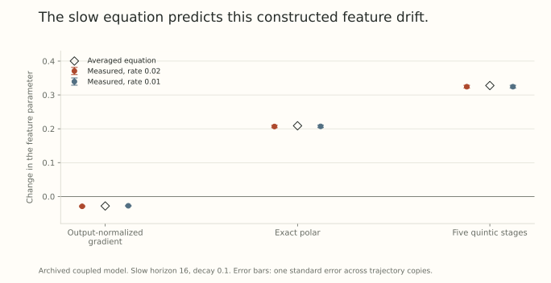

Even when two update rules have a common scale, their fluctuations can interact differently with learned features. Part 25 gave us the local ingredients: an average response and a noise covariance. Now we will use those ingredients in a model where features actually move.

The calculation has three levels. A Gaussian identity gives exact local coefficients. A frozen linear recursion gives an exact stationary variance. Replacing the evolving matrix fluctuations by that variance gives a *leading averaged feature equation*. The last step needs assumptions beyond the first two.

## Construct a feature family with fixed total energy

Use the two training inputs $e_1,e_2\in\mathbb R^2$. Let $Z$ be a trainable two by two residual matrix and define

$$
B(\theta)=\operatorname{Diag}(\sqrt{a_1(\theta)},\sqrt{a_2(\theta)}),
\qquad a_1+a_2=2,
\quad a_j>0.
$$

The prediction matrix on the training inputs is $M+ZB(\theta)$, where $M$ is a fixed teacher. At each step, targets are $M+\Xi$, with fresh independent standard Gaussian entries in $\Xi$. The sampled loss is

$$
\ell(\theta,Z,\Xi)=\tfrac12\|ZB(\theta)-\Xi\|_F^2.
$$

For uniform sampling over the two input columns, mean feature energy is $(a_1+a_2)/2=1$. This normalizes energy across the training distribution. It does not force every input's feature to have the same norm.

Choose

$$
a_1(\theta)=\frac{2}{1+100e^{1.05(\theta-0.2)}},
\qquad a_2=2-a_1.
$$

Near $\theta=0.2$, increasing $\theta$ makes the already smaller energy $a_1$ decrease and the larger energy $a_2$ increase.

## Keep a functional interpretation explicit

The training predictor $M+ZB(\theta)$ alone does not make $\theta$ an identifiable feature of the represented function. Changing $B$ can be absorbed into $Z$.

The constructed model therefore extends predictions off the training inputs as

$$
f_{\theta,Z}(x)=Mx+\theta v x_1x_2+ZB(\theta)x,
$$

with fixed nonzero output vector $v$. The quadratic term vanishes on $e_1,e_2$, but changes predictions on mixed inputs. A linear adjustment to $Z$ cannot absorb that coefficient.

This deliberately shares the parameter controlling feature energies with a nonlinear extrapolation term. Untying those parameters removes this particular functional conclusion. An ordinary network needs a separate check that the selected feature quantity corresponds to a meaningful learned function.

The clean training loss is

$$
L(\theta,Z)=\tfrac12\sum_j a_j(\theta)\|Z_{:j}\|^2.
$$

Every $Z=0$ is a zero-loss point. Its full Hessian trace in $(\theta,Z)$ coordinates is $2(a_1+a_2)=4$. Other spectral quantities, including the largest eigenvalue, can change. Constant trace is a controlled property, not a claim that all sharpness-based explanations have been eliminated.

## Write the actual coupled update

Put $A=B^2$. Differentiation gives

$$
G_Z=ZA-\Xi B,
$$

and

$$
g_\theta=\tfrac12\sum_j a'_j\|Z_{:j}\|^2
-\sum_j\frac{a'_j}{2\sqrt{a_j}}\langle\Xi_{:j},Z_{:j}\rangle.
$$

The current noise is independent of the current parameters, so the second term has conditional mean zero. Update with

$$
Z^+=(1-\eta\lambda)Z-\eta D_\theta(G_Z),
\qquad\theta^+=\theta-\eta g_\theta.
$$

Decay acts on $Z$, a residual map that changes the function. It does not decay the scalar $\theta$. This is different from decay acting only on a redundant radius in Parts 3 and 22.

## Compute columnwise response and noise

At fixed $\theta$, let $N=\sigma\Xi B$, with $\sigma=1$ in the displayed experiments. For the odd, left-orthogonally equivariant maps considered here, row symmetry and independent column sign symmetry give a local expansion

$$
\mathbb E D(ZA-N)=Z\operatorname{Diag}(\kappa_1,\kappa_2)+o(\|Z\|_F).
$$

In square dimension $d$, the Gaussian score identity yields

$$
\kappa_j=\frac{\mathbb E\langle D(N)_{:j},N_{:j}\rangle}{d\sigma^2},
\qquad
v_j=\frac{\mathbb E\|D(N)_{:j}\|^2}{d}.
$$

The factor $a_j$ in the Gaussian column variance cancels the factor $a_j$ in the mean perturbation $ZA$. The response is with respect to $Z$, rather than an unscaled perturbation of the gradient input.

For $D(N)=\operatorname{polar}(N)/\sqrt d$, each column of the proposal has squared norm $1/d$. Hence $v_j=1/d^2$. Noise variance is equal across matrix coordinates even when the feature energies differ. The restoring responses $\kappa_j$ need not be equal.

For a raw linear proposal $D(G)=cG$ with a common positive scalar $c$ while $\theta$ is frozen,

$$
\kappa_j=ca_j,\qquad v_j=c^2\sigma^2a_j.
$$

Changing $c$ changes the comparison's scale. It does not reverse the column ordering within a fixed state.

## Derive the fast variance before averaging the feature

Linearizing the mean matrix response gives the frozen scalar-coordinate surrogate

$$
z^+=(1-\eta(\kappa_j+\lambda))z-\eta\zeta,
\quad\mathbb E\zeta=0,
\quad\operatorname{Var}(\zeta)=v_j.
$$

With independent innovations and $0<\eta(\kappa_j+\lambda)<2$, its stationary variance is

$$
\mathbb E z^2
=\frac{\eta v_j}{2(\kappa_j+\lambda)-\eta(\kappa_j+\lambda)^2}
=\frac{\eta v_j}{2(\kappa_j+\lambda)}+O(\eta^2).
$$

Substitute the leading variance into the conditional mean of $g_\theta$, summing over $d$ rows. On the slow clock $\tau=\eta^2t$,

$$
\boxed{\frac{d\theta}{d\tau}
=-\frac d4\sum_j a'_j(\theta)
\frac{v_j(\theta)}{\kappa_j(\theta)+\lambda}.}
$$

The matrix fluctuates on a faster scale, while its squared fluctuations create a systematic feature drift. To justify this substitution for the full coupled recursion, one needs uniform stability, mixing, moment bounds, and control as $\theta$ changes. We have a checked local calculation and numerical agreement, rather than a proved uniform averaging theorem for this nonlinear recursion.

## Opposite signs in the two-feature calculation

Suppose $a_1<a_2$ and $a'_1=-s$, $a'_2=s$, with $s>0$. Write $k_j=v_j/(\kappa_j+\lambda)$.

For the raw linear proposal and $\lambda>0$,

$$
k_j=\frac{c^2\sigma^2a_j}{ca_j+\lambda}
$$

increases strictly with $a_j$. Thus $k_2>k_1$, and the averaged $\dot\theta$ is negative. It favors balancing the two energies. At zero decay, these leading ratios are equal, so this leading drift vanishes when their sum is fixed. Finite-step terms can still produce motion.

For the polar proposal, $v_1=v_2=1/d^2$. In the two-column Gaussian model, $\kappa_2>\kappa_1$. One way to see the ordering is to use the symmetric convex function

$$
\mathcal F(b_1,b_2)=\mathbb E\|\sigma\Xi\operatorname{Diag}(b_1,b_2)\|_*,
\qquad b_j=\sqrt{a_j}.
$$

Symmetry and convexity order its partial derivatives when $b_2>b_1$. They are positive, and the nuclear-norm differential gives $\mathbb E[(N^\top N)^{1/2}_{jj}]=b_j\partial_j\mathcal F$. The strict ordering transfers to the polar response coefficients.

Consequently $k_1>k_2$, and the polar averaged drift is positive. The two directions of feature selection cannot be reconciled by a common positive change of time. This is a statement about the displayed averaged equation in this constructed family, not a proof of eventual feature collapse.

## What the archived coupled calculation measured

The stronger numerical control matched the matrix contribution to the training-output step by imposing $\|D_\theta(G)B(\theta)\|_F=1$. It compared an output-normalized gradient, exact polar, and five finite quintic stages with a norm graft.

The normalized-gradient map in this table is not the raw linear map $cG$ above. Its response and covariance were evaluated separately. At decay 0.1 and slow horizon 16, the archived results are:

| Proposal | Predicted change in $\theta$ | Measured at $\eta=0.02$ | Measured at $\eta=0.01$ |
| --- | --- | --- | --- |
| Output-normalized gradient | -0.02804 | -0.02905 | -0.02747 |
| Exact polar | +0.20893 | +0.20678 | +0.20718 |
| Five quintic stages | +0.32774 | +0.32433 | +0.32435 |

{fig-alt="Predicted feature changes and archived simulated means with one-standard-error bars for an output-normalized gradient, exact polar, and five quintic stages. Both tested step sizes follow the different drift signs and magnitudes."}

The larger rate used 40,000 steps and 128 independent copies. Halving the rate required four times as many steps to preserve $\eta^2t=16$, using 64 copies. The figure shows one standard error across those copies. These are development calculations of an intentionally constructed model, not held-out task comparisons or a new training run for this article.

The output constraint controls the matrix-update term at fixed $\theta$. It excludes the common decay contribution and simultaneous feature motion. It does not match the complete network's finite functional step. A momentum buffer would also require an augmented response and temporal covariance analysis.

## What survives, and what still needs a network test

The construction establishes a possible mechanism: nonlinear matrix updates can change the balance between restoring response and stochastic forcing, which can bias a slower learned feature parameter. A flat training family and fixed total feature energy do not erase that mechanism.

It does not say which extrapolation is better. The held-out target determines that. It also does not show the same feature dependence arises without the deliberately shared scalar parameter, or that a predicted anisotropy drift becomes rank collapse in a normal network.

[Part 27](../scale-geometry-27/index.html) follows that next test. Independently trained features did change after angular matching, but a local response baseline explained much of the difference. Keeping both findings is more informative than treating the constructed model as a universal explanation.

## Try reading the two time scales

1. Why is the leading matrix variance order $\eta$ rather than order one?
2. Why does the feature equation use $\eta^2t$?
3. Does constant Hessian trace imply a constant largest Hessian eigenvalue?
4. Does output normalization of the matrix proposal match the simultaneous decay and feature update too?

Answer sketches

1. Each innovation has size $\eta$, while restoring contraction per step is order $\eta$. The stationary variance is their squared size divided by that contraction.
2. The feature step has one factor $\eta$ from its rate and another from the matrix's squared fluctuation size.
3. No. Eigenvalues can redistribute while their sum stays fixed.
4. No. The stated constraint concerns only the matrix proposal at fixed features.

## Yo twin, go read... {#sources-and-scope}

The coupled model and numerical values come from our archived stochastic feature-selection calculation. This article checks its coefficients and aggregates, without rerunning its long trajectories or asserting a uniform averaging theorem.

[What Happens after SGD Reaches Zero Loss? A Mathematical Framework](https://arxiv.org/abs/2110.06914v4), Section 4 and Theorem 4.6, develops slow limiting dynamics under explicit minimizer-manifold and regularity assumptions. [Label Noise SGD Provably Prefers Flat Global Minimizers](https://arxiv.org/abs/2106.06530v1), Section 2.2, includes a finite-step spectral regularizer, so constant Hessian trace alone does not eliminate its mechanism.

[Muon Under Gradient Noise](https://arxiv.org/abs/2609.32861v1), Theorem 4.1 and Section 6, supplies the response and frozen-surrogate context. Its theorem is not a uniform theorem for the evolving-feature recursion used here.
