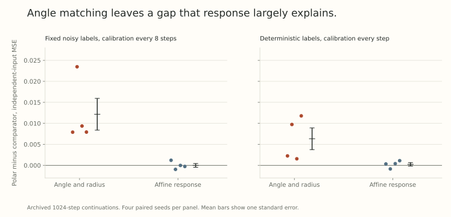

The model in Part 26 predicts different feature drifts under different matrix updates. Its local mathematics is valid within the declared construction. The harder question is whether that proposed explanation transfers to a network whose features learn independently.

Our archived ordinary-network experiment found a real difference after matching matrix angles and radii. But that difference was largely reproduced by a calibrated affine response baseline, and the proposed extra feature-collapse pattern was not reliable.

This is another useful boundary between *an observation and its explanation*. The experiment did not erase the constructed-model result. It changed what that result justified claiming about a more ordinary network.

## Remove the deliberately shared feature parameter

The network was

$$
f(x)=V\tanh\left(\gamma\odot\operatorname{LayerNorm}(Wx+b)+\beta\right)+c.
$$

It had six inputs, 12 hidden units, two outputs, and 134 independently trained parameters. Both matrices, all biases, and both LayerNorm parameter vectors learned. No scalar tied a feature energy to a separate nonlinear output term.

The nonlinear teacher depended on the first three inputs. Each dataset had 384 training examples. In one distribution, nuisance coordinates were independent. In the other, two nuisance coordinates correlated with the teacher outputs, creating spurious shortcuts. Evaluation included clean labels on an independent-input distribution where those correlations disappeared.

In the main grid, label noise of standard deviation 0.25 was added once to the training labels. It was not refreshed each update. A fixed partition supplied 12 blocks of 32 examples, sampled uniformly with replacement. Their gradients were unbiased for the finite-data training objective, with genuine non-Gaussian minibatch noise.

This differs from the fresh Gaussian target noise in Part 26. Later controls removed the fixed observational label noise as well.

## Match the quantities the original explanation might hide behind

Every paired continuation began from the same checkpoint after 2000 Adam steps and lasted 1024 updates. The grid used four independent dataset and initialization seeds, two matrix step sizes, zero or positive decay, zero momentum, and float64 arithmetic.

The polar reference applied an exact rectangular polar map to matrix gradients. The angular-gradient comparison used ordinary gradient tangent directions while copying the reference's actual matrix angle and radius at each step. Vector parameters used the same rule across arms.

For a matrix treated as a vector under the Frobenius inner product, write $u=W/\|W\|_F$ and choose unit $q\perp u$. The explicit sphere step

$$
W^+=r^+\left(\cos\alpha\,u-\sin\alpha\,q\right)
$$

has prescribed radius $r^+$ and angle $\alpha$ with $W$. This makes clear what the angular control does: it fixes displacement scale on the sphere while allowing the tangent direction to differ.

Matching those quantities does not match the response of the mean update to changing gradients. Part 25 showed why that distinction matters near a fitted model.

## Fit the actual finite-minibatch response

At a calibration checkpoint, enumerate all 12 batch gradients $g_i$ and their unit polar tangent directions $q_i$. Let

$$
\bar g=\frac1{12}\sum_i g_i,
\qquad\bar q=\frac1{12}\sum_i q_i,
\qquad J=\frac1{12}\sum_i Dq(g_i).
$$

The global affine control is

$$
L(g)=\bar q+J(g-\bar g).
$$

At calibration, it matches the expected tangent direction and its derivative under a common perturbation of the gradient input. The full block Jacobian was obtained by finite differences, with a two-scale numerical check.

This is not a Gaussian approximation or a regression on the 12 noise samples. Such a regression would not generally identify the same derivative, and its centered input covariance has rank at most 11.

An affine proposal has variable length. Renormalizing it to restore an exact common angle changes its response through the derivative of normalization. The experiment retained both versions and measured their realized errors. It did not declare simultaneous response and angle matching merely because both were intended.

## Preserve more than the mean with a local control

A stronger diagnostic kept a separate affine expansion for each batch:

$$
L_i(g)=q_i+J_i(g-g_i),\qquad J_i=Dq(g_i).
$$

At calibration, it reproduces every discrete proposal and its first derivative. It therefore preserves the batchwise update distribution at that point, before the subsequent declared angular step. It is a minibatch-conditioned model, rather than one global linear preconditioner.

As features evolve, both fitted controls can become stale. Recalibration interval and measured response error are part of the comparison. These are expensive diagnostic oracles, not proposed faster optimizers.

## Features differed after angle and radius matching

For spurious training inputs and decay 0.1, the refreshed control recalibrated every eight steps. Averaging the two step sizes within each independent seed gave:

| Continuation | Clean independent-input MSE | Hidden effective rank | Spurious sensitivity fraction |
| --- | --- | --- | --- |
| Polar | 0.08083 | 6.3959 | 0.07984 |
| Angular gradient | 0.06867 | 6.3001 | 0.06148 |
| Affine response | 0.08084 | 6.4308 | 0.07985 |
| Batchwise local response | 0.08242 | 6.4330 | 0.08205 |

Positive polar-minus-comparator loss differences mean higher error for polar. The paired mean difference against angular gradient was $0.012163$, with standard error $0.003785$ across four seeds. Against affine response, it was $-0.000010$, with standard error $0.000453$.

The geometry-dependent observation survived matching angles and norms. The affine response control reproduced most of its held-out error and spurious-input sensitivity. This is evidence against treating the contrast as a phenomenon beyond the measured local response description in this setting.

The hidden rank was the entropy effective rank of the feature covariance. For eigenvalues $\lambda_j$ and $p_j=\lambda_j/\sum_k\lambda_k$, it is

$$
r_{\rm eff}=\exp\left(-\sum_j p_j\log p_j\right).
$$

The polar-minus-angular-gradient rank difference was $+0.0959$ with standard error $0.1175$, and its sign varied across seeds. That does not support a robust extra-collapse prediction. A feature difference, a rank decrease, and a useful predictor are three distinct claims.

## Removing label noise did not remove the response explanation

The final strict control used deterministic teacher labels, the smaller prescribed matrix angle 0.003, positive decay, and affine recalibration at every step. Polar and angular gradient shared their prescribed angles and radius profile.

| Continuation | Clean independent-input MSE | Hidden effective rank |
| --- | --- | --- |
| Polar | 0.055550 | 5.18060 |
| Angular gradient | 0.049221 | 4.99908 |
| Affine response at every step | 0.055303 | 5.17852 |

The paired polar-minus-gradient error difference was $0.006329\pm0.002593$. The polar-minus-affine difference was $0.000247\pm0.000407$, with signs differing across seeds. Here the plus-minus terms are one standard error, not confidence intervals or a proof of equivalence.

{fig-alt="Two panels show polar-minus-comparator independent-input MSE for four paired seeds. The noisy-label control averages two step sizes within each seed. The deterministic-label control uses the smaller angle and every-step affine calibration. Mean bars include one standard error."}

Fixed observational label noise was therefore unnecessary for the contrast with angular gradient. Minibatch noise remained. The clean-label control also changed the clock and recalibration protocol, so the difference between the two tables cannot isolate the effect of removing label noise alone.

The affine arm's angular RMS was about 1.082 times the prescribed polar angle in the strict control. It was response matched rather than exactly angle matched. A separate normalized-affine control restored angles but retained response error. This limits any claim of exact simultaneous global affine-response and angular equivalence.

## Stale controls can manufacture a misleading gap

With 128 steps between calibrations, the batchwise local model's independent-input MSE in the same spurious, positive-decay setting was about 0.18915, compared with 0.08083 for polar. Its midpoint median response error was about 28 percent over the main grid.

Recalibrating every eight steps reduced its error to 0.08242. The midpoint median response error still reached about 10.3 percent over that refreshed grid. A shorter interval helped, but did not certify uniform accuracy.

Thus a bad result from an outdated local approximation is not evidence that a valid response control fails. Conversely, close losses from an approximate control are not an exact equivalence theorem. The every-step affine experiment was added to probe this distinction directly.

## Keep the statistical unit visible

The noisy-label summary averages step sizes within each seed before computing paired differences and standard errors. Four seeds remain four independent dataset and initialization draws. Repeated conditions and many continuation arms do not turn into additional independent datasets.

Likewise, the hidden features were not frozen: they moved from the common checkpoint, and linear probes and sensitivities changed. That fact establishes an ordinary learned-feature experiment. It does not establish that the specific two-feature collapse mechanism from Part 26 describes those changes.

The benchmark was small, synthetic, finite-horizon, and used exact polar evaluation without momentum. It does not establish an optimizer ranking on natural datasets, Transformers, practical finite polar routines, or the asymptotic time scale of a minimizer-manifold theorem.

## What changed in the research conclusion

The appropriate conclusion was to demote the proposed collapse mechanism as the main submission hypothesis. The constructed calculation still illustrates a valid possible bias. The network experiment still shows features can differ after angular matching. The stronger claim that these observations reveal a new useful effect beyond response and minibatch noise did not earn support.

A future proposal needs a prediction that distinguishes it from the strongest accurate controls, survives independently learned features, and improves a declared task outcome under fair tuning and compute comparisons. The present experiment helps specify that target by showing which explanations were insufficient.

## Try checking the control

1. Does matching matrix angle determine the expected update Jacobian?
2. Why is averaging all 12 batch derivatives different from regressing on their gradient noise?
3. What should happen before interpreting a large loss gap from a stale local approximation?
4. Why are eight step-size conditions in the refreshed setting still summarized with four independent seeds?

Answer sketches

1. No. Angle fixes a geometric step size, while response describes how the mean proposal changes with its input.
2. The derivative concerns a common perturbation of each input. A finite non-Gaussian regression need not recover that operator.
3. Measure its current response error and recalibrate or otherwise validate the approximation.
4. Two step sizes share each dataset and initialization draw. Average within those draws before reporting uncertainty across them.

## Yo twin, go read... {#sources-and-scope}

The empirical values come from our archived untied LayerNorm-network study, including its refreshed, deterministic-label, and every-step response controls. This article recomputes selected aggregates and checks the displayed identities. It does not rerun the continuations or claim a new network result.

[Muon Under Gradient Noise and the Limits of Orthogonalization Near Optima](https://arxiv.org/abs/2609.32861v1), Sections 4 through 6, motivates separating response from remaining fluctuations under its Gaussian and surrogate assumptions. Our finite-batch controls instead enumerate the actual gradient outcomes and evaluate the response directly.

Read [Part 25](../scale-geometry-25/index.html) for why the Gaussian score formula is not a universal empirical regression rule, and [Part 26](../scale-geometry-26/index.html) for the constructed model whose extrapolation this experiment tested.
