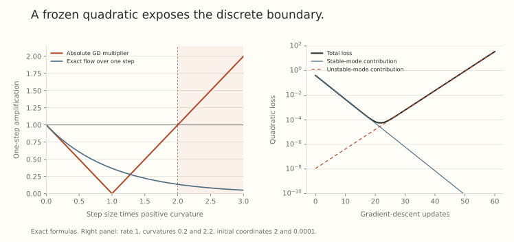

The last three posts examined noisy updates. Now remove sampling entirely. Even full-batch gradient descent can alternate rapidly, increase the loss on individual steps, and follow a path that a small-step gradient-flow model misses.

The phrase *edge of stability* describes an interaction between curvature and a finite update. It does not mean the objective suddenly becomes ill-defined or every trajectory must explode. To use the phrase carefully, we need to derive the boundary and specify what remains fixed in that derivation.

## Start with one excited quadratic mode

Consider

$$
L(x)=\tfrac12 a(x-x_\star)^2,
\qquad a>0,
\qquad x^+=x-\eta L'(x).
$$

Writing $e=x-x_\star$ gives the exact recurrence

$$
e_{t+1}=(1-\eta a)e_t,
\qquad e_t=(1-\eta a)^t e_0.
$$

For a nonzero initial error, the cases are:

| Dimensionless curvature | Behavior of the error |
| --- | --- |
| $0<\eta a<1$ | Decay without changing sign |
| $\eta a=1$ | Reach the minimizer in one step |
| $1<\eta a<2$ | Alternating decay |
| $\eta a=2$ | A constant-amplitude two-cycle |
| $\eta a>2$ | Alternating growth |

The boundary $2/\eta$ comes from a multiplier reaching $-1$. It is a property of this discrete map. At $e_0=0$, the iterate stays exactly at the minimizer for every rate, including unstable rates. Instability concerns the response to a displacement, not a claim that an unexcited coordinate moves by itself.

For a fixed symmetric quadratic Hessian $H$, diagonalize into eigenvectors. Each coordinate has its own multiplier $1-\eta\lambda_j$. Positive modes contract when $0<\eta\lambda_j<2$. Negative modes have a multiplier above one, and a flat direction may be neutral or have affine drift.

Thus the largest positive eigenvalue supplies the familiar upper boundary only after we specify the relevant modes and objective. Momentum, preconditioning, or normalization of the proposal changes the update map whose stability must be analyzed.

## A falling loss can conceal an unstable coordinate

Take the fixed quadratic

$$
L(z,x)=\tfrac12(0.2)z^2+\tfrac12(2.2)x^2,
\qquad \eta=1,
\qquad (z_0,x_0)=(2,10^{-4}).
$$

Then

$$
z_t=2(0.8)^t,
\qquad x_t=10^{-4}(-1.2)^t.
$$

The loss initially falls because the large stable coordinate shrinks. The tiny unstable coordinate grows throughout, eventually dominating. An early downward loss curve is therefore compatible with an unstable fixed quadratic.

{fig-alt="Left: absolute GD amplification versus dimensionless positive curvature, compared with exact gradient-flow amplification over the same time. Right: loss of a two-mode fixed quadratic initially decreases and later grows as an initially tiny unstable coordinate takes over."}

This figure evaluates the displayed formulas. It contains no neural-network training. It also shows why a meaningful nonlinear experiment needs a long enough observation window: brief progress alone does not demonstrate self-stabilization.

## Gradient flow has no corresponding sign flip

Use the continuous clock $\tau=\eta t$. The quadratic gradient-flow equation is

$$
\frac{de}{d\tau}=-ae,
\qquad e(\tau)=e_0e^{-a\tau}.
$$

Over one interval of length $\eta$, its amplification is $e^{-\eta a}$, always positive and below one. GD replaces this with the first-order approximation $1-\eta a$. That approximation has qualitatively different behavior when $\eta a$ is order one.

For a smooth general loss, exact gradient flow satisfies

$$
\frac{d}{d\tau}L(w(\tau))=-\|\nabla L(w(\tau))\|^2.
$$

Finite GD need not share this monotonicity. Comparing the two requires a common clock and a numerically accurate flow reference. A stable numerical ODE solver can still have appreciable integration error, so step refinement matters before interpreting a trajectory difference.

## Curvature at the starting point does not control a whole step

Let $g=\nabla L(w)$ and take $w^+=w-\eta g$. The integral Taylor formula is

$$
L(w^+)-L(w)
=-\eta\|g\|^2
+\eta^2\int_0^1(1-s)
g^\top H(w-s\eta g)g\,ds.
$$

If $H\preceq MI$ along the entire segment, this gives

$$
L(w^+)-L(w)
\le-\eta(1-\eta M/2)\|g\|^2.
$$

That is a segment-wide hypothesis. Measuring the Hessian only at $w$ does not establish it.

For an explicit counterexample, use the smooth, bounded-below polynomial

$$
L(x)=x+\tfrac12x^2+10x^4.
$$

At $x=0$, the gradient is one and the Hessian is one. With $\eta=1$, the pointwise product $\eta L''(0)=1$ is below two, yet the update lands at $-1$ and raises the loss from zero to $9.5$. Curvature increases sharply along the step.

Conversely, a large Hessian eigenvalue at one nonlinear iterate does not make every future Hessian equal to that value. The fixed-quadratic prediction can fail because subsequent motion changes the landscape being sampled.

## What the neural-network observation adds

[Gradient Descent on Neural Networks Typically Occurs at the Edge of Stability](https://arxiv.org/abs/2103.00065v3), Sections 3 and 4, reports full-batch trajectories whose sharpness tends toward the quadratic boundary and remains nearby while loss decreases over longer intervals. Its central contribution is empirical characterization. It does not prove global convergence for arbitrary neural objectives.

The interesting observation is the combination: a frozen local quadratic predicts growing oscillations, while the changing nonlinear objective can avoid that frozen prediction. Explaining the boundary is therefore only the first step. We still need to explain why curvature rises toward it and what opposes further growth.

Here sharpness means the largest algebraic training-loss Hessian eigenvalue, in the stated parameter coordinates. Parts 2 and 23 already explained why coordinate scaling can change such a number. Keep the parameterization, loss normalization, and optimizer fixed when interpreting its relation to $2/\eta$.

## Progressive sharpening has a sign that needs explaining

Suppose the top eigenvalue $S(w)$ is simple, with unit eigenvector $u$. Differentiating $Hu=Su$ gives

$$
DS(w)[v]=u^\top DH(w)[v]u.
$$

The eigenvector-derivative terms cancel after multiplication by $u^\top$. Consequently, along gradient flow,

$$
\frac{dS}{d\tau}=-\langle\nabla S,\nabla L\rangle.
$$

This formula contains no universal positive sign. For $L(x)=x^4/4$ at $x=1$, it is $-6$. For the local cubic $L(x)=-x+x^3/6$ at $x=1$, it is $+1/2$. Both follow from direct differentiation.

Progressive sharpening asks why this contraction is positive over substantial parts of particular training trajectories. Repeating the formula is not an explanation of its sign. At repeated top eigenvalues, even this scalar derivative needs replacement by a critical-subspace calculation.

## Loss curvature is not just feature geometry

For a scalar predictor $f(w)$ and scalar loss $\ell(f)$, the chain rule gives

$$
\nabla^2_w\ell(f(w))
=\ell''(f)\nabla f\nabla f^\top
+\ell'(f)\nabla^2 f.
$$

Both predictor geometry and the loss's output derivatives matter. In logistic classification, the first coefficient is $p(1-p)$, which becomes small at confident predictions. Growth of a predictor Jacobian does not by itself imply growth of the loss Hessian.

The paper's Appendix A records exceptions and qualifications: late cross-entropy sharpness reduction, weak sharpening in some wide or simple settings, early decreases, and complications from normalization and nonsmooth components. These matter when turning a recurring observation into a research hypothesis.

## The next question is the feedback

The fixed quadratic has no mechanism that changes its own curvature. A nonlinear objective does. The next post keeps one mixed cubic term and follows its effect on both the oscillating coordinate and the coordinate that controls curvature.

That will give us an explicit case where oscillations feed back on the geometry. It will not settle why an arbitrary neural network progressively sharpens, or turn a full-batch mechanism into an SGD theorem.

## Try checking the boundary

1. Does $\eta a=1.8$ produce growing or shrinking oscillations on a positive scalar quadratic?
2. Can an exactly zero unstable coordinate remain zero?
3. What is missing when a descent argument uses only $H(w)$ but takes a finite step?
4. Does the identity $\dot S=-\nabla S\cdot\nabla L$ establish sharpening?

Answer sketches

1. Shrinking. The multiplier is $-0.8$.
2. Yes, on the exact decoupled quadratic. A perturbation can excite it.
3. Curvature control along the segment, or another justified remainder bound.
4. No. Its sign depends on the loss and current state.

## Yo twin, go read... {#sources-and-scope}

[Gradient Descent on Neural Networks Typically Occurs at the Edge of Stability](https://arxiv.org/abs/2103.00065v3), Sections 2 through 4 and Appendices A and B, is the primary source for the observation and quadratic comparison. The examples and figure here are independent low-dimensional evaluations, not reproductions of its neural experiments.

Return to [Part 23](../scale-geometry-23/index.html) for coordinate-sensitive sharpness and [Part 27](../scale-geometry-27/index.html) for why a finite observed contrast needs an explanation that survives stronger controls.
