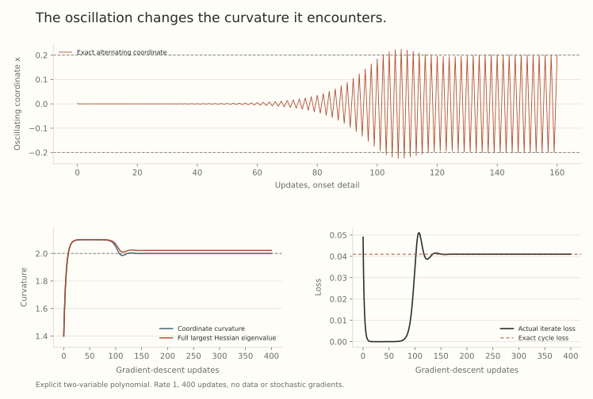

A quadratic mode above its discrete stability threshold alternates and grows. A changing loss can respond to that motion. The key is a mixed cubic term: displacement squared in the oscillating direction can drive motion in a direction that changes curvature.

This is *negative feedback from the oscillations*. We will derive its sign and then study an explicit two-variable example. The example has an attracting two-cycle, so we can check more than a suggestive trajectory plot.

## A third derivative links oscillation to curvature

At a reference point $w$, let $H=\nabla^2L(w)$ have a simple leading eigenvalue $S$ with unit eigenvector $u$. Write $T=\nabla^3L(w)$, viewed as a symmetric trilinear form. Part 28's eigenvalue derivative gives

$$
a:=\nabla S=T[u,u],
$$

where the vector on the right is defined by $v^\top T[u,u]=T[v,u,u]$.

For a small displacement $\delta$, Taylor expansion gives

$$
\nabla L(w+\delta)
=g+H\delta+\tfrac12T[\delta,\delta]
+O(\|\delta\|^3),
$$

provided a fourth-derivative bound controls the remainder locally. A displacement $xu$ contributes the quadratic gradient term

$$
\tfrac12x^2a.
$$

Its descent contribution is $-\eta x^2a/2$. The corresponding first-order change of sharpness is

$$
-\frac{\eta x^2}{2}\|a\|^2.
$$

It has the same sign for positive and negative $x$. Alternating directions cancel in a mean displacement, but their squared amplitude can leave a persistent curvature-reducing effect.

This calculation isolates one term. For a general displacement $xu+v$, there are also $xT[u,v]$, $T[v,v]/2$, moving-eigenvector effects, and Taylor errors. Dropping those terms needs a regime in which they are controlled.

## See both updates in one mixed monomial

Suppose, locally, the retained loss contains

$$
\frac{x^2}{\eta}+\frac b2yx^2-cy,
\qquad b,c>0.
$$

The mixed term gives $bxy$ in the $x$ gradient and $bx^2/2$ in the $y$ gradient. Thus

$$
x^+=-(1+\eta by)x,
\qquad
y^+=y+\eta c-\frac{\eta b}{2}x^2.
$$

Positive $y$ makes the oscillation grow. The growing squared amplitude then opposes the upward drift of $y$. Omitting either derivative of the mixed term destroys this feedback loop.

This is the explanatory structure developed in [Self-Stabilization](https://arxiv.org/abs/2209.15594v2), Section 4. Its more general analysis tracks a moving reference and additional terms. Progressive sharpening enters as an assumption, rather than a consequence of the curvature-reduction calculation.

## An explicit loss with a restoring curvature coordinate

For our worked example, use

$$
L(x,y)=\tfrac12(a+by)x^2+\tfrac\gamma2(y-y_0)^2.
$$

Here $x$ is the oscillating coordinate. The quadratic penalty pulls $y$ toward $y_0$, while $y$ controls the curvature in $x$. Choose

$$
\eta=1,\qquad a=b=1,\qquad\gamma=0.2,
\qquad y_0=1.1.
$$

Exact simultaneous gradient descent is

$$
x^+=(1-\eta(a+by))x,
$$

$$
y^+=(1-\eta\gamma)y+\eta\gamma y_0
-\frac{\eta b}{2}x^2.
$$

The coordinate curvature $\kappa(y)=a+by$ reaches $2/\eta$ at

$$
y_c=\frac{2/\eta-a}{b}=1.
$$

Without oscillations, the restoring term would move $y$ toward 1.1 and the $x$ curvature toward 2.1. With sufficiently large squared amplitude, the last term pushes $y$ back.

This polynomial is a local model. It is not globally bounded below over all $(x,y)$, and the calculation does not claim global convergence from arbitrary starting points. We analyze a specified trajectory and a neighborhood of its cycle.

## Solve the two-cycle before simulating it

Seek a cycle $(A,y_c)\mapsto(-A,y_c)\mapsto(A,y_c)$. The $x$ update flips sign exactly because $a+by_c=2/\eta$.

The $y$ update stays fixed when

$$
\gamma(y_0-y_c)=\frac b2A^2.
$$

Therefore

$$
\boxed{A^2=\frac{2\gamma(y_0-y_c)}b=0.04,\qquad A=0.2.}
$$

The center is $(0,1)$, but neither cycle point equals the center. Both have loss

$$
L(\pm0.2,1)=0.041,
$$

while $L(0,1)=0.001$. The additional loss is the cost of the persistent oscillation. A stable training trajectory need not converge to a stationary parameter vector.

## Check that the cycle attracts nearby points

Existence of a cycle alone does not establish stability. Let $F$ be the one-step map. At $(A,y_c)$ its Jacobian is

$$
DF(A,y_c)=
\begin{pmatrix}
-1&-k\\
-k&1-h
\end{pmatrix},
\qquad k=\eta bA,\quad h=\eta\gamma.
$$

At $(-A,y_c)$, both off-diagonal signs reverse. Multiplying in trajectory order gives the two-step Jacobian

$$
M=
\begin{pmatrix}
1-k^2&k(2-h)\\
-k(2-h)&(1-h)^2-k^2
\end{pmatrix}.
$$

For $k=h=0.2$,

$$
M=\begin{pmatrix}0.96&0.36\\-0.36&0.60\end{pmatrix}.
$$

Its eigenvalues are $0.78\pm0.311769i$, each of modulus 0.84. The cycle is locally attracting. A one-step Jacobian at only one cycle point would not be the relevant return map.

This is a mathematical property of the displayed example. It is not an application of a neural-network coupling theorem to unchecked assumptions.

## Follow the full recurrence

Starting at $(x_0,y_{\mathrm{init}})=(0.001,0.4)$, evaluate 400 simultaneous updates in float64. The small oscillation initially shrinks. The restoring force raises $y$, the multiplier crosses its threshold, and the oscillation grows until its squared amplitude regulates $y$ near one.

{fig-alt="Three panels show the two-variable example. The first tracks alternating x and its predicted cycle amplitude through update 160. The other panels span all 400 updates. The second distinguishes coordinate curvature from the full Hessian's largest eigenvalue near the boundary two. The third shows nonmonotone raw loss and its limiting cycle value 0.041."}

By update 400, the trajectory is numerically at the predicted cycle. This is a cheap evaluation of an explicit polynomial, with no neural-network training, data fitting, or random noise.

The initial loss is about 0.0490. It falls close to zero before the instability becomes visible, rises as the oscillation develops, and approaches 0.041. The curve illustrates why a short loss window and eventual bounded motion are different diagnostics.

## The full sharpness is not exactly the coordinate curvature

The Hessian is

$$
H(x,y)=
\begin{pmatrix}
a+by&bx\\bx&\gamma
\end{pmatrix}.
$$

At the cycle center it has eigenvalues two and 0.2. At either actual cycle point, its largest eigenvalue is

$$
S_{\mathrm{cycle}}
=\frac{2+0.2+\sqrt{(2-0.2)^2+4(0.2)^2}}2
\approx2.021954.
$$

So the full instantaneous sharpness remains slightly above $2/\eta$, even though the two-step orbit attracts. There is no contradiction: the two changing one-step maps have a stable product. The frozen-quadratic calculation does not describe that product.

Calling $a+by$ the full sharpness away from $x=0$ would erase this distinction. For smaller cycle amplitudes, the difference is quadratic in amplitude when the center eigengap stays positive, but it is visible at the finite values used here.

## A perturbation and an averaging window both matter

If $x_0=0$ exactly, the recurrence preserves $x=0$. Then $y$ approaches 1.1 without any oscillation-induced correction. The resulting fixed point is transversely unstable, but exact arithmetic does not invent a displacement.

A tiny nonzero initial $x$ can take many steps to regrow after an initial contraction. The onset delay depends on that amplitude. A model that immediately imposes the eventual equilibrium variance will miss this transient, even if it predicts the final cycle center correctly.

Likewise, averaging two adjacent iterates cancels an exact two-cycle. It need not eliminate a changing envelope, curvature-coordinate drift, or a burst. A smooth curve should identify what was averaged and over which time window.

## What the general theory does and does not give

Self-Stabilization's Theorem 1 is a finite-horizon local coupling to a constrained reference plus a predicted oscillatory displacement. Its hypotheses include an eigengap, positive sharpening alignment, controlled higher derivatives and transverse terms, a small error parameter, and a nonvanishing oscillatory component over the stated horizon. It is not global convergence or a proof that every loss progressively sharpens.

Our example verifies a local cycle directly. The paper supplies a broader conditional analysis. Both support keeping the feedback term. Neither establishes that a larger learning rate always improves generalization or that stochastic momentum training has the same reduced dynamics.

The next post asks what survives after the fast phase is removed: a covariance that still contributes to the center's motion.

## Try following the feedback

1. Why does the curvature-reducing term survive a sign flip of $x$?
2. What return map checks local stability of the displayed cycle?
3. Is the full Hessian's largest eigenvalue exactly two at the actual cycle points?
4. Why does the initial state $x_0=0$ need separate treatment?

Answer sketches

1. It depends on $x^2$.
2. The product of the two one-step Jacobians, in trajectory order.
3. No. It is about 2.021954 because the off-diagonal Hessian entries are nonzero.
4. That coordinate remains zero exactly, so the instability is never excited.

## Yo twin, go read... {#sources-and-scope}

[Self-Stabilization: The Implicit Bias of Gradient Descent at the Edge of Stability](https://arxiv.org/abs/2209.15594v2), Lemma 2, Sections 4 and 5.3, and Section 8.3, gives the cubic feedback, conditional coupling, and unresolved sharpening question. The polynomial, cycle, return-map calculation, and figure here are independent worked examples. They do not reproduce its experiments or certify all of its assumptions.

[Part 28](../scale-geometry-28/index.html) derives the frozen boundary. [Part 30](../scale-geometry-30/index.html) retains the effect of the oscillations through their covariance.
