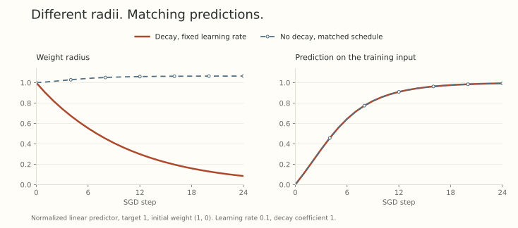

Suppose shrinking a weight leaves every prediction unchanged. What could a penalty on that weight possibly be doing?

The usual answer is that weight decay discourages large weights. That describes the coordinates, but it leaves the important question unanswered: what happens to learning?

[Part 1](../scale-geometry-1/index.qmd) gave us the missing connection. For an exactly scale-invariant block, the radius disappears from the forward function and remains in the directional SGD step. [Part 2](../scale-geometry-2/index.qmd) checked where that exact symmetry is available. Now we can follow the radius through an entire sequence of updates.

There are two results worth keeping separate. We can derive an exact change of variables that replaces decay with a learning-rate schedule. We can also build a simplified model in which shrinkage balances the growth caused by gradient steps. The first is an identity. The second needs an additional assumption.

## Fix the convention before interpreting the penalty

Let $L_t$ be the data loss on the minibatch used at step $t$. Assume a positive rescaling of the block $w$ preserves the model's predictions, so that

$$
L_t(cw)=L_t(w),\qquad c>0.
$$

All other parameters are fixed in this calculation. The identity must hold for every minibatch used, and we stay away from $w=0$.

Our update is raw SGD without momentum:

$$
w_{t+1}=a_t w_t-\eta_t\nabla L_t(w_t),
\qquad a_t=1-\eta_t\lambda_t>0.
$$

Take $\eta_t>0$ and $\lambda_t\geq0$. For this algorithm, adding the penalty $\lambda_t\|w\|_2^2/2$ to the current loss produces exactly the displayed update. With an adaptive preconditioner or a momentum buffer, we must inspect the actual equations before making that identification.

For the data loss, all radii on a positive ray are equivalent. Along that ray, the penalty can be made arbitrarily small by shrinking $w$. It therefore does not directly distinguish a simpler predictor from a more complicated one within this equivalence class. That does not make the training dynamics, or their eventual effect on generalization, irrelevant.

This distinction is the starting point of [van Laarhoven's normalization analysis](https://arxiv.org/abs/1706.05350v1), Sections 2 through 4. It concerns a specified symmetry, not every weight in a normalized network.

## The radius records what decay and gradients do together

Write $w_t=R_t e_t$ with $R_t>0$ and $\|e_t\|_2=1$. Define $h_t=\nabla L_t(e_t)$. The scale identities from Part 1 give

$$
\nabla L_t(w_t)=\frac{h_t}{R_t},
\qquad \langle e_t,h_t\rangle=0.
$$

The radial and tangent parts of the update are perpendicular. Squaring its norm gives the exact recurrence

$$
R_{t+1}^2
=a_t^2R_t^2+\frac{\eta_t^2}{R_t^2}\|h_t\|_2^2.
$$

Decay contributes the first term. The finite gradient displacement contributes the second. A tangent step can increase a radius even though its first-order radial derivative is zero.

The corresponding direction is

$$
e_{t+1}
=\frac{e_t-\alpha_t h_t}{\|e_t-\alpha_t h_t\|_2},
\qquad
\alpha_t=\frac{\eta_t}{a_tR_t^2}.
$$

Here $\alpha_t$ is the coefficient in the exact normalized update. The actual rotation obeys $\tan\theta_t=\alpha_t\|h_t\|_2$. An effective learning rate, a displacement length, and an angle are related quantities, but they are not interchangeable.

At the same current weight and gradient, decreasing $a_t$ increases the rotation. Across different training runs, however, the weights and gradients soon differ. This one-step comparison is not a theorem that stronger decay always helps or always produces faster progress.

## Replace decay with a different learning-rate schedule

There is a stronger statement than the local observation about $R_t$.

Define the cumulative shrinkage

$$
c_0=1,\qquad c_{t+1}=a_t c_t,
$$

and introduce coordinates $z_t=w_t/c_t$. Since every $c_t$ is positive, $z_t$ and $w_t$ represent the same predictor. Their gradients satisfy

$$
\nabla L_t(w_t)=\frac1{c_t}\nabla L_t(z_t).
$$

Substitute $w_t=c_tz_t$ into the SGD update and divide by $c_{t+1}$:

$$
z_{t+1}
=z_t-\widetilde\eta_t\nabla L_t(z_t),
\qquad
\widetilde\eta_t=\frac{\eta_t}{c_t c_{t+1}}.
$$

There is no decay in the $z$ update. Its learning rate has changed instead. Starting both runs from the same weight, using the same minibatches, and using this transformed schedule makes their predictions agree at every step, under the stated symmetry.

No equilibrium, averaging, or small-step approximation entered this derivation. If the minibatches are random, it is an identity for the same realized sequence of minibatches. The exact prediction agreement also uses the assumed forward symmetry, rather than merely an equality of scalar losses.

For constant $\eta$ and $a=1-\eta\lambda$, the formula simplifies to

$$
c_t=a^t,\qquad
\widetilde\eta_t=\eta a^{-(2t+1)}.
$$

The first transformed learning rate is $\eta/a$. Each subsequent one is larger by the factor $a^{-2}$. This is the momentum-free equivalence studied in [Li and Arora's Section 2.1](https://arxiv.org/html/1910.07454v3#S2.SS1). The initialization and first-step factor matter.

The word *clock* is shorthand for this change in step coefficients. It does not mean that an arbitrary finite-step training run is the same trajectory played back faster.

## One toy run in two coordinate systems

Return to our predictor $f_w(x)=w^\top x/\|w\|_2$, input $x=(0,1)$, and target $1$:

$$
L(w)=\frac12\left(\frac{w_2}{\|w\|_2}-1\right)^2.
$$

Use $w_0=(1,0)$, $\eta=0.1$, and $\lambda=1$, so $a=0.9$. These deliberately simple numbers illustrate the identity, not a recommended training configuration.

The decayed first step is $w_1=(0.9,0.1)$. The matched run has no decay and starts with learning rate $0.1/0.9$, giving $z_1=(1,1/9)$. Since $w_1=0.9z_1$, their predictions agree exactly. Both rotate by approximately $6.34^\circ$.

The first three transformed learning rates are approximately $0.111111$, $0.137174$, and $0.169351$. Keeping the no-decay learning rate fixed at $0.1$ would not give the same run.

{fig-alt="A 24-step toy calculation. Decayed SGD shrinks the weight radius while the equivalent no-decay coordinates keep a radius close to one. Their prediction curves overlap."}

The figure computes both recurrences independently. Their prediction discrepancy stays below $10^{-12}$ in this calculation. This verifies the example numerically. The algebra above is what establishes the equivalence.

## An equilibrium estimate needs one more assumption

The radius recurrence is exact, but $\|h_t\|_2^2$ changes with direction and minibatch. To get a simple scalar model, freeze that quantity at a positive constant $Q$, and also hold $\eta>0$ and $\lambda>0$ fixed with $0<a<1$.

If this simplified recurrence has a fixed radius $R_*$, then

$$
R_*^4=\frac{\eta^2Q}{1-a^2}
\approx\frac{\eta Q}{2\lambda},
\qquad \eta\lambda\ll1.
$$

The approximation uses $1-(1-\eta\lambda)^2\approx2\eta\lambda$. It does not follow from scale invariance alone. In our deterministic toy problem, the directional gradient becomes small as the prediction approaches its target, so holding $Q$ fixed would miss part of the dynamics.

For stochastic gradients, replacing $Q$ by an average also requires care: the radius and gradient magnitude may be correlated, and an expectation of an inverse radius is not the inverse of an expected radius. A stationary-radius heuristic is not the same result as the pathwise schedule identity.

This is where the distinctions in the [Intrinsic Learning Rate paper](https://arxiv.org/abs/2010.02916v1) become useful. Its direction-and-radius SDE and its Fast Equilibrium Conjecture have their own assumptions. Neither licenses a universal statement that every optimizer on every architecture depends only on $\eta\lambda$.

## What a decay comparison must hold fixed

On a truly invariant block, decay can change the optimization path without directly changing the predictor when applied alone. Those are compatible facts.

To understand a comparison, I want the actual shrinkage factor $a_t$, the nominal learning rate, the radius, and the angular displacement. Matching only the nominal learning rate can leave the directional dynamics unmatched. Matching one angle still does not establish matching useful feature changes.

We also cannot transfer the derivation unchanged to epsilon-sensitive normalization, scale-sensitive gains, or a block that is only invariant under a joint transformation with another parameter. Part 2 explains why those distinctions matter.

Next comes a complication that is present even under perfect forward invariance: the optimizer remembers. The current gradient is tangent, but its memory need not be.

## Try changing the clock

1. Set $\lambda=0$. What happens to $c_t$ and the transformed schedule?
2. With constant $a=0.9$, what is the ratio $\widetilde\eta_{t+1}/\widetilde\eta_t$? Why is it not $1/a$?
3. In the frozen-$Q$ model, take $\eta=0.1$, $\lambda=1$, and $Q=1$. Compute the exact fixed radius and its angular step.

Answer sketches

1. Every $a_t=1$, so $c_t=1$ and $\widetilde\eta_t=\eta_t$. The change of coordinates becomes the identity.
2. The ratio is $1/0.9^2\approx1.234568$. Both $c_t$ and $c_{t+1}$ appear in the denominator of the transformed learning rate.
3. $R_*=(0.01/0.19)^{1/4}\approx0.4790$. At that fixed point, $\tan\theta=\sqrt{1-a^2}/a$, so $\cos\theta=a$ and $\theta\approx25.84^\circ$. These are predictions of the frozen-$Q$ model, not of the earlier fitting trajectory.

## Yo twin, go read... {#sources-and-scope}

[Twan van Laarhoven, L2 Regularization versus Batch and Weight Normalization (2017)](https://arxiv.org/abs/1706.05350v1), Sections 2 through 4, develops the distinction between a direct norm penalty and its effect on effective learning rates, including equilibrium modeling.

[Zhiyuan Li and Sanjeev Arora, An Exponential Learning Rate Schedule for Deep Learning (ICLR 2020)](https://arxiv.org/abs/1910.07454v3), Section 2.1 and Theorem 2.1, gives the exact momentum-free schedule equivalence. The derivation here states the initialization and extends the displayed change of coordinates to explicitly specified varying $a_t$ and $\eta_t$.

[Zhiyuan Li, Kaifeng Lyu, and Sanjeev Arora, Reconciling Modern Deep Learning with Traditional Optimization Analyses: The Intrinsic Learning Rate (NeurIPS 2020)](https://arxiv.org/abs/2010.02916v1), Sections 3 through 6, is the route into stochastic scale dynamics. Theorem 5.1 and the subsequent conjecture should be read separately.
