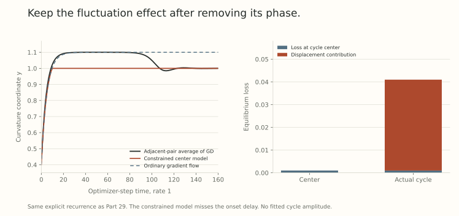

An oscillating trajectory can have a smooth average and still behave differently from gradient flow. Removing the alternating displacement does not remove the effect of its squared amplitude on the gradient.

The useful state is therefore more than a mean parameter vector. It also includes a *displacement covariance*. A central-flow model uses that covariance to retain the curvature feedback developed in Part 29 while discarding the fast phase.

## Define the average before replacing it with a flow

For saved iterates $w_t$, one concrete offline average is

$$
c_t=\sum_{j=-m}^{m}a_jw_{t+j},
\qquad a_j\ge0,
\qquad\sum_ja_j=1.
$$

Freeze this center within the window and write $\delta_{t,j}=w_{t+j}-c_t$. Then $\sum_ja_j\delta_{t,j}=0$ exactly, and

$$
\Sigma_t=\sum_ja_j\delta_{t,j}\delta_{t,j}^\top\succeq0.
$$

This describes a particular filter applied to an existing trajectory. It uses future observations when the window is centered. A flow predicted from the objective is a different object.

To connect them, we would need enough averaging to suppress oscillation, little center drift over that window, controlled derivative variation, and a justified replacement of smoothed finite differences by derivatives. At the birth of an oscillation or during a large spike, those requirements can fail.

A moving average is also not generally idempotent. Subtracting a changing smoothed trajectory does not automatically give a residual whose moving average is exactly zero. The frozen-window construction makes clear which elementary centering identity is exact.

## Average gradients, rather than differentiating the average loss blindly

At a frozen center $c$, let $g=\nabla L(c)$, $H=\nabla^2L(c)$, and define

$$
\mathcal T[v]=DH(c)[v].
$$

Its adjoint maps a symmetric matrix $X$ to a vector, with

$$
\langle v,\mathcal T^*[X]\rangle
=\langle\mathcal T[v],X\rangle_F.
$$

Averaging the gradient Taylor expansion for centered $\delta$ gives

$$
\mathbb E_{\rm time}\nabla L(c+\delta)
=g+\tfrac12\mathcal T^*[\Sigma]
+\mathbb E_{\rm time}r(\delta).
$$

With a bounded fourth derivative, $\|r(\delta)\|\le C\|\delta\|^3$ locally. Small average remainder, rather than visual smoothness of the plotted center, is the relevant requirement.

On optimizer-step time $t$, the resulting model is

$$
\boxed{\dot c=-\eta\left(g+\tfrac12\mathcal T^*[\Sigma]\right).}
$$

Equivalently, the correction is $\nabla_c\langle H(c),\Sigma\rangle_F/2$ with $\Sigma$ held fixed during that derivative. Differentiating a state-dependent fitted $\Sigma(c)$ inside this expression adds terms that were not present in the averaged gradient calculation.

This is the deterministic time-averaging construction in [Understanding Optimization in Deep Learning with Central Flows](https://arxiv.org/abs/2410.24206v2), Section 3 and Appendix A. The discrete-to-flow connection is heuristic and numerically supported, rather than a proved approximation theorem with a general error bound.

## Let marginal stability determine one variance

Suppose the center has one simple critical eigenpair,

$$
Hu=Su,\qquad S=2/\eta,\qquad\|u\|=1.
$$

Model the covariance as $\Sigma=q uu^\top$, where $q\ge0$. Let $a=\nabla S=\mathcal T^*[uu^\top]$. Then

$$
\dot c=-\eta(g+qa/2),
$$

$$
\dot S=\eta\left(r-\frac q2\|a\|^2\right),
\qquad r=\langle a,-g\rangle.
$$

If free descent pushes outward, $r>0$, remaining on the stability boundary requires

$$
q=\frac{2r}{\|a\|^2}.
$$

If $r\le0$, zero variance is enough and the center can move inward. A negative variance is never an admissible way to enforce equality. Thus, for $a\ne0$, the boundary rule is

$$
q=\left[\frac{2r}{\|a\|^2}\right]_+.
$$

In the strict stable interior, the model sets $q=0$. At $a=0$, this formula is undefined and a higher-order or degenerate analysis is needed. It does not determine onset phase or the time required for a tiny displacement to grow.

## Recover the cycle balance from Part 29

At the center $(0,1)$ of that example,

$$
H=\operatorname{Diag}(2,0.2),\qquad
u=(1,0),\qquad a=(0,1),\qquad g=(0,-0.02).
$$

Hence $r=0.02$ and $q=0.04$. This equals the squared cycle amplitude derived directly from the recurrence. No measured trajectory amplitude was fitted to get the prediction.

For centers $(0,y)$ below $y_c=1$, ordinary gradient flow gives

$$
\frac{dy}{d\tau}=0.2(1.1-y),
\qquad \tau=\eta t.
$$

The constrained center follows that flow until it reaches one, then stays there. Starting from $y(0)=0.4$,

$$
y_{\rm central}(\tau)
=\min\{1,\ 1.1-0.7e^{-0.2\tau}\}.
$$

The contact time is $\tau_c=5\log7\approx9.72955$. Ordinary gradient flow instead approaches 1.1. Both flow curves start at the axis center $(0,0.4)$. The discrete comparison retains Part 29's nonzero initial $x=0.001$, so it can develop the oscillation that the center model replaces by a variance.

{fig-alt="Left: the two-variable recurrence's adjacent-pair average y overshoots the constrained central path during oscillation onset, then approaches its boundary value one. Ordinary gradient flow approaches 1.1. Right: equilibrium center loss is 0.001, displacement contribution is 0.04, and cycle loss is their sum 0.041."}

The figure deliberately retains the transient mismatch. The pair average removes the two-step carrier, not its evolving envelope. Agreement of the eventual center and variance does not make the displayed flow an exact description of the entire recurrence.

## The center loss and average raw loss are different observables

The loss Taylor expansion gives

$$
\mathbb E_{\rm time}L(c+\delta)
\approx L(c)+\tfrac12\operatorname{tr}(H\Sigma).
$$

If covariance is supported on GD-critical directions, $H\Sigma=(2/\eta)\Sigma$, so

$$
\overline L\approx L(c)+\frac{\operatorname{tr}\Sigma}{\eta}.
$$

For the explicit cycle, this is exact: $0.001+0.04=0.041$. Comparing a center-loss curve directly with smoothed raw losses would therefore create a discrepancy even at the perfectly balanced cycle.

Likewise, a decreasing center loss does not imply decreasing fluctuation variance. The average raw loss can rise while the center continues to descend. A useful prediction needs both components.

## More than one critical mode needs a matrix condition

Let

$$
A_s=\frac2\eta I-H(c)\succeq0.
$$

The model requires $\Sigma\succeq0$ and $\langle A_s,\Sigma\rangle_F=0$. For positive semidefinite matrices this implies $A_s\Sigma=0$, so the covariance lies in the critical subspace.

These static conditions do not fix its magnitude. Zero covariance satisfies them even when free descent points out of the stable region. We also need future feasibility.

With $U$ an orthonormal critical basis, write $\Sigma=UXU^\top$. Differentiating the slack along the proposed flow gives

$$
\dot A_s
=\eta\mathcal T[g]
+\frac\eta2\mathcal T\mathcal T^*[UXU^\top].
$$

At a regular contact, the critical block must obey a complementarity condition

$$
X\succeq0,\qquad
Y:=U^\top\left(\mathcal T[g]
+\tfrac12\mathcal T\mathcal T^*[UXU^\top]\right)U\succeq0,
\qquad\langle X,Y\rangle_F=0.
$$

Off-diagonal entries of $X$ can matter. Rotating a repeated-eigenvalue basis changes those entries while preserving the ambient covariance. Solving unrelated scalar balances in an arbitrary basis need not preserve that geometry.

Positive definiteness of the associated operator gives a unique covariance solution. Mere positive semidefiniteness does not. Degenerate feedback can leave the covariance ambiguous or make the balance infeasible, so existence and uniqueness require hypotheses.

## The projection interpretation gives a precise conditional statement

At a regular stable center, the feasible velocity cone is

$$
C_c=\{v:U^\top\mathcal T[v]U\preceq0\}.
$$

Under the conditions identifying this linearized cone with the actual tangent cone, the GD central velocity is

$$
\dot c=\eta\Pi_{C_c}(-g).
$$

Let $p=\Pi_{C_c}(-g)$. Projection onto a closed convex cone gives $g^\top p=-\|p\|^2$, hence

$$
\frac{d}{dt}L(c(t))=-\eta\|p\|^2\le0.
$$

This is a property of the defined constrained flow. The stable region itself need not be globally convex. Neither the projection identity nor monotone center loss proves that arbitrary discrete GD tracks the flow.

## This covariance is not the noise from Part 25

Here $\Sigma$ has units of squared parameter displacement and can arise in deterministic full-batch training. Part 25's gradient-noise covariance has squared gradient units. They are not interchangeable inputs to the same formula.

Stochastic gradients can contribute to displacement fluctuations, but deriving their covariance needs a dynamical calculation. Momentum adds temporal state. Adaptive methods add preconditioning history and change the effective stability geometry. None follows by inserting an SGD noise matrix into the deterministic closure unchanged.

The central-flows paper studies deterministic GD and RMSProp variants. Its limitations include costly numerical evaluation, reduced accuracy around large excursions and nonsmooth architectures, and the absence of a stochastic or momentum extension. Its predictive success remains distinct from a uniform approximation guarantee.

## Try reading the averaged state

1. Why does averaging away the sign of an oscillation leave a gradient correction?
2. At the boundary, should an inward free drift be balanced by negative variance?
3. Why can the center loss differ from average raw loss?
4. Do stability support conditions alone determine the covariance magnitude?

Answer sketches

1. The quadratic displacement term survives and contracts the loss's third derivative with the covariance.
2. No. Zero variance is admissible and lets the center move inward.
3. The raw trajectory carries a quadratic fluctuation loss, approximately $\operatorname{tr}\Sigma/\eta$ on critical directions.
4. No. Future feasibility and a nondegenerate response are needed to close the balance.

## Yo twin, go read... {#sources-and-scope}

[Understanding Optimization in Deep Learning with Central Flows](https://arxiv.org/abs/2410.24206v2), Section 3, Appendix A.1.5, Appendix A.2, and Section 8, develops the averaging, complementarity, projection, and scope qualifications. The two-variable evaluation here is an independent illustration, including its onset mismatch. It is not a reproduction of the paper's neural-network comparisons.

[Part 29](../scale-geometry-29/index.html) supplies the exact cycle. [Part 25](../scale-geometry-25/index.html) supplies the separate Gaussian gradient-response calculation whose covariance has a different meaning.
