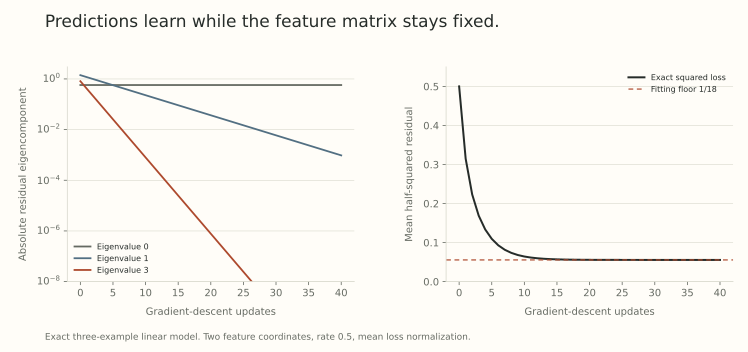

Increasing a network's width does not specify how it learns. Initialization, output normalization, parameter coordinates, and learning rates determine which changes remain visible as width grows.

One possible limit keeps the tangent features fixed while predictions continue to change. That is *function learning without persistent feature motion*. Before asking how to preserve feature learning, it helps to solve this simpler regime exactly.

## Freeze the Jacobian, not the predictions

For $M$ training inputs and a scalar-output network, collect predictions in $f(\theta)\in\mathbb R^M$. At initialization $\theta_0$, let

$$
J_0=D_\theta f(\theta_0)\in\mathbb R^{M\times P}.
$$

The tangent model is

$$
f_{\rm lin}(\theta)=f_0+J_0(\theta-\theta_0).
$$

Its features are the rows of $J_0$, one gradient vector per input. They remain fixed because that is how this model is defined. Parameters and predictions can still move.

For squared loss

$$
\mathcal L(\theta)=\frac1{2M}\|f_{\rm lin}(\theta)-y\|^2,
$$

write the residual $r_t=f_{\rm lin}(\theta_t)-y$. Gradient descent gives

$$
\theta_{t+1}=\theta_t-\frac\eta M J_0^\top r_t.
$$

Multiplying by $J_0$ yields an exact output recurrence:

$$
\boxed{r_{t+1}=\left(I-\frac\eta M K_0\right)r_t,
\qquad K_0=J_0J_0^\top.}
$$

This is exact for the tangent model. For the original nonlinear network, it is an approximation whose validity needs separate control. A small parameter step alone does not make all accumulated Taylor errors disappear.

## Read the dynamics through kernel eigenvalues

The matrix $K_0$ is positive semidefinite because

$$
v^\top K_0v=\|J_0^\top v\|^2\ge0.
$$

If $K_0u_j=\lambda_ju_j$, the residual component evolves as

$$
u_j^\top r_t=
\left(1-\frac{\eta\lambda_j}{M}\right)^t u_j^\top r_0.
$$

Every positive excited mode decays when $0<\eta\lambda_j/M<2$. This is Part 28's stability calculation applied in output space. A zero eigenvalue preserves its residual component, rather than learning it slowly.

When all positive modes are stable,

$$
r_\infty=\Pi_{\ker K_0}r_0.
$$

A fixed kernel can learn rapidly and still leave a fitting floor. Whether that floor exists depends on the data and the tangent feature span, not on the word kernel.

## A three-example model with a visible fitting floor

Take the fixed feature matrix

$$
Z=\begin{pmatrix}1&0\\0&1\\1&1\end{pmatrix},
\qquad f(\theta)=Z\theta,
\qquad r_0=(1,-1,1)^\top.
$$

Its kernel is

$$
K=ZZ^\top=
\begin{pmatrix}1&0&1\\0&1&1\\1&1&2\end{pmatrix},
$$

with eigenvalues zero, one, and three. The third prediction always equals the sum of the first two, so the model cannot represent arbitrary labels on these three examples.

At $\eta=1/2$ and $M=3$, the residual multipliers are one, $5/6$, and $1/2$. The surviving residual is

$$
r_\infty=(-1/3,-1/3,1/3)^\top,
\qquad\mathcal L_\infty=\frac1{18}.
$$

{fig-alt="Left: the two learnable residual eigencomponents decay geometrically while the nullspace component stays constant. Right: the exact three-example squared loss falls from 0.5 toward the fitting floor one over eighteen. No feature changes are involved."}

The figure evaluates this small linear recurrence. It is not a neural-network benchmark. Its purpose is to make a distinction concrete: unchanged features do not imply unchanged predictions, and changing predictions do not prove feature learning.

## Predictions away from the training inputs use the same features

Let $j_0(x)=\nabla_\theta f(x,\theta_0)$ be the tangent vector of a test input. Define its training kernel vector by

$$
k_x=J_0j_0(x)\in\mathbb R^M.
$$

The finite-step prediction is

$$
f_t(x)=f_0(x)-\frac\eta M\sum_{s<t}k_x^\top r_s.
$$

For stable positive modes, its limit is

$$
f_\infty(x)=f_0(x)-k_x^\top K_0^+r_0,
$$

where $K_0^+$ is the pseudoinverse. There is no divergent nullspace term: $k_x$ lies in the range of $J_0$, which equals the range of $K_0$.

The extension to new inputs is therefore determined by the original feature geometry and the initial function. It can generalize well or badly. The algebra alone does not determine the task's answer.

## How a wide nonlinear network can approach this model

Consider the two-layer network

$$
f_n(x)=\frac1{\sqrt n}\sum_{i=1}^n a_i\phi(w_i^\top x),
$$

with fixed input dimension, order-one independent centered readout coefficients, order-one first-layer coordinates, and a smooth activation with suitable moments. Train both parameter groups with an order-one SGD rate.

For a single order-one loss derivative $\chi$, the updates are

$$
\Delta a_i=-\frac\eta{\sqrt n}\chi\phi(w_i^\top x),
$$

$$
\Delta w_i=-\frac\eta{\sqrt n}\chi a_i\phi'(w_i^\top x)x.
$$

Individual feature changes are small at large width. Yet their aligned contributions to the output can sum to an order-one change. The corresponding tangent kernel is

$$
K_n(x,x')=\frac1n\sum_i
\left[\phi(h_i(x))\phi(h_i(x'))
+a_i^2\phi'(h_i(x))\phi'(h_i(x'))x^\top x'\right].
$$

The first term comes from training the readout. The second comes from training the first layer. Freezing the first layer removes the second contribution, so training every layer in a kernel regime is not generally equivalent to training only the last layer.

At initialization, a law of large numbers can make this kernel deterministic even while $f_n$ has a nondegenerate random limit. A deterministic limiting kernel does not require a zero or deterministic initial function.

## One-step scaling is the beginning of a limit argument

The displayed updates show the first step's coordinate scale. Extending that reasoning to several steps needs control of residuals, moments, derivative changes, and the dependence created by reusing trained matrices. Declaring the neurons independent again after every update would change the problem.

[Feature Learning in Infinite-Width Neural Networks](https://arxiv.org/abs/2011.14522v3), Section 3 and Appendix H, classifies kernel and feature-learning regimes for a specified family of bias-free, fixed-depth MLP parameterizations. Its results keep input dimension and training horizon fixed as width grows and impose activation and stability hypotheses. They do not classify every architecture or every width-dependent training duration.

Thus, a statement such as features freeze at every fixed training step cannot be exchanged automatically with a statement about training for $n$ steps. Small per-step motion may accumulate on a growing horizon.

## Measure feature motion in a width-consistent way

For hidden activations $h_t(x)\in\mathbb R^n$, one useful measure is

$$
\frac1n\|h_t(x)-h_0(x)\|^2.
$$

The normalization asks whether typical coordinates move, rather than whether a vector's unnormalized length grows with its dimension. A vanishing value is compatible with a nonvanishing Euclidean norm of the full displacement.

A feature Gram matrix, tangent kernel, and output trajectory are different observables. Hidden-feature agreement alone does not automatically prove that every backpropagated tangent feature is unchanged. The complete limit argument must supply that link.

This also keeps the practical question separate. A width limit can retain feature motion without making those features useful, and a fixed-feature predictor can perform well. Part 27's distinction between feature change and a successful mechanism still applies.

The next post changes the output scale and rate together, so order-one feature motion can survive without an exploding output update.

## Try reading a fixed-feature trajectory

1. Does a frozen Jacobian force the parameters to stay fixed?
2. Which residual components survive stable kernel gradient descent?
3. Why can training both layers produce a different kernel from training only the readout?
4. Does a deterministic limiting kernel imply a deterministic initial prediction?

Answer sketches

1. No. The tangent model is linear in trainable parameters.
2. The projection of the initial residual onto the kernel nullspace.
3. First-layer parameter gradients contribute an additional tangent inner product.
4. No. The initial output can retain order-one Gaussian fluctuations.

## Yo twin, go read... {#sources-and-scope}

[Feature Learning in Infinite-Width Neural Networks](https://arxiv.org/abs/2011.14522v3), Sections 3.1 and 3.2, Theorems 3.6 and 3.8, and Appendix H, supplies the parameterization-dependent distinction. The finite linear example and kernel calculations above are worked illustrations, not a reproduction of the paper's empirical comparisons.

Read [Part 28](../scale-geometry-28/index.html) for the discrete multiplier boundary and [Part 32](../scale-geometry-32/index.html) for a scaling that preserves feature motion.
