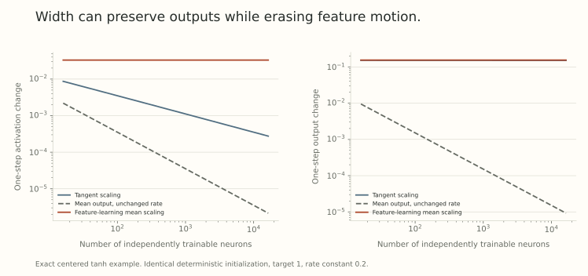

The tangent scaling in Part 31 keeps output updates visible while individual feature changes vanish. To preserve feature learning, increasing the learning rate alone is not enough. The output scale must tolerate the coherent changes produced by that update.

The key distinction is between *random initialization and aligned learning*. A centered random sum typically grows like the square root of width. A training-induced sum can grow like width. A parameterization has to account for both.

## Keep both exponents visible

Use a two-layer network with fixed input dimension:

$$
f_n(x)=c_n\sum_{i=1}^n a_i\phi(w_i^\top x),
\qquad c_n=n^{-\beta}.
$$

The effective neuron coordinates $a_i,w_i$ begin at order one. Give both groups the rate $\eta n^\gamma$. For one example and an order-one loss derivative $\chi$,

$$
\Delta a_i=-\eta n^{\gamma-\beta}\chi\phi(h_i),
$$

$$
\Delta w_i=-\eta n^{\gamma-\beta}\chi a_i\phi'(h_i)x.
$$

At a nondegenerate state, the typical preactivation change has scale $n^{\gamma-\beta}$. An order-one feature change requires $\gamma=\beta$.

The first-order output update contains a sum of squared tangent features. For this training example,

$$
\Delta f_{\rm tangent}
=-\eta n^{\gamma-2\beta}\chi
\sum_i\left[\phi(h_i)^2
+a_i^2\phi'(h_i)^2\|x\|^2\right].
$$

If its empirical bracket average remains positive and finite, its scale is $n^{1+\gamma-2\beta}$. A bounded, nonvanishing first-order output update therefore calls for

$$
1+\gamma-2\beta=0.
$$

Combining the two requirements gives $\beta=\gamma=1$. At this boundary the higher-order output terms can also survive, so the tangent expression is a scale diagnostic, not an exact finite-update formula.

## Three choices make the tradeoff concrete

| Convention in the displayed coordinates | $c_n$ | Rate | Feature-coordinate step | First-order output step |
| --- | --- | --- | --- | --- |
| Tangent scaling | $n^{-1/2}$ | $\eta$ | $n^{-1/2}$ | Order one |
| Mean output with unchanged rate | $n^{-1}$ | $\eta$ | $n^{-1}$ | $n^{-1}$ |
| Feature-learning mean scaling | $n^{-1}$ | $\eta n$ | Order one | Order one |

These orders assume a nonzero training signal and nondegenerate features. They describe a two-layer family with common coordinate rates, not every possible layerwise scaling.

More generally, setting $\gamma=2\beta-1$ preserves the tangent output scale. The feature step then scales as $n^{\beta-1}$. For $\beta<1$ it vanishes. At $\beta=1$ it survives. Above one, generic feature steps grow with width and leave this stable-feature power count.

## Initialization supplies a different constraint

If the readout coefficients are independently centered and the summands have finite nonzero variance, the initial output standard deviation is of order

$$
\sqrt n\,c_n=n^{1/2-\beta}.
$$

The tangent choice keeps order-one initial fluctuations. The feature-learning mean choice makes them vanish as $n^{-1/2}$. A zero limiting initial prediction does not imply a zero training signal: a nonzero target still gives an order-one loss derivative.

After training, the readout and feature changes depend on each other. The output update can be coherent across neurons, which is why its power count contains $n$ rather than $\sqrt n$. Reapplying an initialization independence argument to trained weights can miss the leading contribution.

This also explains why preserving initial activation variance is insufficient to determine learning-rate transfer. It fixes a forward scale, while aligned updates impose an additional condition.

## Check one complete nonlinear step

For a controlled calculation, take $x=1$, $\phi=\tanh$, and initialize every independently trainable neuron at $a_i=w_i=1$. Subtract the fixed initial function:

$$
f_n=c_n\sum_i[a_i\tanh(w_i)-\tanh(1)].
$$

The subtraction is constant during optimization. It makes $f_0=0$ for every width, allowing a common target of one. The neurons have separate parameters even though their initialization and updates coincide by symmetry.

Write $p=\tanh(1)$, $d=1-p^2$, and $s=\eta n^{\gamma-\beta}$. One simultaneous SGD step gives

$$
a_i^+=1+sp,\qquad w_i^+=1+sd,
$$

$$
\boxed{f_n^+=n^{1-\beta}
\left[(1+sp)\tanh(1+sd)-p\right].}
$$

This formula retains the finite nonlinear change. With $\eta=0.2$, the feature-learning mean choice gives the same activation change, about 0.03308, and the same output step, about 0.15413, at every width.

{fig-alt="Two log-log panels compare three exact one-step scalings across width. Tangent scaling retains the output step while its activation change decreases. An unadjusted mean output freezes both. The feature-learning mean scaling retains both changes at width-independent values."}

The deterministic, centered initialization is intentionally different from the random initialization used in a width-limit theorem. The figure verifies the displayed scale mechanism. It is not evidence that arbitrary finite networks follow these curves or that the feature-learning choice predicts better labels.

## A growing effective rate can be a constant raw rate

The factor $\eta n$ may look alarming until we specify parameter coordinates. Set

$$
u_i=w_i/\sqrt n,\qquad v_i=a_i/\sqrt n.
$$

Then the mean-scaled network is exactly

$$
f_n(x)=\frac1{\sqrt n}\sum_i
v_i\phi(\sqrt n\,u_i^\top x),
$$

up to any fixed initial-function subtraction used in the example. Apply ordinary SGD with the same raw rate $\eta$ to $u_i,v_i$. The chain rule gives

$$
\nabla_{u_i}\mathcal L=\sqrt n\nabla_{w_i}\mathcal L,
\qquad
\nabla_{v_i}\mathcal L=\sqrt n\nabla_{a_i}\mathcal L.
$$

Multiplying the raw updates back by $\sqrt n$ yields the effective rate $\eta n$ for $w_i,a_i$. These are identical finite trajectories under coupled initial conditions, not merely equivalent orders as width grows.

Order-one random $w_i,a_i$ correspond to raw $u_i,v_i$ of standard deviation $n^{-1/2}$. This is the shallow mean-field form of the maximal-update convention discussed in [Tensor Programs IV](https://arxiv.org/abs/2011.14522v3), Sections 3.1 and 5. A rate number without its coordinates does not identify the algorithm.

## Maximality has a stated comparison class

The exponent calculation asks how much direct feature motion survives while activations and output updates remain controlled. In the displayed common-rate family, the feature-learning boundary makes that motion order one.

For deeper networks, first-layer, hidden-matrix, and readout coordinates have different shapes and alignments. The full maximal-update construction handles those channels separately. It is not obtained by multiplying every existing implementation's learning rate by width.

The paper's classification uses stable, nontrivial parameterizations, fixed depth and finite training time, and specified activation hypotheses. Its maximality concerns width orders within that setup. It does not determine the best finite learning-rate constant, certify every nonlinear stability condition, or prove universal predictive superiority.

Part 17's aligned-action calculation explains why these distinctions already matter before taking a limit. A matrix can have small entries while its coherent action on the current features remains substantial.

## What a useful width check would measure

For a specified architecture and optimizer, record the actual forward coefficients, initialization variances, coordinate rates, loss normalization, and damping conventions. Then measure hidden RMS changes, output changes, and any intended transfer metric across widths.

A flat curve for one chosen rate is a scaling check. A claim about transferable optimal hyperparameters needs actual sweeps and an evaluation protocol. A nonvanishing feature change is another property again, and needs task evidence before it becomes a claim about useful representations.

Adaptive updates introduce one more distinction: even when features freeze, their nonlinear processing of gradients can prevent a fixed linear kernel description. That is the next post's subject.

## Try separating coordinates from scales

1. Why does an aligned output update use an $n$ factor rather than $\sqrt n$?
2. What happens to the displayed mean-output model if its coordinate rate stays fixed?
3. Why can rate $\eta n$ and rate $\eta$ describe the same trajectory?
4. Does maximal-update scaling select the optimal finite rate constant?

Answer sketches

1. Training correlates contributions, and the tangent self-update sums nonnegative squared features.
2. Both feature motion and the output update vanish on a fixed number of steps.
3. The trainable coordinates can differ by $\sqrt n$, producing two chain-rule factors in the effective update.
4. No. The exponent specifies width order, not the best constant or task outcome.

## Yo twin, go read... {#sources-and-scope}

[Feature Learning in Infinite-Width Neural Networks](https://arxiv.org/abs/2011.14522v3), Sections 3.1, 3.2, and 5, develops the shallow equivalence and general maximal-update framework. The exact centered-neuron calculation is an independent illustration with deliberately deterministic initialization. It does not establish a new limit theorem or reproduce a benchmark.

Read [Part 17](../scale-geometry-17/index.html) for aligned action and raw versus master rates, and [Part 31](../scale-geometry-31/index.html) for the frozen tangent model being extended here.
