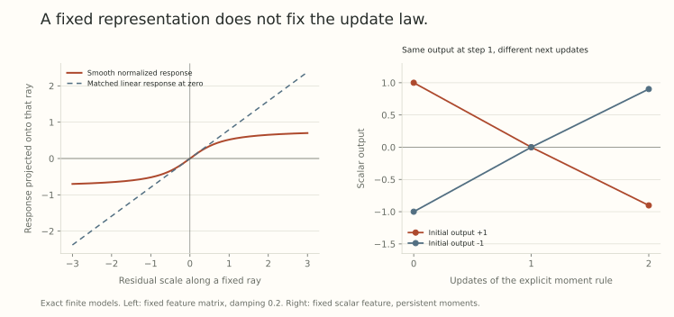

Part 31 derived a fixed kernel because a fixed feature matrix was paired with a linear gradient update. Freeze those same features but process each parameter gradient nonlinearly, and the output dynamics can become nonlinear in the residual.

This is a *nonlinear response with fixed features*. It does not establish representation learning. It tells us that the rule turning errors into parameter motion is another ingredient of the limiting dynamics.

## Begin with an exact finite feature model

Let $f=Z\theta$ on $M$ training examples, with fixed $Z\in\mathbb R^{M\times P}$. Use

$$
\mathcal L=\frac1{2M}\|r\|^2,
\qquad r=Z\theta-y,
\qquad g=\frac1MZ^\top r.
$$

Apply a scalar function $Q$ separately to every coordinate of $g$:

$$
\theta^+=\theta-\eta Q(g).
$$

The exact residual update is

$$
\boxed{r^+=r-\eta\mathcal T_Q(r),
\qquad \mathcal T_Q(r)=ZQ(Z^\top r/M).}
$$

Identity processing recovers $\mathcal T_{\rm Id}(r)=ZZ^\top r/M$, the ordinary linear kernel rule. General $Q$ does not commute with the feature sum and need not give a linear function of $r$.

For a smooth example, take

$$
Q_\epsilon(u)=\frac{u}{\sqrt{u^2+\epsilon^2}},
\qquad\epsilon>0.
$$

It is nearly linear near zero and saturates at larger inputs. In general, $\mathcal T_Q(2r)\ne2\mathcal T_Q(r)$. No single fixed matrix reproduces that map on all residuals, although a local Jacobian can approximate it near a chosen state.

## The local Jacobian can be positive without the map being linear

Differentiating gives

$$
D\mathcal T_Q(r)
=\frac1M Z\operatorname{Diag}(Q'(Z^\top r/M))Z^\top.
$$

For the displayed rule,

$$
Q_\epsilon'(u)
=\frac{\epsilon^2}{(u^2+\epsilon^2)^{3/2}}>0.
$$

Hence this Jacobian is positive semidefinite, but depends on the current residual. Positive semidefinite describes the derivative matrix here. It does not turn the nonlinear map itself into a fixed kernel matrix.

There is also a useful potential. If $\psi'=Q$, define

$$
\Psi(r)=M\sum_{j=1}^P\psi((Z^\top r/M)_j).
$$

Then $\nabla_r\Psi=\mathcal T_Q$. For $Q_\epsilon$, one can take $\psi(u)=\sqrt{u^2+\epsilon^2}$. A monotone $Q$ gives a convex potential. This is a finite-dimensional calculation, not an unconditional convergence result for adaptive optimizers with memory.

## A descent direction still needs a finite-step restriction

If $uQ(u)\ge0$, then

$$
r^\top\mathcal T_Q(r)
=M\sum_jg_jQ(g_j)\ge0.
$$

The continuous direction therefore points toward smaller squared residual norm. The actual finite-step loss change is

$$
\mathcal L^+-\mathcal L
=-\frac\eta M r^\top\mathcal T_Q(r)
+\frac{\eta^2}{2M}\|\mathcal T_Q(r)\|^2.
$$

A sufficiently large step can raise the loss despite the favorable first term. This is the same distinction between a local direction and a finite update that appeared in Part 28.

{fig-alt="Left: response along a residual ray for a fixed feature matrix saturates under a smooth normalized coordinate update, unlike its matched linear response at zero. Right: two explicit moment-rule trajectories meet at the same zero output after one step and then separate because their stored first moments have opposite signs."}

The left panel uses Part 31's three-by-two feature matrix, residual direction $(1,0.5,-0.25)$, and $\epsilon=0.2$. The linear comparison matches the derivative at zero. The right panel is the exact memory example developed below. Neither panel changes its feature matrix.

## Specify a nontrivial width normalization

The finite formula does not yet specify an infinite-width limit. Let fixed tangent columns be $z_i/\sqrt n$, with $z_i\in\mathbb R^M$, and write

$$
f_n=\frac1{\sqrt n}\sum_i z_i\theta_i.
$$

The raw parameter gradient is $g_i=z_i^\top r/(M\sqrt n)$. To keep the argument of a nonlinear rule visible, consider the explicitly scaled update

$$
\Delta\theta_i=-\frac\eta{\sqrt n}
Q(z_i^\top r/M).
$$

It produces

$$
\Delta f_n=-\frac\eta n\sum_i z_iQ(z_i^\top r/M).
$$

If the empirical tangent law and required moments converge, the output response becomes

$$
\mathcal K_Q(r)=\mathbb E_z[zQ(z^\top r/M)].
$$

Identity processing gives $\mathbb E[zz^\top]r/M$. Nonlinear processing retains more of the fixed tangent law than its second moment alone.

[Tensor Programs IVb](https://arxiv.org/abs/2308.01814v2), Section 2.4, develops this operator viewpoint for neural tangent limits under its architecture and update-function assumptions. In a body matrix, the relevant tangent variable involves a forward and backward coordinate pair. Our linear feature model illustrates the contraction without claiming to derive every deep-network limit.

## Epsilon belongs to the width scaling

Suppose the raw update is

$$
\Delta\theta_i=-\alpha_n
\frac{g_i}{\sqrt{g_i^2+\epsilon_n^2}}.
$$

Set $u_i=z_i^\top r/M$. If $\epsilon_n=\epsilon/\sqrt n$ and $\alpha_n=\eta/\sqrt n$, the update becomes exactly the scaled nonlinear rule above.

With fixed positive $\epsilon_n=\epsilon$ and bounded $u_i$, the denominator instead becomes epsilon-dominated at large width. At raw rate $\alpha_n=\eta$, the leading update is $-\eta g_i/\epsilon$, giving a linear kernel response with a rescaled rate. Keeping $\alpha_n=\eta/\sqrt n$ in that same fixed-epsilon regime would make the aggregate output update vanish under the stated moment scaling.

Thus the same informal name for a normalized update can describe different limits. Gradient preprocessing, damping placement, and rate conventions must be specified together. The denominator here is $\sqrt{g^2+\epsilon^2}$, which is a particular convention.

## Memory prevents closure on the current output alone

Consider an explicit scalar rule on $\mathcal L(\theta)=\theta^2/2$:

$$
m^+=0.9m+0.1g,\qquad
v^+=0.99v+0.01g^2,
$$

$$
\theta^+=\theta-\alpha\frac{m^+}{\sqrt{v^++0.1^2}}.
$$

Use zero initial moments, no bias correction, and

$$
\alpha=\frac{\sqrt{0.01+0.1^2}}{0.1}=\sqrt2.
$$

Starting at either $\theta=1$ or $\theta=-1$, the first update reaches zero exactly. The two paths now have the same output, loss, and current gradient. Their stored first moments are $+0.1$ and $-0.1$, while both second moments are 0.01.

The next zero gradient does not erase that memory. The first moments become $\pm0.09$, second moments become 0.0099, and the next outputs are approximately $\mp0.902258$.

These states come from actual preceding updates, rather than arbitrary invented buffers. A rule depending only on the current residual cannot distinguish them. A closed description must retain the optimizer state or the relevant history.

## Reuse each coordinate's history

In a frozen tangent law, a memoryful response has the schematic form

$$
\mathbb E_z\left[z\,
Q_t(z^\top r_0/M,\ldots,z^\top r_t/M)\right].
$$

The same $z$ appears at every time. Drawing an independent tangent variable at each step changes correlations within a coordinate's moment history and describes another algorithm.

This distinction is especially important for matrix updates, where state belongs to a coordinate pair. An independent-copy expectation used to average over a different neuron index is not permission to resample an existing coordinate's temporal state.

The paper's memoryful tangent formulation retains error history. Its formal width statements use fixed finite horizons and regularity and moment conditions. They do not establish that arbitrary Adam training, nonsmooth updates, or growing training durations share one universal limiting equation.

## Keep three descriptions separate

A fixed linear kernel describes frozen tangent features with linear processing. A nonlinear tangent operator can describe frozen features with nonlinear processing. A feature-learning limit evolves the feature law itself and generally needs additional state.

None of these labels ranks predictive quality by itself. Their value is that they identify what a proposed explanation must track: a matrix, a fixed law processed nonlinearly, or a changing representation and optimizer state.

## Try identifying the missing state

1. When does $ZQ(Z^\top r/M)$ reduce to a fixed matrix times $r$?
2. Does a positive semidefinite local Jacobian imply the response is linear?
3. Why does fixed epsilon change the displayed normalized rule's width limit?
4. Why do the two scalar paths separate after meeting at zero?

Answer sketches

1. Identity processing gives $ZZ^\top r/M$. Other linear processing gives another fixed linear map.
2. No. The Jacobian can vary with the residual.
3. Raw gradients shrink with width, so fixed damping can dominate their magnitude and linearize the rule.
4. Their first-moment histories differ even though their current output and gradient coincide.

## Yo twin, go read... {#sources-and-scope}

[Tensor Programs IVb: Adaptive Optimization in the Infinite-Width Limit](https://arxiv.org/abs/2308.01814v2), Definitions 2.4.4 and 2.4.8, Theorems 2.4.7 and 2.4.9, and Section 2.4.3, distinguishes frozen nonlinear operators, memory, and feature motion. The finite potential, damping calculation, and two-path example here are worked illustrations, not a reproduction of the paper's experiments or a claim that every advertised extension is proved.

Read [Part 24](../scale-geometry-24/index.html) for optimizer-state transformations and [Part 32](../scale-geometry-32/index.html) for why raw rates need their parameter coordinates.
