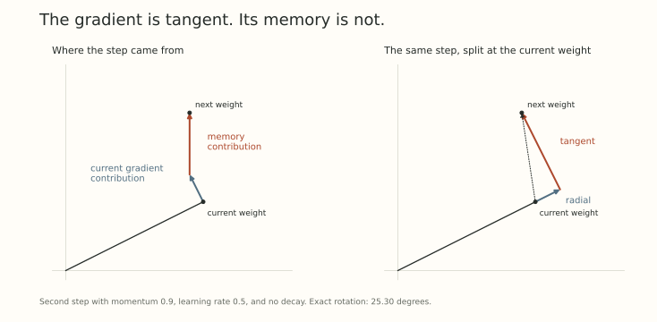
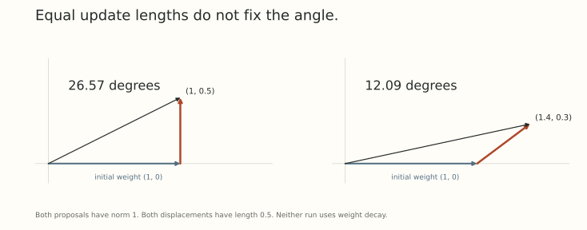

Under exact scale invariance, the current gradient is perpendicular to the current weight. Does that mean a momentum optimizer also steps perpendicular to the weight?

Only if its memory happens to point that way.

A gradient from the last iteration was tangent to the weight at the last iteration. The weight has moved since then. Add that old gradient to the current one, and the resulting update can have a radial component even when both gradients came from the same perfectly scale-invariant loss.

This changes the geometry behind the effective step. It also explains why two updates with the same norm can rotate a weight by different angles.

## Choose a buffer convention we can actually analyze

Use the following momentum update with decoupled decay:

$$
m_t=\beta m_{t-1}+g_t,
\qquad g_t=\nabla L_t(w_t),
$$

$$
w_{t+1}=a_t w_t-\eta_t m_t,
\qquad a_t=1-\eta_t\lambda_t>0.
$$

Here $0\leq\beta<1$, $m_{-1}=0$, $\eta_t>0$, and $\lambda_t\geq0$. The buffer stores gradients before multiplication by the learning rate. There is no $(1-\beta)$ factor, dampening, Nesterov lookahead, or decay term inside this buffer.

That last choice matters. A coupled quadratic penalty would instead give

$$
m_t^{\mathrm{coupled}}
=\beta m_{t-1}^{\mathrm{coupled}}+g_t+\lambda_t w_t,
\qquad
w_{t+1}=w_t-\eta_t m_t^{\mathrm{coupled}}.
$$

The penalty then persists in the buffer. With zero initial buffers, the first weight update agrees with our decoupled version, but the stored states differ and later weight updates generally diverge. With $\beta=0$ the distinction disappears for these equations.

[Loshchilov and Hutter's decoupled-weight-decay paper](https://arxiv.org/abs/1711.05101v3), Section 2 and Algorithm 1, is a useful reference for keeping these choices separate. Its buffer stores a learning-rate-scaled contribution. Our displayed convention stores the unscaled gradient, so a changing learning rate requires its own bookkeeping.

For the geometry below, assume the same blockwise forward invariance as before. Then $g_t\perp w_t$. The statement is about the data gradient, not automatically about $m_t$.

## Split the proposed update at the current weight

Write $w_t=R_t e_t$ with unit $e_t$. Decompose the buffer into

$$
p_t=\langle e_t,m_t\rangle,
\qquad v_t=m_t-p_t e_t,
\qquad v_t\perp e_t.
$$

The scalar $p_t$ is the radial component of the buffer. The vector $v_t$ is its tangent component. The weight update becomes

$$
w_{t+1}
=(a_tR_t-\eta_t p_t)e_t-\eta_t v_t.
$$

Everything about this one step is now a right triangle. Its new radius is

$$
R_{t+1}^2
=(a_tR_t-\eta_t p_t)^2+\eta_t^2\|v_t\|_2^2.
$$

If $a_tR_t-\eta_t p_t>0$, the rotation satisfies

$$
\tan\theta_t
=\frac{\eta_t\|v_t\|_2}{a_tR_t-\eta_t p_t}.
$$

The denominator contains information that $\eta_t\|m_t\|_2/R_t$ loses. If the denominator is zero or negative, use

$$
\theta_t=\operatorname{atan2}
\left(\eta_t\|v_t\|_2,\ a_tR_t-\eta_t p_t\right),
$$

with an angle in $[0,\pi]$ and a nonzero resulting weight. A negative denominator can mean a rotation beyond $90^\circ$. Ordinary arctangent of the ratio would choose the wrong quadrant. If both arguments vanish, the next weight is zero and its direction is undefined.

These are exact finite-step identities. No assumption about random gradients or equilibrium is needed.

## A two-step example exposes the radial memory

Use the same normalized predictor and squared loss as Parts 1 and 3. Turn decay off for this example, set $\eta=1/2$ and $\beta=0.9$, and begin at $w_0=(1,0)$.

The first gradient and buffer are $g_0=m_0=(0,-1)$, so $w_1=(1,1/2)$. The old gradient is no longer perpendicular to the new weight:

$$
\langle w_1,m_0\rangle=-1/2.
$$

The new gradient is still tangent. Direct differentiation gives

$$
g_1\approx(0.197771,-0.395542),
\qquad
m_1\approx(0.197771,-1.295542).
$$

Since $R_1=\sqrt5/2$, the radial component is

$$
p_1=\frac{\langle w_1,m_1\rangle}{R_1}
=-\frac{\beta\eta\|m_0\|_2^2}{R_1}
\approx-0.402492.
$$

The equality uses $m_0\perp w_0$ and $g_1\perp w_1$. It is a statement about this second step with a zero initial buffer, not a formula for every later $p_t$.

The tangent component has norm $\|v_1\|_2\approx1.247214$. The exact geometric formula gives a rotation of approximately $25.30^\circ$, and the next weight is

$$
w_2\approx(0.901115,1.147771).
$$

Pretending that the whole buffer were tangent would instead give $\arctan(\eta\|m_1\|_2/R_1)\approx30.37^\circ$.

{fig-alt="The second momentum step in the worked example. The current gradient step is tangent, but the contribution from the previous gradient has a radial component. The same total step splits exactly into radial and tangent displacements."}

The negative $p_1$ has a useful interpretation. We subtract the buffer, so its negative radial component adds an outward displacement. The step contains more radial growth than we would infer from a tangent-gradient picture alone.

## A unit update does not fix a rotation

Suppose we normalize a nonzero proposed update $u$ to length one and apply $w^+=aw-\eta u$. Set

$$
r=\langle e,u\rangle,
\qquad \|u-r e\|_2=\sqrt{1-r^2}.
$$

When $aR-\eta r>0$,

$$
\tan\theta
=\frac{\eta\sqrt{1-r^2}}{aR-\eta r}.
$$

For a tangent unit update, $r=0$ and the familiar ratio is $\eta/(aR)$. If the update is not tangent, that ratio does not determine the angle.

Take $w=(1,0)$, $a=1$, and $\eta=1/2$. Both $u=(0,-1)$ and $\widetilde u=(-0.8,-0.6)$ have unit norm. They produce

$$
w^+=(1,0.5),\qquad
\widetilde w^+=(1.4,0.3),
$$

with rotations $26.57^\circ$ and $12.09^\circ$. Both relative displacement lengths are $1/2$.

{fig-alt="Two unit-length update proposals at the same weight and learning rate. Their displacement lengths match, but one rotates the weight by 26.57 degrees and the other by 12.09 degrees."}

Normalizing an update controls its length. Removing its radial component is a separate operation. Renormalizing the resulting weight is another: multiplying a nonzero $w^+$ by a positive scalar does not undo the angle it already acquired.

## A rescaled checkpoint also needs a rescaled buffer

Momentum makes the optimizer state part of any trajectory comparison.

For a constant $c>0$, an exactly corresponding run under our convention uses

$$
\widetilde w_t=cw_t,
\qquad
\widetilde m_{t-1}=m_{t-1}/c,
\qquad
\widetilde\eta_t=c^2\eta_t.
$$

Keep $\beta$ and $a_t$ the same in both runs. The gradients scale as $1/c$, so the buffer recurrence preserves $\widetilde m_t=m_t/c$. The weight recurrence then preserves $\widetilde w_{t+1}=cw_{t+1}$.

If decay is parameterized by $a_t=1-\eta_t\lambda_t$, matching $a_t$ requires $\widetilde\lambda_t=\lambda_t/c^2$. Rescaling the learning rate while leaving $\lambda_t$ fixed would change the shrinkage too.

At a checkpoint, keeping the old buffer unchanged, or resetting it to zero, breaks this correspondence in general. A resulting transient cannot automatically be attributed to the geometry of the represented function.

What becomes of Part 3's exact clock change?

Keep the cumulative shrinkage $c_{t+1}=a_tc_t$ and the coordinates $z_t=w_t/c_t$. For the decoupled convention used here, define $q_t=c_tm_t$. For $t\geq1$,

$$
q_t=\beta a_{t-1}q_{t-1}+\nabla L_t(z_t),
$$

and

$$
z_{t+1}=z_t-\frac{\eta_t}{c_tc_{t+1}}q_t.
$$

With the zero initial buffer, $q_0=\nabla L_0(z_0)$. This is again an exact no-decay representation, but the effective momentum coefficient has changed as well as the learning rate. For constant $a$, it is $\beta a$.

The transformation is a direct calculation for our explicitly chosen buffer. It is not the momentum formula from Li and Arora's coupled-penalty convention. Their Section 2.2 treats that convention with a different full-state transformation.

Copying only the schedule from Part 3 while retaining $\beta$ would generally compare different trajectories.

## One angle cannot summarize the whole learning process

Even an exact angle only describes the present directional displacement. Momentum also changes correlations between updates over time. A long sequence of similarly directed rotations can travel differently from a sequence whose rotations cancel, even if their per-step angle magnitudes agree.

[Kosson, Messmer, and Jaggi](https://arxiv.org/abs/2305.17212v4) distinguish instantaneous update sizes from longer-term contributions in their rotational-equilibrium analysis. Their predictions use a simplified random-walk model. We have used exact local identities here, rather than importing its equilibrium assumptions.

We now have three quantities to keep track of: the radius, the tangent displacement, and the radial component of the optimizer's proposal. We also need its memory when comparing trajectories. None of these alone says whether a learned feature became more useful.

The next part of the series turns toward that missing functional measurement: what should count as a small change to a layer when its job is to transform activations?

## Try moving the memory

1. At $w=(1,0)$, let $u=(0,-1)$, $a=0.8$, and $\eta=0.2$. Compute the new weight and its angle.
2. With $w=(1,0)$, $u=(1,0)$, and $a=1$, what happens at $\eta=1$ and $\eta=2$? Why is the tangent-ratio formula insufficient?
3. Double a weight and compare the same represented predictor. How should the unscaled buffer, learning rate, and decay coefficient change under our constant-$c$ correspondence?
4. In the expandable clock calculation, use $a=0.9$ and $\beta=0.9$. What momentum coefficient does the no-decay $q$ recurrence use after the first step?

Answer sketches

1. $w^+=(0.8,0.2)$ and $\theta=\arctan(1/4)\approx14.04^\circ$.
2. At $\eta=1$, the new weight is zero and its direction is undefined. At $\eta=2$, it is $(-1,0)$ and the angle is $180^\circ$. The tangent numerator is zero in both cases, but the radial part distinguishes them.
3. Divide the buffer by two, multiply the learning rate by four, and divide $\lambda$ by four, preserving the same shrinkage factor and $\beta$. Resetting the buffer is a different intervention.
4. It is $\beta a=0.81$. This answer depends on the decoupled, unscaled-buffer convention displayed in this post.

## Yo twin, go read... {#sources-and-scope}

[Ilya Loshchilov and Frank Hutter, Decoupled Weight Decay Regularization (ICLR 2019)](https://arxiv.org/abs/1711.05101v3), Section 2 and Algorithm 1, distinguishes coupled regularization from decoupled shrinkage. Check both decay placement and whether the buffer stores a gradient or a learning-rate-scaled displacement.

[Zhiyuan Li and Sanjeev Arora, An Exponential Learning Rate Schedule for Deep Learning (ICLR 2020)](https://arxiv.org/abs/1910.07454v3), Definition 1.2 and Sections 2.2 and 2.3, treats trajectory equivalence with momentum and the required state transformations. Its coupled-penalty convention differs from the decoupled example derived here.

[Atli Kosson, Bettina Messmer, and Martin Jaggi, Rotational Equilibrium: How Weight Decay Balances Learning Across Neural Networks (ICML 2024)](https://arxiv.org/abs/2305.17212v4), Sections 2 and 3.1 and Appendices C and L, connects angular updates, momentum, and total update contributions. The equilibrium estimates require their modeling assumptions. Our worked examples and radial-tangent identities are direct finite-step calculations, not evidence for an optimizer ranking.
