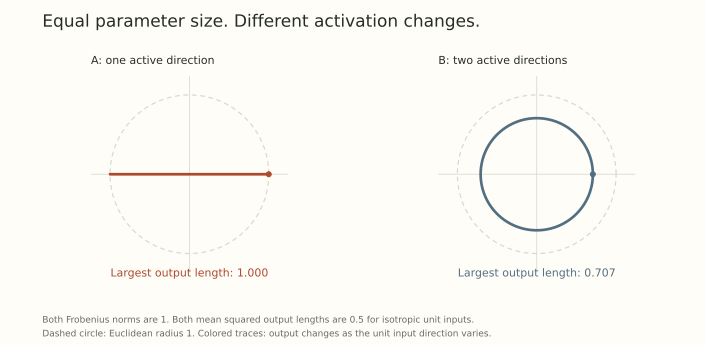

The last post compared two updates with the same length and different rotation angles. That already made parameter distance look like an incomplete description of learning.

There is another question underneath it. A layer does not exist to move its weights around. It exists to transform inputs into activations. If we call an update small, what exactly are we promising about those activations?

We need *a choice of ruler*. A norm on the weight matrix becomes useful when it answers a question about the computation the layer performs.

Start with a linear layer. It is simple enough that we can calculate the answer exactly, and rich enough to show why one matrix norm will not fit every purpose.

## Hold the input fixed and look at the output

Let $W\in\mathbb R^{m\times n}$ and $y=Wx$. Change the weights by a matrix $\Delta W$, keeping the input fixed. The activation change is

$$
\Delta y=(W+\Delta W)x-Wx=\Delta W x.
$$

This is exact. There is no neglected higher-order term because the layer is linear in $W$ at a fixed $x$.

Suppose we measure input and output size with norms $\lVert\cdot\rVert_X$ and $\lVert\cdot\rVert_Y$. The induced operator norm is

$$
N_{X\to Y}(\Delta W)
=\sup_{x\ne0}\frac{\lVert\Delta W x\rVert_Y}{\lVert x\rVert_X}.
$$

It gives the bound

$$
\lVert\Delta y\rVert_Y
\leq N_{X\to Y}(\Delta W)\lVert x\rVert_X.
$$

If inputs have norm at most one, the matrix norm is a worst-case activation-change budget. The choices of input and output norms specify what that promise means.

This is the starting point of [Bernstein and Newhouse's treatment of layer geometry](https://proceedings.mlr.press/v267/bernstein25a.html), especially Sections 3.3 and 4.1. The semantics of the layer determine which operator norm is worth considering.

## Equal Frobenius size can hide different worst cases

With Euclidean norms on both activation spaces, the induced norm is the spectral norm:

$$
N_{2\to2}(\Delta W)=\lVert\Delta W\rVert_{\mathrm{op}}
=\sigma_{\max}(\Delta W).
$$

Compare two perturbations in two dimensions:

$$
A=\begin{pmatrix}1&0\\0&0\end{pmatrix},
\qquad
B=\frac1{\sqrt2}\begin{pmatrix}1&0\\0&1\end{pmatrix}.
$$

Both have Frobenius norm one. But $A$ can move the output by one on a unit input, while $B$ moves every unit input by $1/\sqrt2$. Thus

$$
\lVert A\rVert_F=\lVert B\rVert_F=1,
\qquad
\lVert A\rVert_{\mathrm{op}}=1,
\qquad
\lVert B\rVert_{\mathrm{op}}=1/\sqrt2.
$$

{fig-alt="Images of the Euclidean unit input circle under two perturbations with Frobenius norm one. A maps the circle to a line segment reaching radius one. B maps it to a circle of radius one over square root two."}

The distinction grows with width. In $n$ dimensions, a rank-one matrix with its only nonzero singular value equal to one has the same Frobenius norm as $I/\sqrt n$. Their operator norms are one and $1/\sqrt n$.

Frobenius size adds energy across singular directions. Spectral size asks for the largest response in any one direction. Neither description is meaningless. They answer different questions.

## An average asks a different question again

Suppose $x$ is uniformly distributed on the Euclidean unit sphere in $\mathbb R^n$. Then $\mathbb E[xx^\top]=I/n$, and

$$
\mathbb E\lVert\Delta W x\rVert_2^2
=\frac1n\operatorname{tr}(\Delta W^\top\Delta W)
=\frac1n\lVert\Delta W\rVert_F^2.
$$

For our two-dimensional $A$ and $B$, this mean squared activation change is $1/2$ in both cases. Their worst cases differ, but this particular average agrees.

More generally, if $C=\mathbb E[xx^\top]$ is the input second-moment matrix,

$$
\mathbb E\lVert\Delta W x\rVert_2^2
=\operatorname{tr}(\Delta W C\Delta W^\top).
$$

This formula uses the second moment, not necessarily the covariance. They agree when the input mean is zero.

A weight perturbation can be large on a direction the data rarely uses. Conversely, a modest-looking change can align with a frequently amplified feature. The uniform-sphere calculation does not establish what is typical under an arbitrary training distribution.

Before debating which matrix norm is best, decide whether the goal is a worst-case guarantee, a distributional average, or another functional quantity. The matrix entries alone do not make that choice for us.

## RMS measurements introduce an explicit width factor

For a vector $x\in\mathbb R^n$, define

$$
\lVert x\rVert_{\mathrm{RMS}}=\frac{\lVert x\rVert_2}{\sqrt n}.
$$

This measures a typical coordinate scale. A vector with all coordinates equal to one has RMS norm one at every width, while its Euclidean norm grows as $\sqrt n$.

Use RMS norms on the input and output of $y=Wx$. Substituting their definitions into the operator norm gives

$$
N_{\mathrm{RMS}\to\mathrm{RMS}}(\Delta W)
=\sqrt{\frac n m}\,\lVert\Delta W\rVert_{\mathrm{op}}.
$$

The factor is $\sqrt{n/m}$, with input width in the numerator. A budget $N(\Delta W)\leq\epsilon$ therefore allows

$$
\lVert\Delta W\rVert_{\mathrm{op}}
\leq\epsilon\sqrt{\frac m n}.
$$

For a map from four inputs to sixteen outputs, a perturbation with spectral norm one has RMS-to-RMS norm $1/2$. For a map from sixteen inputs to four outputs, the same spectral norm corresponds to RMS-to-RMS norm two. The worst-case RMS responses differ by a factor of four.

These are choices of measurement for the same forward expression $y=Wx$. *RMS is a ruler here*, not an extra RMSNorm operation inserted into the network. Conventions that rescale the forward function itself can move width factors elsewhere, so the forward equation and the norm must be read together.

This width factor will reappear in the next post's update direction. It comes from the activation geometry before we choose an optimizer.

## A lookup table has different input semantics

A dense layer may receive mixtures of input coordinates. An embedding lookup receives a one-hot vector $e_j$, and its output is simply column $j$ of the embedding matrix $E$.

If we want every lookup to have a bounded Euclidean output change, the relevant quantity is

$$
\max_j\lVert\Delta E[:,j]\rVert_2.
$$

This is also the induced $\ell_1$-to-Euclidean norm. Indeed,

$$
\lVert\Delta E x\rVert_2
\leq\sum_j |x_j|\lVert\Delta E[:,j]\rVert_2
\leq\lVert x\rVert_1\max_j\lVert\Delta E[:,j]\rVert_2.
$$

Equality is attained by choosing a one-hot input for a largest column. With an RMS output ruler, divide the column lengths by $\sqrt m$.

The same matrix can look different under the dense-layer question. Take

$$
\Delta E=\begin{pmatrix}1&1\\0&0\end{pmatrix}.
$$

Each lookup changes the Euclidean output by one. But the Euclidean unit input $(1,1)/\sqrt2$ combines the columns and produces an output of length $\sqrt2$. The spectral norm sees that mixture, while the lookup budget need not.

The distinction is *what the input can be*. Matrix shape does not tell us whether the module is a dense transformation or a categorical lookup. Bernstein and Newhouse make this explicit in their Linear and Embed examples in Section 4.1.

## Let the input move and a second term appears

So far, we have held $x$ fixed. If upstream parameters also change the input by $\Delta x$, then

$$
(W+\Delta W)(x+\Delta x)-Wx
=\Delta W x+W\Delta x+\Delta W\Delta x.
$$

The first two terms form the differential. The final term is a finite-step interaction. For Euclidean measurements, for example,

$$
\lVert\Delta y\rVert_2
\leq\lVert\Delta W\rVert_{\mathrm{op}}\lVert x\rVert_2
+\lVert W\rVert_{\mathrm{op}}\lVert\Delta x\rVert_2
+\lVert\Delta W\rVert_{\mathrm{op}}\lVert\Delta x\rVert_2.
$$

A local weight-update budget controls the first contribution. It does not erase input sensitivity or the interaction term. Shared normalization gains from Part 2 also belong in the joint perturbation when they move.

This is why a layerwise measurement is a starting point for network geometry. Composing modules requires accounting for how one module's output perturbation becomes another's input perturbation. We will reach that question in Part 7.

For now, the layer's role gives us a constraint set for its update. The next question is how to choose a direction within that set to reduce the loss.

## Try changing the ruler

1. In four dimensions, compare the Frobenius and operator norms of $A=\operatorname{diag}(1,0,0,0)$ and $B=I/2$. What is their common mean squared response on uniformly distributed unit inputs?
2. For a layer with nine input and four output coordinates, what spectral update budget gives an RMS-to-RMS budget of $0.1$?
3. For the two-column lookup example above, compare the largest column's RMS change with the RMS-to-RMS operator norm of the same matrix.

Answer sketches

1. Both Frobenius norms are one. The operator norms are one and $1/2$. The common mean squared response is $1/4$.
2. $\lVert\Delta W\rVert_{\mathrm{op}}\leq0.1\sqrt{4/9}=1/15\approx0.066667$.
3. The largest column RMS is $1/\sqrt2$. Since input and output dimensions are both two, the RMS-to-RMS norm equals the spectral norm, $\sqrt2$. Their input unit sets differ, so this is not a contradiction.

## Yo twin, go read... {#sources-and-scope}

[Jeremy Bernstein and Laker Newhouse, Modular Duality in Deep Learning (ICML 2025)](https://proceedings.mlr.press/v267/bernstein25a.html), Definition 3, Examples 3 and 4, and Section 4.1, derives the dense and embedding operator norms used here. Its Linear module uses the forward convention $y=Wx$, matching this post.

[Tim Large and collaborators, Scalable Optimization in the Modular Norm (NeurIPS 2024)](https://arxiv.org/abs/2405.14813v1), Section 3 and Appendix B, develops the module-level bounds that let local measurements compose. Its appendix also illustrates why forward scaling conventions matter when comparing norm formulas. The examples in this post are direct calculations about activation perturbations, not evidence that a particular layer budget yields more useful features.
