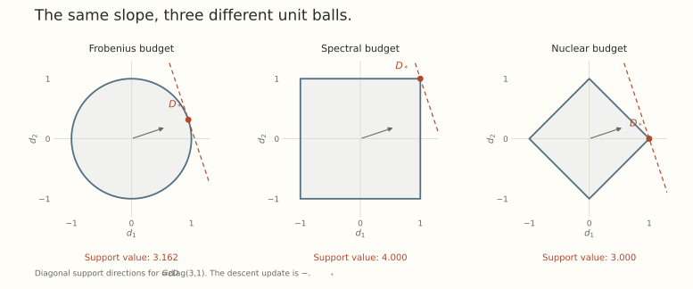

Suppose we have decided what a small layer update means. We can afford any perturbation inside a chosen norm ball. Which of those perturbations should we take?

The obvious answer is to move opposite the gradient. But that answer has already made a geometric choice: it treats the usual Euclidean identification of slopes and directions as the right one.

There is nothing invalid about that choice. The point of a dual norm is to make it visible, and to calculate what changes when the layer's activation geometry suggests a different unit ball.

We will keep *the same derivative* and change the allowed updates. The steepest direction will change with them.

## The gradient first acts as a measuring device

Let $L(W)$ be differentiable, with matrix gradient $G=\nabla L(W)$. Its first-order change along a perturbation is

$$
\mathrm dL_W[\Delta W]
=\langle G,\Delta W\rangle_F
=\operatorname{tr}(G^\top\Delta W).
$$

At this point, $G$ represents a linear functional: give it a proposed update and it reports a scalar slope. The Frobenius pairing is how we write that derivative in matrix coordinates. It does not require us to measure the size of an update with the Frobenius norm.

Let $N$ be our chosen norm on perturbations. For a radius $\epsilon>0$, choose the update that minimizes the linear model:

$$
\min_{N(\Delta W)\leq\epsilon}\langle G,\Delta W\rangle_F.
$$

The constraint is the missing definition of *steepest*. Without it, a negative linear slope can be made arbitrarily negative just by scaling up the step.

## The dual norm is the support value

Define the dual norm by

$$
N^*(G)=\max_{N(D)\leq1}\langle G,D\rangle_F.
$$

Because a norm ball is symmetric, minimizing over a radius-$\epsilon$ ball gives

$$
\min_{N(\Delta W)\leq\epsilon}\langle G,\Delta W\rangle_F
=-\epsilon N^*(G).
$$

If $D_*(G)$ is a maximizing unit-ball direction, one optimal update is

$$
\Delta W_*=-\epsilon D_*(G).
$$

The dual norm gives the best linear decrease per unit budget. The maximizing direction tells us how to attain it. Those are different outputs of the same support problem.

This is standard normed steepest descent. [Boyd and Vandenberghe's Section 9.4](https://web.stanford.edu/~boyd/cvxbook/bv_cvxbook.pdf) develops the geometric interpretation, and [Bernstein and Newhouse's Sections 3.1 and 3.2](https://proceedings.mlr.press/v267/bernstein25a.html) use it to construct layerwise duality maps.

## Frobenius geometry recovers the normalized gradient

For $N(D)=\lVert D\rVert_F$, Cauchy-Schwarz gives

$$
\langle G,D\rangle_F
\leq\lVert G\rVert_F\lVert D\rVert_F.
$$

For nonzero $G$, equality is attained by $D_*=G/\lVert G\rVert_F$. Thus the Frobenius norm is self-dual, and the fixed-radius step is

$$
\Delta W_*=-\epsilon\frac{G}{\lVert G\rVert_F}.
$$

That is a normalized gradient update. Ordinary gradient descent, $-\eta G$, also uses this direction, but its radius is $\eta\lVert G\rVert_F$ rather than a fixed $\epsilon$.

Now change the norm while keeping $G$ fixed.

## A spectral budget produces a polar direction

Let $N(D)=\lVert D\rVert_{\mathrm{op}}$, the largest singular value. Write a compact singular value decomposition using only the positive singular values of $G$:

$$
G=U\Sigma V^\top
=\sum_{i=1}^r\sigma_i u_i v_i^\top.
$$

For any $D$ with operator norm at most one,

$$
\langle G,D\rangle_F
=\sum_{i=1}^r\sigma_i u_i^\top Dv_i
\leq\sum_{i=1}^r\sigma_i.
$$

The bound follows because $u_i$ and $v_i$ are unit vectors and $\lvert u_i^\top Dv_i\rvert\leq1$. It is attained by the partial polar factor

$$
D_*(G)=UV^\top.
$$

This matrix has singular value one on each active singular mode. Consequently,

$$
N^*(G)=\lVert G\rVert_{\mathrm{nuc}}
=\sum_{i=1}^r\sigma_i,
\qquad
\Delta W_*=-\epsilon UV^\top.
$$

The spectral norm's dual is the nuclear norm, not the spectral norm again. I use the subscript $\mathrm{op}$ for the largest singular value and $\mathrm{nuc}$ for their sum. The asterisk on $N^*$ means duality.

If $G$ is rank deficient, the compact polar factor is one maximizer. Additional components on unused subspaces can also be optimal if they stay feasible. If $G=0$, choose the zero update. These cases should not be implemented by dividing blindly by a zero norm or singular value.

This operation changes the singular values of the update direction. It does not impose a norm constraint on the current weight matrix $W$.

## The same derivative, three different unit balls

Take $G=\operatorname{diag}(3,1)$ and a budget radius $\epsilon=0.1$.

Under a Frobenius budget,

$$
\Delta W_F=-\frac{0.1}{\sqrt{10}}\operatorname{diag}(3,1),
\qquad \langle G,\Delta W_F\rangle_F=-0.1\sqrt{10}\approx-0.316228.
$$

Under a spectral budget,

$$
\Delta W_{\mathrm{op}}=-0.1 I,
\qquad \langle G,\Delta W_{\mathrm{op}}\rangle_F=-0.4.
$$

For comparison, a nuclear-norm budget has dual value $\lVert G\rVert_{\mathrm{op}}=3$. One optimal update spends the whole budget on the leading singular mode:

$$
\Delta W_{\mathrm{nuc}}=-0.1\operatorname{diag}(1,0),
\qquad \langle G,\Delta W_{\mathrm{nuc}}\rangle_F=-0.3.
$$

{fig-alt="Diagonal slices of the Frobenius, spectral, and nuclear unit balls. For the same derivative with diagonal entries three and one, their maximizing directions lie on a circle, a square, and a diamond respectively."}

The figure shows positive support directions $D_*$. The actual descent update is $-\epsilon D_*$. Restricting the picture to diagonal matrices is enough to display maximizers for this diagonal $G$.

The larger decrease under the spectral budget is not an optimizer victory. It is a comparison of different feasible sets. The spectral step has Frobenius norm $0.1\sqrt2$, so it would not fit inside the Frobenius budget of radius $0.1$.

There is another useful comparison inside the spectral ball. Simply dividing the gradient by its spectral norm gives

$$
\frac{G}{\lVert G\rVert_{\mathrm{op}}}=\operatorname{diag}(1,1/3).
$$

It is feasible, but its support value is $10/3$, below the optimum four. *Normalization alone* does not solve a general support problem.

## Carry the RMS ruler through the dual calculation

Part 5 measured a dense-layer perturbation with

$$
N(D)=k\lVert D\rVert_{\mathrm{op}},
\qquad k=\sqrt{n/m}.
$$

Its unit ball allows operator norm $1/k$. Scaling the support problem therefore gives

$$
N^*(G)=\frac1k\lVert G\rVert_{\mathrm{nuc}},
\qquad
D_*(G)=\frac1k UV^\top
=\sqrt{m/n}\,UV^\top.
$$

The width factor reverses because a larger primal norm makes the feasible unit ball smaller. For a nine-input, four-output layer, the polar factor is multiplied by $2/3$ to have unit RMS-to-RMS norm.

This is the dense-layer duality map in Bernstein and Newhouse's Example 3. The activation ruler, its induced matrix norm, and its support direction are three connected parts of one construction.

What changes for an embedding lookup?

For Euclidean output measurements, Part 5's lookup budget was $N(D)=\max_j\lVert D[:,j]\rVert_2$. Each column can use its unit budget independently, so

$$
N^*(G)=\sum_j\lVert G[:,j]\rVert_2,
\qquad
D_*[:,j]=\frac{G[:,j]}{\lVert G[:,j]\rVert_2}
$$

for nonzero columns. Choose zero for a zero gradient column. With an RMS output ruler, multiply both the dual value and the direction by $\sqrt m$.

The largest-column update norm is paired with a sum of gradient-column norms. It does not mean spending the entire update on only one column. This is the Embed duality map in the paper's Example 4.

## A direction and a step-size model are separate choices

The fixed-radius support problem is not the only way to choose a step. Consider instead

$$
\min_\Delta\left\{\langle G,\Delta\rangle_F
+\frac1{2\eta}N(\Delta)^2\right\},\qquad \eta>0.
$$

At radius $r$, the best linear term is $-rN^*(G)$. Minimizing $-rN^*(G)+r^2/(2\eta)$ gives $r=\eta N^*(G)$, hence one minimizer is

$$
\Delta_*=-\eta N^*(G)D_*(G).
$$

For the Frobenius norm, this recovers $-\eta G$. For the spectral norm, it gives $-\eta\lVert G\rVert_{\mathrm{nuc}}UV^\top$. A fixed-radius polar update omits that dual-magnitude factor because it solves a different optimization problem.

Neither linear model automatically controls a large finite loss change. A useful quadratic upper bound, a line search, or an appropriately chosen small step needs its own justification. The norm describes which perturbations are allowed. Curvature describes what the loss does along them.

The same care applies to momentum. If we replace $G$ by a buffer $M$, dualization solves the support problem for the linear functional represented by $M$. The actual current derivative is still $G$. A norm-feasible buffer step need not be a descent direction for the current loss.

We now know how to choose a direction for one module's geometry. The next post asks how those local budgets fit together across the network, and why Modula uses a weighted maximum to combine them.

## Try solving the support problem

1. For $G=\operatorname{diag}(3,1)$, compare the spectral-budget support values of $G/\lVert G\rVert_{\mathrm{op}}$ and $UV^\top$.
2. For $G=\operatorname{diag}(3,0)$, give a compact polar maximizer and a different spectral-unit-ball maximizer with the same support value.
3. Under a Euclidean lookup budget with gradient columns $(3,4)$ and $(0,2)$, find the dual value and one maximizing matrix.
4. Let $L(W)=\lVert W\rVert_F^2/2$ at $W=\operatorname{diag}(3,1)$. A spectral-budget step is $\Delta=-\epsilon I$. Compute the exact loss change at $\epsilon=5$, and compare it with the linear prediction.

Answer sketches

1. They are $10/3$ and four. Both proposals have spectral norm one, but only the polar factor attains the support maximum here.
2. The compact polar factor is $\operatorname{diag}(1,0)$. The matrix $\operatorname{diag}(1,1)$ also has operator norm one and support value three. The unused second mode does not affect the linear objective.
3. The dual value is $5+2=7$. Normalize each column separately, giving columns $(3/5,4/5)$ and $(0,1)$.
4. The exact change is $-4\epsilon+\epsilon^2$, so it equals five. The linear prediction is $-20$. A direction that is steepest for the linear model can still overshoot badly.

## Yo twin, go read... {#sources-and-scope}

[Stephen Boyd and Lieven Vandenberghe, Convex Optimization](https://web.stanford.edu/~boyd/cvxbook/), Section 9.4 and Appendix A.1.6, explains normed steepest descent, dual norms, and the spectral-nuclear pairing. Keep the normalized direction separate from its dual-norm-scaled version.

[Jeremy Bernstein and Laker Newhouse, Modular Duality in Deep Learning (ICML 2025)](https://proceedings.mlr.press/v267/bernstein25a.html), Sections 3.1 through 3.3, Proposition 1, and Section 4.1, derives the layerwise constructions used here. Section 5 discusses efficient matrix iterations. The exact SVD support calculation above does not by itself specify a complete practical optimizer, its momentum convention, or an approximation algorithm.
