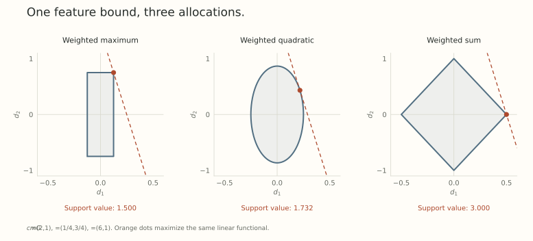

The last two posts gave each layer a ruler and a way to choose an update inside its unit ball. A network contains many such layers. How should their budgets fit together?

Giving every layer the same numerical learning rate does not settle the question. A perturbation early in the computation may be amplified by later modules. Different layers also use different activation norms. We need a rule that respects both facts.

Modula's weighted maximum has a useful answer: assign each module a share of the functional budget, then allow all those shares to be used in parallel. The maximum is not just convenient notation. It determines the shape of the feasible update set.

## Begin with a bound on the computation

Suppose local perturbation analysis gives

$$
\lVert\delta f\rVert_Y\leq\sum_{i=1}^k c_i N_i(\delta W_i),
$$

where $N_i$ measures a module's weight perturbation and each $c_i>0$ accounts for its downstream sensitivity. This is a bound on the differential at the point under discussion. A finite-step bound needs the corresponding remainder control.

For a composition $f_2\circ f_1$, for example, a sensitivity bound $s_2$ for the second module leads to contributions of the form

$$
\lVert\delta f\rVert_Y\leq s_2N_1(\delta W_1)+N_2(\delta W_2),
$$

assuming the module norms and input domain make those local bounds valid. The earlier module pays for amplification through the later one.

We now want a single norm on the whole update tuple. Choose positive masses $m_i$ summing to one, and set

$$
N_{\max}(\delta W)=\max_i\frac{c_iN_i(\delta W_i)}{m_i}.
$$

If $N_{\max}(\delta W)\leq\epsilon$, then $c_iN_i(\delta W_i)\leq m_i\epsilon$ for each module. Adding these inequalities proves

$$
\lVert\delta f\rVert_Y\leq\epsilon.
$$

Mass is a share of this bound. It is not a claim that each layer will learn equally useful features, or that the assigned share is always fully used by the true output change.

## The maximum creates a product of local balls

The global unit ball is exactly

$$
\{\delta W:N_{\max}(\delta W)\leq1\}
=\prod_i\{\delta W_i:N_i(\delta W_i)\leq m_i/c_i\}.
$$

The constraints are independent once their radii are chosen. One layer does not consume another's radius simply by taking a nonzero step. That product structure is the key geometric property.

Let $G_i$ be the loss differential for block $i$, represented through its usual coordinate pairing. Maximizing the global linear functional separates into one support problem per block:

$$
N_{\max}^*(G)=\sum_i\frac{m_i}{c_i}N_i^*(G_i).
$$

If $D_i$ is a unit-ball support maximizer for $G_i$, one globally steepest fixed-radius descent update is

$$
\delta W_i=-\epsilon\frac{m_i}{c_i}D_i.
$$

Every block with nonzero gradient can saturate its assigned local radius at once. Zero gradients and ties permit nonunique choices. Choosing zero on an inactive block is convenient.

This is *parallel budget use*, not a guarantee that all blocks make comparable progress. Sensitivity and gradient geometry still differ.

## A two-module calculation

Take two scalar blocks with $c=(2,1)$, masses $m=(1/4,3/4)$, and gradient coordinates $G=(6,1)$. The global norm is

$$
N_{\max}(d)=\max(8|d_1|,\,4|d_2|/3).
$$

The positive support maximizer is $d=(1/8,3/4)$. It has

$$
G^\top d=6/8+3/4=3/2,
\qquad 2|d_1|+|d_2|=1.
$$

The actual descent update is $-\epsilon d$. The first block receives a smaller parameter displacement because its output effect is amplified by a factor of two and its mass is smaller.

There is no missing global rescaling to divide the remaining budget between these two directions. The maximum already allocated both radii.

## A sum asks the optimizer to make a different allocation

The functional bound also suggests the valid norm

$$
N_{\mathrm{sum}}(d)=\sum_i c_iN_i(d_i).
$$

Its dual norm is

$$
N_{\mathrm{sum}}^*(G)=\max_i\frac{N_i^*(G_i)}{c_i}.
$$

With a unique largest ratio, a support maximizer can spend the entire budget on that block. In our example, the ratios are three and one. The sum-budget maximizer is $(1/2,0)$, with support value three.

A weighted quadratic aggregation gives an intermediate geometry:

$$
N_2(d)=\left[\sum_i m_i
\left(\frac{c_iN_i(d_i)}{m_i}\right)^2\right]^{1/2},
$$

$$
N_2^*(G)=\left[\sum_i m_i
\left(\frac{N_i^*(G_i)}{c_i}\right)^2\right]^{1/2}.
$$

Here its support value is $\sqrt3$, attained at approximately $(0.216506,0.433013)$. The three norms control the same stated linearized feature bound, but their feasible sets and allocations differ.

{fig-alt="Three ways to allocate the two-module budget. A weighted maximum gives a rectangle, a quadratic aggregation an ellipse, and a weighted sum a diamond. Their support maximizers for the same gradient occur at different points."}

The larger support value of the sum budget is not an optimization victory over the maximum. Its unit ball is larger here. The question is which allocation describes the changes we want to permit.

## What recursive modular geometry adds

In a network, the coefficients are not a list of independent tuning constants pasted onto unrelated layers. Composition propagates input sensitivity through downstream modules. Concatenation combines outputs under a specified output-space norm. The module tree determines how those rules are applied.

[Scalable Optimization in the Modular Norm](https://arxiv.org/abs/2405.14813v1) develops this recursive construction. [Modular Duality](https://proceedings.mlr.press/v267/bernstein25a.html) then derives the corresponding support directions. The distinction parallels Part 6: normalizing a proposal in a norm and solving the norm's support problem are different operations.

Our simple product-ball derivation explains one important property of the weighted maximum. It does not by itself establish all the curvature bounds or learning-rate transfer results of the modular framework. Those require the papers' module assumptions and composition arguments.

## Where the choice still needs judgment

The norm depends on the chosen module boundary. If a gain and several matrices jointly determine an effective map, treating each matrix as an independent atom may leave out part of the perturbation. A different outer aggregation cannot repair that missing dependency.

Masses also encode priorities. They can reserve more possible feature motion for one part of the computation, but a bound on motion is not a bound on its usefulness. Task progress still depends on gradients, data, and nonlinear interactions.

The maximum earns its place because it gives explicit local radii and parallel support problems. It is *a design with consequences*, not a uniqueness theorem. Changing it is mathematically possible. A useful alternative needs a reason for its different allocation.

Next we add a distinct kind of restriction: the weights themselves may have to remain on a constraint set. That restriction changes which directions are admissible even before we choose their size.

## Try allocating the budget

1. In the two-module example, verify that the maximum-budget support direction obeys the unit feature bound.
2. Keep $c=(2,1)$ but use equal masses. What local radii and support value does the maximum give for $G=(6,1)$?
3. Why does the sum budget admit an optimizer that changes only the first block in the original example?

Answer sketches

1. $2(1/8)+3/4=1$, while the gradient pairing is $3/2$.
2. The radii are $1/4$ and $1/2$. The support value is $6/4+1/2=2$.
3. Its dual compares $6/2=3$ with $1/1=1$. The first block offers more linear decrease per unit of that sum budget, so $(1/2,0)$ is a support maximizer.

## Yo twin, go read... {#sources-and-scope}

[Tim Large and collaborators, Scalable Optimization in the Modular Norm (2024)](https://arxiv.org/abs/2405.14813v1), Sections 2.2 and 3, defines the modular norm and its composition rules while acknowledging other aggregations.

[Jeremy Bernstein and Laker Newhouse, Modular Duality in Deep Learning (ICML 2025)](https://proceedings.mlr.press/v267/bernstein25a.html), Sections 3.4 and 4.2, connects recursive modular norms to dualization. The scalar example and alternative-ball calculations above are direct support calculations under explicitly stated coefficients.
