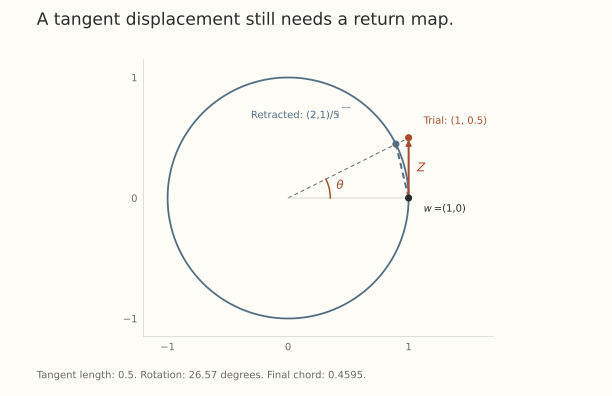

An update can be small in the right norm and still leave the set of weights we intended to allow.

Suppose a matrix must keep orthonormal columns, or an embedding vector must retain a fixed radius. Part 6's unconstrained support direction does not automatically respect either condition. The admissible directions now depend on the current weight.

Three choices need separate names: *where the weight may live*, how large a tangent displacement may be, and how a finite displacement returns to the allowed set. A manifold optimizer specifies all three.

## A sphere gives the simplest example

Constrain a nonzero vector to the sphere $\lVert w\rVert_2=R$. Differentiating $\lVert w+tZ\rVert_2^2=R^2$ at $t=0$ gives the tangent condition

$$
\langle w,Z\rangle=0.
$$

Let $g$ be the ambient loss gradient. Its tangent projection is

$$
g_T=g-\frac{\langle w,g\rangle}{R^2}w.
$$

Under a Euclidean displacement budget $\lVert Z\rVert_2\leq\epsilon$, the constrained linear problem has solution

$$
Z_*=-\epsilon\frac{g_T}{\lVert g_T\rVert_2}
$$

when $g_T\ne0$. Choose zero if $g_T=0$. This follows because a tangent displacement pairs with $g$ exactly as it pairs with $g_T$, and Cauchy-Schwarz solves the remaining support problem.

The ambient gradient need not be tangent. We did not assume scale invariance of the loss here. The tangent condition comes from the weight constraint itself.

## A tangent step is still only locally on the sphere

For tangent $Z$,

$$
\lVert w+Z\rVert_2^2=R^2+\lVert Z\rVert_2^2.
$$

The trial point leaves the sphere by a second-order amount. A radial retraction brings it back:

$$
\mathcal R_w(Z)=R\frac{w+Z}{\lVert w+Z\rVert_2}.
$$

Its derivative at zero returns $Z$, so it agrees with the tangent displacement to first order. It is not an assertion that a finite straight step lies on a curved surface.

For $w=(1,0)$ and $Z=(0,1/2)$, the trial point is $(1,1/2)$ and the retracted point is $(2,1)/\sqrt5$. The rotation is $\arctan(1/2)\approx26.57^\circ$. More generally,

$$
\tan\theta=\frac{\lVert Z\rVert_2}{R},
\qquad
\lVert\mathcal R_w(Z)-w\rVert_2=2R\sin(\theta/2).
$$

Tangent length, arc length $R\theta$, and chord length are close for small steps. They are different finite-step quantities.

{fig-alt="A tangent displacement leaves the unit circle at a trial point. Radial retraction returns it to the circle while preserving its new direction. The tangent length, rotation angle, and chord length are distinct."}

## The Stiefel constraint preserves more than one length

For $W\in\mathbb R^{m\times n}$ with $m\geq n$, the column Stiefel constraint is

$$
W^\top W=I_n.
$$

It fixes each column length and every pairwise column inner product. Differentiating gives

$$
W^\top Z+Z^\top W=0.
$$

Under Frobenius geometry, the tangent projection of an ambient matrix $G$ is

$$
\Pi_W(G)=G-W\operatorname{sym}(W^\top G),
\qquad \operatorname{sym}(A)=\frac{A+A^\top}{2}.
$$

The removed term is Frobenius-orthogonal to every tangent matrix. A fixed Frobenius-radius support step therefore normalizes $\Pi_W(G)$, just as in the sphere example.

A convenient retraction is

$$
\mathcal R_W(Z)=(W+Z)
\left[(W+Z)^\top(W+Z)\right]^{-1/2}.
$$

For tangent $Z$, the Gram matrix in brackets is $I+Z^\top Z$, which is positive definite. The retracted matrix has orthonormal columns and equals $W+Z$ to first order.

The row-orthonormal version applies when the matrix shape calls for it. A rectangular matrix cannot generally have both orthonormal rows and orthonormal columns. The orientation of the constraint is part of the specification.

## A different tangent norm changes the support problem

Replacing the Frobenius budget by a spectral budget gives

$$
\min_Z\langle G,Z\rangle_F
\quad\text{subject to}\quad
W^\top Z+Z^\top W=0,
\quad\lVert Z\rVert_{\mathrm{op}}\leq\epsilon.
$$

This is not the unconstrained polar problem from Part 6. Projecting an ambient polar factor is not automatically its solution.

For a small counterexample, set $W=I_2$ and

$$
G=\begin{pmatrix}2&1\\0&1\end{pmatrix}.
$$

The tangent matrices are skew-symmetric. The ambient polar factor is

$$
P=\frac1{\sqrt{10}}\begin{pmatrix}3&1\\-1&3\end{pmatrix}.
$$

Its Frobenius tangent projection is $J/\sqrt{10}$, where $J=\left(\begin{smallmatrix}0&1\\-1&0\end{smallmatrix}\right)$. This has operator norm $1/\sqrt{10}$ and support value $1/\sqrt{10}$. The feasible tangent matrix $J$ has operator norm one and support value one.

For descent, negate these directions. Projection after dualization wasted available budget in this example. Renormalizing repairs this particular two-dimensional case, but that is not a general derivation of a constrained spectral oracle.

This is why manifold methods must solve the support problem for their actual tangent set and norm. *The operations do not come with permission to commute.*

## A sphere, an oblique set, and Stiefel are different constraints

A Frobenius sphere fixes one total matrix length while allowing its singular values and column lengths to redistribute. An oblique constraint fixes each column length, while leaving the angles between columns free. Stiefel additionally fixes those angles to be right angles.

For example,

$$
W=\begin{pmatrix}1&\cos\phi\\0&\sin\phi\end{pmatrix}
$$

has unit columns for every $\phi$. At $\phi=60^\circ$, its singular values are $\sqrt{3/2}$ and $\sqrt{1/2}$, so its condition number is $\sqrt3$. As $\phi$ approaches zero, it becomes nearly rank deficient despite retaining both column lengths.

A weight constraint can therefore remove useful functional freedoms, not merely redundant coordinate scales. Whether it preserves an architecture's function class needs a separate argument. The later shared-gain examples will make that issue concrete.

## What the optimizer must specify

A complete constrained update needs a weight set, its tangent directions, a norm or metric on those directions, and a finite-step return map. It also needs an account of optimizer memory when the base update has a momentum state.

Fixing only the weight radius leaves the update geometry unspecified. Fixing only the update norm leaves the weight trajectory free to drift. The choices can cooperate, but they answer different questions.

Next we examine a wrapper that explicitly controls both weight and proposal norms, and ask what that control does and does not say about angular schedules.

## Try staying on the constraint set

1. On a radius-two sphere, take a tangent displacement of length one. What is the rotation after radial retraction?
2. Verify that $W^\top\Pi_W(G)+\Pi_W(G)^\top W=0$ whenever $W^\top W=I$.
3. Why does the projected polar factor in the $2\times2$ example fail to maximize spectral-unit support?

Answer sketches

1. $\theta=\arctan(1/2)\approx26.57^\circ$. The tangent length is one, not the angle in radians.
2. Substitute the projection formula. The remaining expression is $W^\top G+G^\top W-2\operatorname{sym}(W^\top G)=0$.
3. It equals $J/\sqrt{10}$, while $J$ itself remains feasible and gives a larger pairing with $G$.

## Yo twin, go read... {#sources-and-scope}

[Jeremy Bernstein, Modular Manifolds (2025)](https://thinkingmachines.ai/blog/modular-manifolds/), especially the sphere example and Manifold Muon discussion, separates weight constraints, tangent norms, support directions, and retractions. Its spectral manifold problem should not be replaced silently by a Frobenius projection.

[Bernstein and Newhouse, Modular Duality in Deep Learning (ICML 2025)](https://proceedings.mlr.press/v267/bernstein25a.html), Section 3, supplies the normed support framework. The Stiefel tangent identity and polar retraction above follow by differentiation and direct Gram-matrix calculation under the stated column convention.
