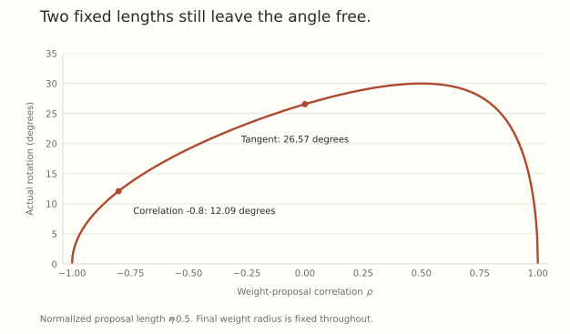

Fix the weight norm. Normalize the optimizer's proposed update. Have we now fixed the size of the learning step?

We have fixed two lengths. The angle between the weight and the proposal still matters. So does the distinction between the trial displacement and the final displacement after renormalization.

This makes fixed-norm methods an interesting test of the ideas developed so far. They turn indirect radius control into an explicit operation, but they do not remove scheduling or the need for a careful comparison.

## Write down the wrapper exactly

The Hyperball paper defines a Frobenius normalization $\operatorname{Normalize}(X)=X/\lVert X\rVert_F$ and a fixed radius $R>0$. Given a nonzero base proposal $u_t$ and step parameter $\eta_t\geq0$, its update is

$$
W_{t+1}=R\operatorname{Normalize}
\left(W_t-\eta_tR\operatorname{Normalize}(u_t)\right).
$$

The matrix starts on the radius-$R$ sphere. The trial displacement has Frobenius length $\eta_tR$. The return map restores the weight norm to $R$.

The final chord $W_{t+1}-W_t$ need not have length $\eta_tR$. This difference is visible even before considering what base optimizer produced $u_t$.

The normalization requires nonzero arguments. A zero proposal needs a defined no-step convention. A zero trial point also needs an implementation guard rather than division by its norm.

## Two fixed norms leave one angle unfixed

Write $E=W/R$ and $U=u/\lVert u\rVert_F$, so both have Frobenius norm one. Let

$$
\rho=\langle E,U\rangle_F,
\qquad U_T=U-\rho E,
\qquad\lVert U_T\rVert_F=\sqrt{1-\rho^2}.
$$

The trial direction is

$$
E-\eta U=(1-\eta\rho)E-\eta U_T.
$$

Radial renormalization preserves that direction. For a nonzero trial point, the actual rotation is therefore

$$
\theta=\operatorname{atan2}
\left(\eta\sqrt{1-\rho^2},\,1-\eta\rho\right).
$$

When $\rho=0$, this reduces to $\theta=\arctan\eta$. Otherwise, the same value of $\eta$ can give a different angle. For $\eta=1/2$, the tangent proposal gives approximately $26.57^\circ$, while $\rho=-0.8$ gives approximately $12.09^\circ$.

The final chord length is

$$
\lVert W_{t+1}-W_t\rVert_F=2R\sin(\theta/2).
$$

If $U=E$ and $0<\eta<1$, the trial point shrinks along the radius and renormalization returns exactly to the starting weight. There was a nonzero proposal budget and no final motion.

{fig-alt="For a fixed normalized proposal length of one half of the weight radius, the actual rotation varies with the weight-proposal correlation. The tangent case is about 26.57 degrees, while a correlation of minus 0.8 gives about 12.09 degrees."}

Fixed norms make the geometry more explicit. They do not make the remaining variable disappear. This is *controlled length*, not automatically a fixed angular step.

## A one-step schedule match we can derive exactly

Compare a free-radius update at $w=R_tE$:

$$
w^+=aR_tE-\alpha U,\qquad a>0.
$$

If the unit proposal $U$ is the same in both comparisons, choosing

$$
\alpha=aR_t\eta
$$

gives $w^+=aR_t(E-\eta U)$. The free-radius update and the Hyperball update have exactly the same next direction. Their radii differ.

This equality holds for radial as well as tangent proposals. It is a conditional one-step identity: we assumed the same current direction and the same normalized proposal. Those conditions do not automatically persist when optimizer states, scale-sensitive parameters, or data-dependent proposal directions evolve differently.

Part 3 gave a whole-trajectory equivalence under its own assumptions. Part 4 showed why optimizer memory must also transform. A schedule intervention in a real matrix optimizer should not silently inherit either theorem.

## What the two papers establish

[Hyperball Optimization](https://arxiv.org/abs/2606.16899v2) studies the fixed-radius wrapper with base optimizers and reports benefits in its pretraining comparisons. Its Section 4 separates an expressivity argument from a model of radius and angular dynamics. The stationary analysis assumes an infinite optimizer history and iid isotropic Gaussian optimizer inputs. Its angular interpretation uses an ansatz, rather than a pathwise theorem for every training run.

[Hyperball May Not Be a Free Lunch](https://arxiv.org/abs/2607.22444v1) explicitly includes the parameter-proposal angle and tests schedule interventions. In its tested settings, aligning angular effective steps reproduces a substantial part of the validation-loss behavior. That result motivates a control, not a universal equality of all optimizer trajectories.

The productive question is whether a claimed benefit survives comparisons that account for the induced schedule. Simply giving both methods the same nominal learning rate does not answer it.

## Separate the interventions before comparing them

For a useful experiment, distinguish the base proposal rule, weight-radius constraint, proposal normalization, and external schedule. Changing all four at once makes the source of an improvement ambiguous.

Start with a common base optimizer and a fully specified state initialization. Compare decay and fixed-radius versions under their tuned schedules. Measure the true angle, proposal-weight correlation, radius, effective map change, and final task loss. A matched-angle control is useful even if it does not reproduce every feature of the trajectory.

If one method needs extra matrix operations, report that work. If a correction depends on a reference run's recorded angles, identify the reference information it uses. An intervention that diagnoses a mechanism is not automatically a deployable tuning rule.

Completed-budget outcomes matter. A method can look slower early because its effective step remains large, then behave differently during decay. An early curve alone is an incomplete comparison.

## The forward function remains a separate question

The geometric derivation above works for any matrix proposal. Interpreting its radius as redundant requires a statement about the forward function.

A normalization gain can compensate one matrix's scale through a joint transformation. That is not the same as independently scaling that matrix with every other parameter fixed. If a gain is shared, compensating it changes every consuming branch. We will examine that compatibility explicitly in Part 11.

Fixed-norm optimization and learned forward scales are therefore not inherently opposed. A method can constrain a directional matrix while another parameter controls a meaningful amplitude. The next post asks which of those amplitudes should remain available.

## Try holding the norms fixed

1. For a unit weight, a tangent unit proposal, and $\eta=1/2$, compare the trial displacement length with the final chord length.
2. What is the rotation when $U=E$ and $\eta=1/2$?
3. A free-radius update has $R_t=3$, shrinkage $a=0.9$, and the same normalized proposal as Hyperball with $\eta=0.2$. Which proposal length $\alpha$ matches its next direction?

Answer sketches

1. The trial length is $0.5$. The angle is $\arctan(0.5)$ and the chord is approximately $0.459506$.
2. Zero. The trial point is $E/2$, which renormalizes back to $E$.
3. $\alpha=aR_t\eta=0.54$. This matches one direction under the stated common-proposal assumption.

## Yo twin, go read... {#sources-and-scope}

[Kaiyue Wen and collaborators, Fantastic Pretraining Optimizers and Where to Find Them II: Hyperball Optimization](https://arxiv.org/abs/2606.16899v2), inspected v2, Section 2 and Sections 4.1 and 4.2, gives the wrapper and distinguishes its expressivity and stationary-model arguments.

[Yihao Xiao and collaborators, Hyperball May Not Be a Free Lunch](https://arxiv.org/abs/2607.22444v1), Sections 2 through 4, derives angle-aware quantities and studies schedule controls. The exact formulas and scalar examples above concern the displayed update, not a reproduction of either paper's training results.
