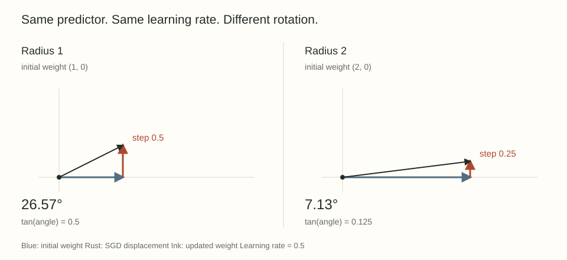

```{=html}
<div class="editorial-home"><header class="plain-intro quarto-title-block"><h1>Angelo Farfan</h1><p class="intro">I like neat algorithms, elegant mathematical structures, and understanding why things work.</p><p class="interest">Right now I’m interested in scientific machine learning and formal reasoning.</p></header><div class="home-work"><section id="writing"><div class="section-heading"><h2>Recent writing</h2><a data-writing href="blog.html">All writing <span class="link-mark" aria-hidden="true"></span></a></div><article class="home-writing"><div><h3><a data-series href="scale-geometry.html">Scale and geometry</a></h3><p>Why can identical networks learn differently? A series on normalization, weight decay, layer geometry, and Modula.</p><a data-series class="text-link" href="scale-geometry.html">Explore the series <span class="link-mark" aria-hidden="true"></span></a></div><a data-series class="home-diagram" href="scale-geometry.html" aria-label="Explore the scale and geometry series"></a></article></section><section id="projects"><div class="section-heading"><h2>Recent projects</h2><a data-projects href="projects.html">All projects <span class="link-mark" aria-hidden="true"></span></a></div><article class="home-project"><p class="home-meta">Graph learning</p><h3><a data-project href="projects/magnetic-pe/index.html">Spectral positional encodings for directed graph transformers</a></h3><p>I tested whether graph transformers could make better use of citation direction. Giving the baseline more spectral features made the answer less clear.</p><a data-project class="text-link" href="projects/magnetic-pe/index.html">Read the project <span class="link-mark" aria-hidden="true"></span></a></article></section></div><section id="about" class="personal-note"><h2>Outside the coursework</h2><p>I like table tennis, learning languages, Peruvian food, and debugging things I was completely sure were correct.</p><a href="https://github.com/elteomc" class="text-link">GitHub <span class="link-mark" aria-hidden="true"></span></a></section></div>
```
